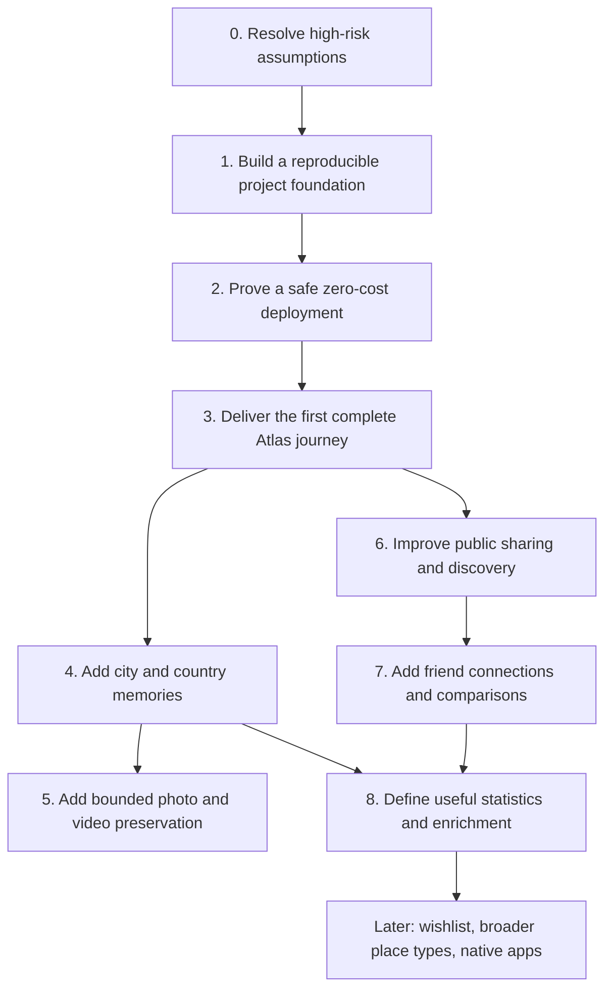

# My Atlas Roadmap

**Status:** Proposed direction for owner review  
**Purpose:** Give the project a steady order of work without predicting dates or pretending that every later feature is known.  
**Product concept:** [`IDEA.md`](IDEA.md)  
**Implementation reference:** [`TECHNICAL_DESIGN.md`](TECHNICAL_DESIGN.md)

## 1. How to use this roadmap

This is a sequence of outcomes and decision gates, not a release calendar. Work advances when a stage's outcome is usable and its exit checks are met. If a technical or product assumption fails, update the roadmap and technical design before adding more work on top of it.

Each stage uses these labels:

- **Foundation:** work that makes later work safer or easier.
- **Core:** required for the central My Atlas experience.
- **Later:** valuable, but not needed to prove the core experience.
- **Open:** requires a product decision, an account/quota check, or evidence from implementation.

Keep tasks small enough that one person or one coding agent can finish and review them. Prefer a thin, working path through the product over building every service or screen in isolation.

## 2. Direction and product promise

The first meaningful outcome is a public travel profile that a person can build by adding a canonical city or municipality and its visit dates. The map then shows the corresponding country as visited, and visitors can explore the public profile without signing in.

Example of the intended core loop:

1. Create an account and verify the email address.
2. Search for Lisbon and select its canonical catalogue entry.
3. Record a visit from `2026-06-20` through `2026-06-28`.
4. See Portugal become visited on the flat world map.
5. Open the public `/@handle` profile and browse the country and city pages.

Memories and media deepen this archive. Social connections and comparisons can follow. Statistics should come from clear product definitions and trustworthy source data, rather than being added just because they are possible to calculate.

## 3. Roadmap principles

1. **Protect the €0 constraint.** Verify each OCI resource and effective quota before relying on it. Never silently introduce a paid dependency.
2. **Prove risky assumptions early.** Check free email delivery, public hostname, place coverage, and media request limits before they become deep dependencies.
3. **Deliver a vertical slice early.** The first complete path should connect registration, place search, dated visit, country coloring, and an anonymous public profile.
4. **Build foundations that help the next feature.** Use reproducible local setup, migrations, API contracts, CI, backups, and documented service boundaries.
5. **Keep the archive dependable.** Data ownership, deletion, upload validation, quota handling, and restore procedures matter as much as the map's appearance.
6. **Treat public as public.** Public pages may be indexed and content can be copied or cached. Make that clear in the product and provide a reliable deletion path.
7. **Defer uncertain breadth.** Wishlist, achievements, extensive country facts, a complete global place catalogue, and native apps should not delay the core archive.
8. **Use microservices deliberately.** The design proposes separate service boundaries because learning microservices is a project goal. First prove the local development and deployment model; do not add a broker, Kubernetes, or more services without a concrete need.

## 4. Roadmap overview

Stages 4 and 6 may overlap after the core journey is stable. Stage 5 is intentionally gated by storage, metadata, and request-quota decisions. Stages 7 and later remain broad until the product has real usage or the owner has defined their value.

## 5. Stage 0 — Resolve high-risk assumptions

**Type:** Foundation  
**Outcome:** The first implementation can begin without depending on unverified free services or unsuitable place data.

### Work to complete

- Check the OCI tenancy's home region, Always Free compute and storage availability, Object Storage request allowance, and effective email quota.
- Decide what public hostname can be used with HTTPS. If no domain is already owned, choose a no-cost hostname provider and document its limitations before relying on profile URLs.
- Choose the first email-delivery route. Keep a local development mail catcher so local registration does not depend on the production provider.
- Run a small place-catalogue coverage review: Lisbon, a few cities in different countries, at least one municipality, aliases, and a small town that should resolve to its associated municipality/city. Check source identity, license, English names, and parent context.
- Confirm the proposed media limits as a starting policy: 20 MiB image, 100 MiB video, 500 MiB and 500 items per account, and 10 GiB application media cap. Review private originals versus metadata-stripped public variants.
- Confirm the media request-budget behavior in [`TECHNICAL_DESIGN.md`](TECHNICAL_DESIGN.md): a service-enforced ceiling below OCI's published quota, with media temporarily unavailable when a monthly budget is exhausted.
- Record decisions that affect implementation in a short Architecture Decision Record (ADR) or the technical design's decision log.

### Exit checks

- The selected account, host, email route, and map/data sources are consistent with €0 operation based on the actual tenancy and published terms.
- Catalogue sample results can support the product's city/municipality selection rule, or the source/import plan is revised.
- Numeric media and metadata handling have an agreed initial policy, or are explicitly deferred behind a disabled upload capability.
- Remaining unknowns have a safe temporary default and a named point at which they must be resolved.

## 6. Stage 1 — Build a reproducible project foundation

**Type:** Foundation  
**Outcome:** A clean checkout can be built and run locally in a predictable way, and later changes are reviewable.

### Work to complete

- Create the monorepo layout for web, backend services, shared API contracts, data imports, infrastructure, and documentation.
- Pin Java, Node, and package-manager versions. Add the Maven Wrapper and a single documented set of root developer commands.
- Create local Compose infrastructure for PostgreSQL/PostGIS and a development email catcher. Keep production credentials out of local config.
- Establish database migration rules, API error format, request validation, structured logs, health checks, and configuration naming.
- Add CI for formatting, linting, builds, contract validation, dependency checks, and the agreed automated test layers.
- Add a short contributor/coding-agent guide: how to run the project, where each service owns data, how to update OpenAPI, and how to verify a change.
- Add a basic observability baseline: request IDs, useful application logs, health status, and a written way to inspect storage/quota counters.

### Exit checks

- A fresh local checkout can start and stop with documented commands.
- Each service has its own database identity and migration history; services do not share database tables or persistence entities.
- CI can catch a broken build or invalid API contract before deployment.
- A coding helper can locate the relevant service, API contract, and domain rules without guessing.

## 7. Stage 2 — Prove a safe zero-cost deployment

**Type:** Foundation  
**Outcome:** The project can run on the intended OCI shape with private service networking, HTTPS, backups, and cost guardrails.

### Work to complete

- Provision only the verified Always Free resources in the tenancy's home region. Set tenancy alerts and review actual usage after provisioning.
- Build ARM64 container images and deploy with Docker Compose. Keep PostgreSQL private and expose only the HTTPS entry point.
- Establish HTTPS, hostname routing, secrets handling, health checks, logs, and controlled SSH access.
- Configure OCI Object Storage access through the Media service only. Test the request ledger with a deliberately low local limit before relying on the real monthly limit.
- Set up encrypted database backups and an initial restore rehearsal. Confirm what a deletion means while a backup still contains older data.
- Add a small operational note covering restart, restore, disk pressure, quota exhaustion, email outage, and map-tile outage.

### Exit checks

- The deployment fits the tenancy's confirmed free allocations and does not depend on paid managed services.
- A database backup can be restored into a clean local environment.
- Public traffic cannot reach service ports or PostgreSQL directly.
- Storage and request-budget exhaustion produce a controlled application response and do not silently create a paid resource.

## 8. Stage 3 — Deliver the first complete Atlas journey

**Type:** Core  
**Outcome:** A person can create a verified public Atlas, record a real visit, and see that history on the map and public profile.

### Suggested implementation order

1. Create the responsive app shell, accessible navigation, empty states, and full-screen flat map.
2. Import a small, traceable set of countries and places; validate search and administrative context before expanding the catalogue.
3. Implement account creation, handle reservation, email verification, sign-in, session renewal, and account deletion initiation.
4. Implement place search and selection, visit creation/edit/deletion, and country derivation from visits.
5. Connect map coloring to visited country codes and provide an accessible list-based alternative to selecting map regions.
6. Render `/@handle` pages server-side with useful metadata so an anonymous visitor can browse the profile.
7. Validate the mobile browser path and handle map fallback when WebGL is unavailable.

### Definition of a usable slice

- A verified user can add Lisbon with exact start and end dates, add another visit to Lisbon, edit a date range, and remove a visit.
- Portugal is visited when at least one Portuguese place has a visit and becomes unvisited only after the user's last visit in Portugal is removed.
- Anonymous visitors can view the public profile and navigate world → country → city without an account.
- A city or municipality cannot be created as a free-form user entry; search results show enough context to avoid choosing the wrong place.
- Ownership, validation, CSRF, error messages, and indexability work end to end.

## 9. Stage 4 — Add city and country memories

**Type:** Core  
**Outcome:** A profile becomes a personal archive rather than only a colored map.

### Work to complete

- Let the owner create, edit, and delete a short text memory attached to a city/municipality.
- Allow a memory to link to a visit at that same place, while keeping the memory city-owned.
- Show all city memories on the city page and aggregate them on the country page without duplicate records.
- Preserve a simple all-memories view across repeat visits; add date/visit organization only if users need it.
- Make plain-text rendering safe and agree on content length, language, and whether line breaks are preserved.
- Implement cache invalidation and account deletion behavior for public memories.

### Exit checks

- Adding or editing a memory changes the owner and public view consistently.
- Deleting a visit clears its memory association while retaining the memory at the city, as specified in the technical design.
- Country galleries/pages aggregate city content without copying or double-counting it.

## 10. Stage 5 — Add bounded photo and video preservation

**Type:** Core, gated by quota and privacy decisions  
**Outcome:** Owners can associate media with a city and optionally a visit, while the system controls storage, request usage, and public derivatives.

### Work to complete

- Implement upload reservation, streaming upload, signature/codec validation, bounded processing, thumbnails, captions, and retryable status.
- Apply per-file, per-account, global-storage, concurrent-upload, and monthly Object Storage request limits on the server.
- Keep original objects private; serve metadata-stripped public variants through the Media service. Do not expose OCI credentials or object URLs.
- Support the agreed image formats and a conservative MP4 video profile. Avoid video transcoding on the small host unless capacity is proven.
- Show upload progress, failure reasons, quota usage, and a clear delete action to the owner.
- Render city galleries and country aggregations from city-owned media. Cache media for a bounded time and document that public viewers may save copies.
- Rehearse failed upload cleanup, abandoned reservations, variant regeneration, media deletion, and account deletion.

### Exit checks

- Oversized, unsupported, corrupt, and quota-exceeding uploads fail predictably.
- Failed or abandoned work releases reserved quota; successful processing counts originals and variants accurately.
- Monthly Object Storage call limits cannot be bypassed by a browser or crawler.
- Public media is unavailable after deletion once the documented cache window expires; private originals are removed through the deletion workflow.

## 11. Stage 6 — Improve public sharing and discovery

**Type:** Core quality / discovery  
**Outcome:** Public profiles are easy to share and work well for both people and search engines.

### Work to complete

- Complete profile title/description, canonical URL, social preview image, sitemap, and robots rules.
- Index verified public profiles with meaningful content; keep sign-in, settings, and incomplete profiles out of search results.
- Improve place search ranking, aliases, duplicate disambiguation, and municipality context from real searches.
- Add loading, empty, error, and degraded states for unavailable map tiles, email delivery, and Media service.
- Review accessibility with keyboard navigation, screen readers, focus handling, map alternatives, and responsive layouts.
- Add abuse reporting and a minimal moderation/removal process before inviting broad public use. Public uploads and memories need a way to report misuse.

## 12. Stage 7 — Add friend connections and comparisons

**Type:** Later  
**Outcome:** People can find travel overlap without turning the product into a feed-based social network.

### Work to complete

- Confirm request, accept, decline, cancel, and remove behavior for connections.
- Decide whether comparisons are available to anyone or only between connected accounts. All Atlas data remains public under the confirmed model.
- Start with a clear comparison: countries and cities both people visited, plus places unique to each person.
- Keep connections and comparisons separate from privacy/access rules. Do not add a feed, likes, or popularity counters.
- Define blocking/reporting and account deletion behavior before social features become broadly available.

## 13. Stage 8 — Define statistics and enrichment

**Type:** Later / product discovery  
**Outcome:** Add only statistics and facts that explain a user's travel history accurately and helpfully.

Before implementation, define each statistic with an example and calculation rule. For example, “cities visited” could mean distinct canonical place records, while “number of visits” counts dated visit records. Distinguish inclusive calendar days from nights before showing time-spent totals.

Potential subjects to evaluate:

- Distinct countries, cities/municipalities, and continents.
- Number of visits, earliest/latest visit, and inclusive days based on date ranges.
- Memories and photos by city or country.
- Country facts and place details, only after selecting a licensed, maintainable source.
- Achievements that reflect the archive rather than encourage competition.

Compute early statistics from canonical rows. Add materialized summaries or caches only after measured performance makes them necessary, with a clear invalidation or rebuild path.

## 14. Later horizons

These ideas remain outside the near-term plan until the owner chooses them:

- Wishlist or planned places.
- Broader place types such as islands, parks, landmarks, and user-defined points.
- Richer albums or organization by visit/trip.
- Profile customization and achievements.
- Native Android and iOS clients using the same public API.
- Advanced comparison, collaborative travel history, and deeper geographic statistics.

The initial product stays centered on World → Country → City/Municipality and the user's own archive.

## 15. What should not lead the work

- Do not build every microservice to completion before the first public Atlas journey works.
- Do not add Kubernetes, a service mesh, Kafka/RabbitMQ, a paid search system, or a paid map provider without evidence that the current design needs it.
- Do not import every available place record before testing data quality and catalogue behavior with representative countries.
- Do not implement many speculative statistics before defining what each one means.
- Do not add social feed mechanics, likes, leaderboards, or trip planning to the core.
- Do not expose the public app before account deletion, storage limits, backups, and public-content expectations are understood.

## 16. Working agreements for roadmap changes

- Add new work when it supports the product promise, reduces a meaningful risk, or is required by evidence from use.
- If a stage reveals a larger unknown, pause expansion of that feature and write down the decision, options, and consequences.
- Keep roadmap changes lightweight: update the stage, its reason, and any dependency; do not preserve obsolete detail for completeness.
- After the first end-to-end Atlas journey, revisit stages 4 onward based on implementation experience and user feedback.
- Keep architecture decisions in `TECHNICAL_DESIGN.md` or focused ADRs; keep this file focused on outcomes and direction.
