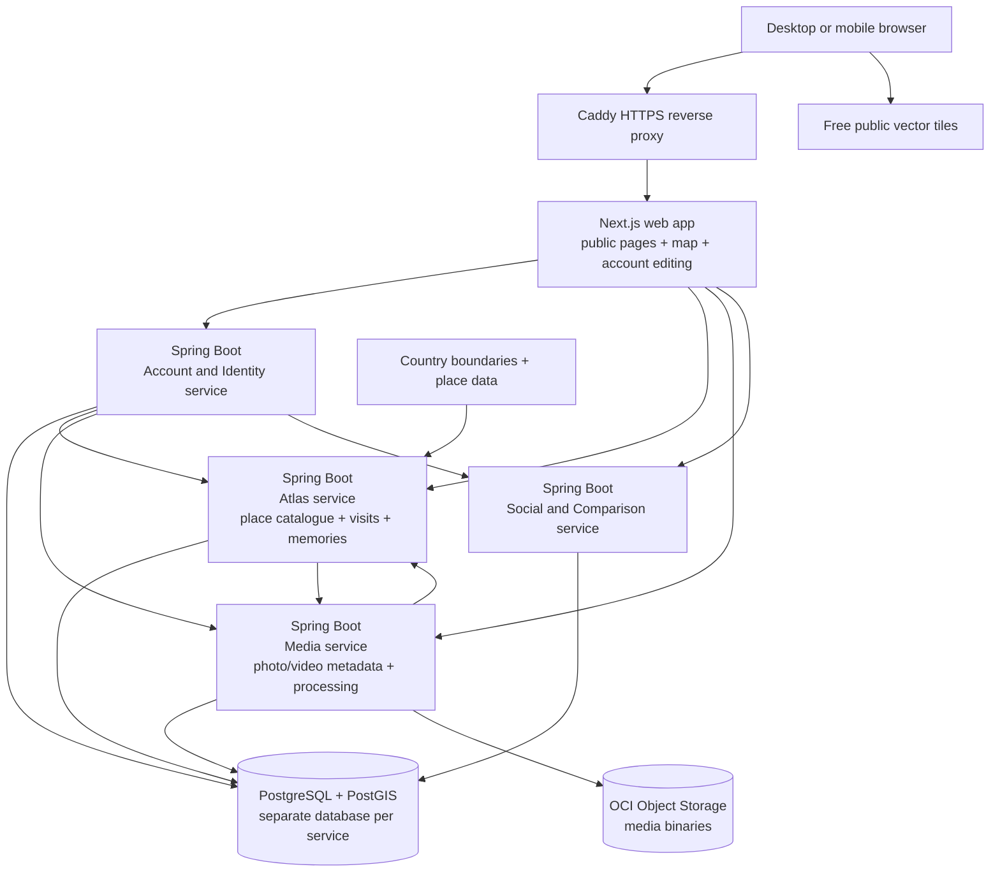
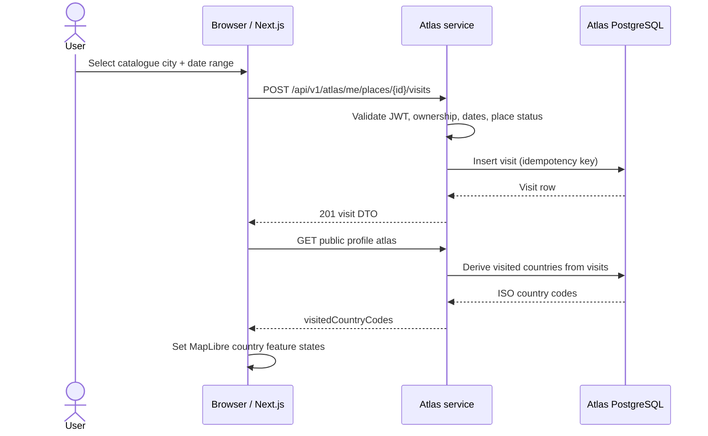

# My Atlas Technical Design

**Status:** Technical design draft for owner review  
**Product concept:** [`IDEA.md`](IDEA.md)

This document is the implementation handoff for My Atlas. A developer or coding agent should use it to understand the system boundaries, domain model, user flows, API behavior, security rules, and deployment approach. Product and technical decisions confirmed by the owner are marked **Confirmed**; recommended implementation defaults are marked **Recommended**; remaining questions are marked **Open**. Roadmap and release sequencing are intentionally separate.

## 1. Confirmed product and project constraints

- The first client is a responsive web application that works in desktop and mobile browsers. Native Android and iOS applications may come later.
- The initial interface language is English.
- App-owned interface text and default place-name display are in English. Whether user-authored memories must also be English is open; the app will not translate user content automatically unless later decided. Use English place-name forms when available; proper names may retain local spelling where no English form exists.
- The project is being built by one developer with intermediate Java experience. Backend, infrastructure, and database work are developer-owned; frontend implementation will be delegated to AI.
- Java and Spring are the preferred primary backend technologies.
- Oracle Cloud Infrastructure (OCI) is the required hosting provider for now, with a strict **€0 monthly spend** constraint.
- User profiles and their content are public by default. Search engines may index public profiles. No private or unlisted content states are planned at this stage.
- Anyone may browse public profiles without an account. An account is required to create and edit an Atlas.
- Initial authentication is email and password only.
- Each account receives a unique public handle, used in profile URLs in the form `/@<handle>` (for example, `/@ricardo`).
- Email verification is required.
- Users can delete their Atlas and its content.
- Photos, videos, memories, and other user content are public. Media uploads have both per-file and per-account limits compatible with the €0 hosting constraint; exact numeric limits are open.
- Users add cities and municipalities from a searchable place catalogue. A place is a single canonical catalogue entry associated with a country; users do not mark countries directly and cannot create arbitrary catalogue entries.
- If a small town or village is not present in the catalogue, the user selects its associated city or municipality.
- Users can record multiple visits to the same place. Each visit has a start date and an end date, stored as calendar dates with no time-of-day. A place is considered visited after its first recorded visit; its country is considered visited when at least one of that user's places in that country has a recorded visit.
- Repeated-visit records use start and end calendar dates with no time-of-day component. They are not a first-class Trip concept.
- Memories and media belong to a city and may optionally link to a specific dated visit. City galleries include all their content; country pages aggregate content from their cities without storing duplicate copies.
- The media model should allow both photos and videos, subject to the free-storage limits and upload policy.
- The primary map experience is a full-screen, flat, interactive map.
- A free public basemap service without an availability guarantee is acceptable to keep map hosting at €0.
- Map and place-data attribution required by source licenses must be displayed in the application.
- Release sequencing is intentionally out of scope for this document; it will be addressed during roadmap planning.

## 2. Target architecture

The developer wants hands-on experience with microservices and is open to additional complexity when it serves the project. The target defines explicit service boundaries while deploying them together within the zero-cost OCI envelope.

**Working recommendation:** design clear, independently deployable Spring service boundaries, then run the initial deployment within OCI Always Free limits. If the free allocation requires multiple services to share a host, that host is a single point of failure and constrains capacity; the architecture must state those limits rather than imply high availability.

The proposed boundaries below are the implementation recommendation. The owner should review the service split and remaining product-specific defaults before implementation begins.

### Proposed target architecture for review

The following is a working proposal based on the requirements collected so far. It defines logical service boundaries separately from the constrained first deployment.



**Service boundaries proposed:**

- **Account and Identity:** email/password credentials, email verification, password recovery, and unique public handles.
- **Atlas:** canonical city/municipality catalogue, user place visits, memories, country derivation, and public place/profile reads. A separate statistics service is not proposed until concrete statistics are defined.
- **Media:** upload authorization, media metadata, image/video processing, and object-storage lifecycle.
- **Social and Comparison:** friend relationships and travel comparisons. The product still excludes a content feed.

**Zero-cost deployment proposal:** run the containers on one OCI Always Free Ampere VM, using Docker Compose and one PostgreSQL/PostGIS host with a separate database and service credential for each service. Store media binaries in OCI Object Storage within its free quota. This provides distinct service boundaries but not host-level resilience: the single VM remains a shared failure point. Do not introduce Kubernetes or a paid managed database while the €0 constraint holds.

The Next.js server can render public `/@<handle>` profile pages for search engines; MapLibre runs in the browser for map interaction. Caddy is proposed as the single HTTPS entry point and reverse proxy, rather than adding a separate paid or resource-heavy API gateway product.

## 3. Recommended implementation stack

These are recommended defaults for the implementation handoff; version pins should be refreshed when coding begins:

- **Backend:** OpenJDK 25 LTS distribution (recommended: Eclipse Temurin), Spring Boot 4.1.x, Maven Wrapper, Spring Security, Spring Data JPA, and Flyway. Pin the latest supported patch versions when implementation begins; do not depend on an Oracle JDK download/license for the free build environment.
- **Web frontend:** Next.js 16 App Router, React, TypeScript, Node.js 24 LTS, and `pnpm`. Render public handle pages on the server for indexability; render the interactive map in a client component. Use Tailwind CSS with accessible, project-owned design tokens and components.
- **Database:** PostgreSQL 18.x with the latest stable PostGIS release compatible with that PostgreSQL major version. Run it self-managed on the free OCI compute host unless an OCI managed option is verified as Always Free.
- **API contract:** REST over HTTPS using JSON, documented with OpenAPI 3.1. Use RFC 9457 Problem Details for API errors.
- **Map renderer:** MapLibre GL JS.
- **Country boundaries:** Natural Earth 1:110m country polygons, vendored as a versioned/simplified GeoJSON asset under `apps/web/public/map-data/`, joined to Atlas responses by ISO 3166-1 alpha-3 code. Keep the source release and attribution alongside the asset.
- **Basemap tiles:** OpenFreeMap public tiles. The owner accepts the no-warranty availability limitation; keep the tile source configurable and replaceable.
- **Place catalogue:** GeoNames as the initial global source, with English display names and imported city/municipality records where the source classification supports them. Catalogue coverage and municipality parent mapping remain explicit data-quality concerns; do not accept arbitrary user-created places.
- **Media binary storage:** OCI Object Storage, constrained by confirmed Always Free quotas. Store metadata and authorization in the Media service; keep the bucket write-protected from anonymous users.
- **Ingress and TLS:** Caddy as the public HTTPS reverse proxy.
- **Deployment:** OCI Ampere A1 Always Free VM, Docker Engine and Docker Compose. No Kubernetes, service mesh, or paid managed services while the €0 constraint applies.
- **Repository:** Monorepo with separate web and service directories, independent container builds, and OpenAPI contracts.

### Why these choices

| Choice | Reason for this project | Cost or tradeoff |
| --- | --- | --- |
| Java/Spring Boot | Matches the owner's experience and provides mature security, persistence, validation, and operations support. | Each service consumes memory; keep JVM heaps bounded on the small VM. |
| Four Spring services | Gives hands-on practice with service ownership, APIs, and failure boundaries while keeping each domain small. | More deployment and troubleshooting work for one developer; all services still share one VM and PostgreSQL host. |
| PostgreSQL + PostGIS | Relational constraints fit visits and ownership; PostGIS handles country geometry and place coordinates without an extra GIS server. | Self-managed backups and upgrades are the owner's responsibility. |
| Next.js SSR + MapLibre | Server-rendered public pages are crawlable; the browser renders the interactive map without adding a paid map SDK. | OpenFreeMap availability and tile policy are external dependencies. |
| Media-service streaming | All Object Storage calls pass through one component, so the app can enforce a request ceiling below OCI's monthly free allowance. | Binary traffic uses VM bandwidth and bounded Java streaming; strict request control is preferred under the €0 constraint. |
| One VM + Compose | Fits the €0 constraint more plausibly than a managed cluster and is learnable for one operator. | No host-level high availability; VM failure takes the whole app offline. |

## 4. Open design decisions

- Final OCI home region and confirmation of actual Always Free compute, Object Storage, and Email Delivery quotas in the tenancy.
- Acceptance of the proposed 40,000 Object Storage API-call application ceiling and degraded-media behavior after a monthly sub-budget is reached.
- Final catalogue data source and a coverage audit for city/municipality types and parent-locality relationships.
- Exact free email provider and sender-domain configuration. OCI Email Delivery's published Always Free and generic service-limit tables conflict; verify the account quota before relying on it.
- Public hostname/domain. A stable HTTPS hostname is required for the requested `/@handle` URLs; ownership or a free-subdomain option has not been confirmed.
- Handle rename policy and final reserved-handle list. Recommended default is permanent old-handle redirects.
- Whether user-authored memories are restricted to English. Interface and catalogue display are English.
- Exact account-deletion backup retention and media metadata policy. Current recommendation: 28-day encrypted backup expiry; public derivatives strip EXIF GPS/device metadata.
- Numeric upload limits and whether the account quota defaults (20 MiB image, 100 MiB video, 500 MiB/account, 500 items) are acceptable.
- Social connection request/accept/reject behavior and comparison output fields.
- Concrete user and country statistics; intentionally deferred for later product definition.
- Final browser support matrix, visual design system, content length limits, and account handle change behavior.

## 5. Constraints to validate

- OCI Always Free resources are limited to eligible services and quotas; exact resource availability can vary by region. The architecture must stay within free allocations and avoid paid resources.
- Current OCI Free Tier documentation limits Always Free Ampere A1 compute to 2 OCPUs and 12 GB RAM total, provisioned in the tenancy's home region. This is a small single-host deployment envelope, not a highly available cluster.
- OCI Always Free Object Storage currently includes 20 GB total storage and 50,000 API requests per month. Direct anonymous bucket access would let crawlers and visitors consume this shared request quota without application controls, so the bucket is private and all object API calls pass through the Media service.
- OCI's Always Free offer currently includes up to 10 TB of outbound data transfer per month. Track transfer as well as storage and request count; stop or degrade media serving before any applicable tenancy allowance is exceeded.
- OCI currently documents Email Delivery as Always Free with 3,000 emails per month, but its generic service-limit table reports a zero daily email quota in the Always Free column. Treat OCI Email Delivery as a candidate only until the account's effective quota is confirmed.
- Publicly indexable profiles and user-uploaded media affect frontend rendering, abuse prevention, bandwidth, storage, and content-removal design.
- The product's map and place hierarchy requires a source of geographic boundaries and place identifiers that can be used legally and reliably.
- Open-source renderer choice does not resolve tile hosting. A free public tile service can keep costs at €0 but may provide no service-level availability guarantee.
- GeoNames can provide a broad baseline for populated places, but catalogue completeness and municipality hierarchy must be assessed before it becomes the canonical catalogue.

## 6. Decision log

| ID | Decision | Status |
| --- | --- | --- |
| D-001 | Responsive browser application first | Confirmed |
| D-002 | English interface initially | Confirmed |
| D-003 | Java and Spring as primary backend technologies | Confirmed preference |
| D-004 | OCI is the hosting target with €0 monthly spend | Confirmed constraint |
| D-005 | Public profiles and content; profiles may be indexed | Confirmed |
| D-006 | Full-screen flat interactive map | Confirmed |
| D-007 | Microservices-oriented target architecture | Under design; operational topology open |
| D-008 | Release sequencing excluded from technical design | Confirmed |
| D-009 | Public profiles can be browsed anonymously; account required to create/edit an Atlas | Confirmed |
| D-010 | Email and password are the only initial sign-in method | Confirmed |
| D-011 | Users select a city or municipality from a searchable catalogue; no direct country marking; small localities use their associated city/municipality; country visited status derives from a recorded place visit | Confirmed |
| D-012 | Public media uploads need per-file and per-account size/quantity limits | Confirmed constraint; numeric limits open |
| D-013 | One canonical city or municipality can have multiple visit records, used for statistics without a Trip entity | Confirmed |
| D-014 | Each place visit has start and end calendar dates without time-of-day | Confirmed |
| D-015 | City owns memories and media; content may link to a city visit; country pages aggregate city content | Confirmed |
| D-016 | Concrete statistic definitions are deferred | Confirmed |
| D-017 | Public profiles use a unique handle in the URL; login email is not public profile data | Confirmed |
| D-018 | Email verification is required | Confirmed; email delivery provider open |
| D-019 | Users can delete their Atlas and its content | Confirmed; exact deletion and backup-retention semantics open |
| D-020 | OCI Email Delivery is the leading candidate for verification and recovery email | Candidate; effective Always Free quota must be confirmed in the tenancy |
| D-021 | Use a free public map tile service; accept its lack of an availability guarantee and keep it replaceable | Confirmed |
| D-022 | Include required map and place-data attribution in the app | Confirmed |
| D-023 | App interface and default place-name display are English | Confirmed; user-authored content language policy open |
| D-024 | Media model supports photos and videos; per-file and per-account limits are required | Confirmed; numeric limits open |
| D-025 | Media and memories may optionally link to a dated city visit while remaining city-owned | Confirmed |

## 7. Domain behavior and invariants

### 7.1 Public Atlas

- A verified account has one public Atlas at `/@<handle>`.
- Public country, place, visit, memory, and media content can be read anonymously. There is no private, friends-only, or unlisted content state in this model.
- Login email, password hash, verification tokens, refresh tokens, and internal account status are never returned by public profile APIs.
- An account owner can create, edit, and delete only their own Atlas data. The owner identity comes from the authenticated token, never from a client-supplied `accountId`.
- Search engines may index verified public profile pages. Unverified profiles are not exposed in public APIs or sitemaps.

### 7.2 Places, visits, and country coloring

- The place catalogue is read-only to end users. It contains canonical city and municipality records with an English label, country, coordinates, place type, and source identity.
- A user selects a catalogue place and records one or more visits. A visit has `startDate` and `endDate`, both calendar dates without times; dates are inclusive and `endDate >= startDate`.
- A future-dated visit is rejected. Wishlist/planned places are a separate concept and are not represented as completed visits.
- The same place can have multiple visit records, including separate visits in the same year. Visits have independent UUIDs; do not impose uniqueness on account/place/date ranges or merge overlapping ranges automatically. The place is shown as visited if at least one visit exists.
- A country is shown as visited if at least one place in that country has at least one visit. There is no direct country-visit record.
- Removing a user's last visit to a place removes that place from their visited map. A country returns to unvisited only if no other place in that country has a visit.
- No trip grouping is implied by a visit record. Country visit-count statistics are not defined by this document.

### 7.3 Memories and galleries

- A memory is a short text item owned by a user and a city/municipality. It may optionally reference one visit at the same place.
- A media asset is owned by a user and a city/municipality, and may optionally reference one visit at the same place.
- The city/municipality gallery returns all media for that place, regardless of visit link. A country gallery aggregates media and memories for all places in the country. Aggregation returns references; it does not copy records.
- Country-only memories and media are not included in the current model because the user has placed content at the city level.
- User statistics are computed from canonical records. Do not persist speculative totals or give an aggregate an implied “trip count.” The exact statistics are deferred to product definition.

### 7.4 Handles

- Handles are globally unique, case-insensitive, URL-safe slugs. Store both the entered display form and a normalized lowercase form; uniqueness is enforced on the normalized value.
- Recommended validation: 3–30 characters, lowercase ASCII letters, digits, and single hyphens; no leading/trailing hyphen; reserved route and service names are blocked.
- The public route is `/@<handle>`. Public Atlas API routes use `/api/v1/atlas/public/profiles/<handle>`; identity summary routes use `/api/v1/identity/public/profiles/<handle>`.
- Handle rename policy remains open. Until decided, implement a handle-history table and redirect old handles to the current handle; do not silently reuse old handles.

## 8. Service ownership and data model

All IDs are UUIDs. Each service owns its schema and migrations. Cross-service references use UUIDs without cross-database foreign keys; services do not read or write another service's database. On the free single host, separate logical databases and database roles run on one PostgreSQL/PostGIS server.

### 8.1 Account and Identity service

Owns authentication, unique handles, account verification, password recovery, refresh-session state, and account deletion orchestration.

Recommended tables:

| Table | Important fields and constraints |
| --- | --- |
| `accounts` | `id UUID PK`, `email_normalized TEXT UNIQUE`, `password_hash TEXT`, `handle TEXT`, `handle_normalized TEXT UNIQUE`, `status` (`PENDING_VERIFICATION`, `ACTIVE`, `DELETION_PENDING`, `DELETED`), `email_verified_at TIMESTAMPTZ NULL`, `created_at`, `updated_at`, `deletion_started_at NULL` |
| `account_tokens` | `id UUID PK`, `account_id`, `purpose` (`VERIFY_EMAIL`, `RESET_PASSWORD`), `token_hash UNIQUE`, `expires_at`, `consumed_at NULL`, `created_at`; store only a hash of the random token |
| `refresh_sessions` | `id UUID PK`, `account_id`, `token_hash UNIQUE`, `expires_at`, `revoked_at NULL`, `rotated_from_id NULL`, `created_at`, `last_used_at` |
| `handle_history` | `id UUID PK`, `account_id`, `old_handle_normalized UNIQUE`, `new_handle_normalized`, `changed_at`; permanent redirects preserve old public links |
| `deletion_jobs` | `id UUID PK`, `account_id`, `target_service`, `attempt_count`, `next_attempt_at`, `completed_at NULL`, `last_error_code NULL`; retries are idempotent |

Store normalized email in lowercase after trimming. Never log password inputs, raw token values, or full verification/reset URLs.

### 8.2 Atlas service

Owns place catalogue imports, user visits, memories, visited-country derivation, and public place/country/profile aggregates.

Recommended tables:

| Table | Important fields and constraints |
| --- | --- |
| `countries` | `iso2 CHAR(2) PK`, `iso3 CHAR(3) UNIQUE`, `name_en`, `active`, `boundary geometry(MultiPolygon, 4326)`; GiST index on `boundary`; source attribution/version stored with catalog import metadata |
| `places` | `id UUID PK`, `source_name`, `source_id`, `place_type` (`CITY`, `MUNICIPALITY`), `name_en`, `country_iso2 FK`, `country_iso3`, `admin1_name NULL`, `admin2_name NULL`, `location geography(Point, 4326)`, `active`, unique `(source_name, source_id)`; GiST index on `location` |
| `place_aliases` | `id UUID PK`, `place_id FK`, `alias_en`, `normalized_alias`; unique `(place_id, normalized_alias)` |
| `place_visits` | `id UUID PK`, `account_id UUID` (external identity), `place_id FK`, `start_date DATE`, `end_date DATE`, `created_at`, `updated_at`; check `end_date >= start_date`; index `(account_id, place_id, start_date, id)`; no unique constraint on date ranges |
| `memories` | `id UUID PK`, `account_id UUID`, `place_id FK`, `visit_id UUID NULL`, `title VARCHAR(120) NULL`, `body TEXT` (1–5,000 chars), `created_at`, `updated_at`; visit must belong to same account and place |
| `catalog_imports` | `id UUID PK`, `source_name`, `source_release`, `started_at`, `completed_at`, `status`, `records_added`, `records_updated`, `records_retired` |
| `outbox_events` | `id UUID PK`, `event_type`, `aggregate_id UUID`, `payload JSONB`, `created_at`, `published_at NULL`, `attempt_count`; insert in the same transaction as visit deletion and retry delivery to Media |

Place imports use stable provider identifiers and preserve source provenance. A provider update must not replace the Atlas UUID if the provider identifier remains the same. Retire missing source records rather than deleting places referenced by visits.

### 8.3 Media service

Owns media metadata, upload reservations, account quotas, processing state, object storage keys, and deletion of media binaries.

| Table | Important fields and constraints |
| --- | --- |
| `media_assets` | `id UUID PK`, `account_id UUID`, `place_id UUID`, `country_iso2 CHAR(2)`, `visit_id UUID NULL`, `media_type` (`IMAGE`, `VIDEO`), `content_type`, `original_name_safe`, `caption NULL`, `private_original_key UNIQUE`, `byte_size`, `sha256`, `status` (`RESERVED`, `PROCESSING`, `READY`, `FAILED`, `DELETE_PENDING`, `DELETED`), `created_at`, `ready_at NULL`, `deleted_at NULL` |
| `upload_reservations` | `id UUID PK`, `account_id`, `media_id`, `reserved_bytes`, `expires_at`, `completed_at NULL`; one active reservation per account unless a later capacity test supports concurrency |
| `media_variants` | `id UUID PK`, `media_id FK`, `variant` (`THUMBNAIL`, `DISPLAY`), `content_type`, `object_key UNIQUE`, `byte_size`, `width`, `height` |
| `account_storage_usage` | `account_id UUID PK`, `item_count`, `stored_bytes`, `reserved_bytes`, `updated_at`; updated in a transaction with upload reservation and deletion |
| `media_jobs` | `id UUID PK`, `media_id`, `job_type`, `status`, `attempt_count`, `next_attempt_at`, `last_error_code NULL` |
| `object_api_usage` | `month_start DATE PK`, `public_read_calls`, `processing_calls`, `delete_calls`, `backup_calls`, `total_calls`, `updated_at`; atomically reserves category and total budget before each OCI Object Storage SDK request |

`country_iso2` is a denormalized catalogue value used for country gallery aggregation. The Media service validates place and visit ownership through an Atlas internal API before accepting the association; it does not query Atlas tables.

Store dimensions and duration only after inspecting a file. Derivative keys are deterministic per asset and variant; metadata stores the SHA-256 checksum of the validated original. Do not store EXIF coordinates as a source of visit/place truth.

### 8.4 Social and Comparison service

Owns accepted friend connections only. It does not own Atlas content and does not provide a feed, likes, or engagement counters.

Recommended initial relation table: `connections(id UUID PK, account_low_id UUID, account_high_id UUID, requester_account_id UUID, status (PENDING, ACCEPTED, DECLINED), created_at, accepted_at NULL)`, unique on `(account_low_id, account_high_id)` with a check that `account_low_id < account_high_id`. Populate low/high from sorted UUIDs and reject self-connections. Recommended behavior: only the recipient accepts or declines; the requester may cancel; either party may remove an accepted connection. Comparison queries call Atlas public summary APIs for both accounts. Since all Atlas content is public, a connection is a saved social relationship, not an access-control grant.

## 9. API contract

### 9.1 Conventions

- Base path: `/api/v1`; every route is service-prefixed (`identity`, `atlas`, `media`, `social`) so Caddy has deterministic routing. JSON request/response bodies use `camelCase` property names and UTF-8.
- Public GET routes require no account. Write routes require a verified account.
- IDs in public APIs are opaque UUID strings. Country codes use ISO 3166-1 alpha-2; boundary joins may also return alpha-3.
- Dates use ISO 8601 calendar form `YYYY-MM-DD`; timestamps use RFC 3339 UTC.
- Pagination uses opaque cursor pagination (`cursor`, `limit`); default limit 24, maximum 100.
- Every paginated list has a deterministic order with a unique UUID tie-breaker. Create endpoints that may be retried (`POST` visit and media-upload reservation) require an `Idempotency-Key`; persist its request hash and result for 24 hours so a network retry does not create a duplicate visit or reservation.
- Errors use `application/problem+json` with `type`, `title`, `status`, `detail`, `instance`, and a stable application `code` extension.
- Do not return database names, stack traces, raw provider responses, passwords, tokens, or storage credentials.
- Keep the published OpenAPI contract in each service directory. Generate/validate clients from contracts; do not hand-maintain duplicate request types in TypeScript.
- Identity owns account state and authentication only. Next.js assembles a public profile by requesting identity, Atlas, and media public representations; Identity does not query other service databases.

### 9.2 Account and Identity endpoints

| Method and path | Purpose | Important behavior |
| --- | --- | --- |
| `POST /api/v1/identity/accounts` | Register account | Input: email, password, handle. Normalize email/handle; create `PENDING_VERIFICATION`; send one-time verification link; return generic success to avoid account enumeration. |
| `POST /api/v1/identity/auth/sessions` | Sign in | Verify password and active status; issue short-lived access token and rotating refresh token in secure cookies. |
| `POST /api/v1/identity/auth/sessions/refresh` | Refresh session | Rotate refresh token, detect reuse, and issue a new short-lived access token. |
| `DELETE /api/v1/identity/auth/sessions/current` | Sign out | Revoke refresh session and expire cookies. |
| `POST /api/v1/identity/auth/email-verifications` | Resend verification | Rate-limited; generic response; invalidate or bound prior tokens. |
| `POST /api/v1/identity/auth/email-verifications/consume` | Verify email | Consume single-use token; activate account. |
| `POST /api/v1/identity/auth/password-resets` | Request reset | Generic response regardless of account existence; rate-limited. |
| `POST /api/v1/identity/auth/password-resets/consume` | Set new password | Single-use, expiring token; revoke all refresh sessions. |
| `GET /api/v1/identity/auth/csrf` | Obtain CSRF token | Establish/return the Spring Security CSRF token used in `X-CSRF-TOKEN` for subsequent mutations. |
| `GET /api/v1/identity/me` | Current account | Requires valid session; returns account ID, handle, and verified status, never email unless the user is in account settings. |
| `DELETE /api/v1/identity/me` | Delete account | Immediately hides public profile, starts idempotent deletion workflow across services, revokes sessions. |
| `GET /api/v1/identity/public/profiles/{handle}` | Public identity summary | Returns canonical handle and whether the profile is publicly available; no Atlas data or login email. |

### 9.3 Atlas endpoints

| Method and path | Purpose | Important behavior |
| --- | --- | --- |
| `GET /api/v1/atlas/places/search?q=&country=&cursor=&limit=` | Search catalogue | English labels; aliases may match; results include canonical label, type, country, administrative context, and coordinates. Never create a place from search. |
| `GET /api/v1/atlas/places/{placeId}` | Place details | Returns canonical place and country context. |
| `GET /api/v1/atlas/public/profiles/{handle}/atlas` | Public map data | Returns visited country codes and visited place summaries, grouped or pageable. |
| `GET /api/v1/atlas/public/profiles/{handle}/countries/{iso2}` | Country page | Returns country identity, visited places, date ranges, and aggregated Atlas-owned memories. |
| `GET /api/v1/atlas/public/profiles/{handle}/places/{placeId}` | City/municipality page | Returns place identity, visits, memories, and media references. |
| `GET /api/v1/atlas/me/places/{placeId}/visits` | Owner visit list | Authenticated owner only. |
| `POST /api/v1/atlas/me/places/{placeId}/visits` | Add visit | Body: `startDate`, `endDate`; reject future end date, invalid ordering, inactive place, or unverified account. |
| `PATCH /api/v1/atlas/me/visits/{visitId}` | Edit visit | Owner only; revalidate dates and memory/media references. |
| `DELETE /api/v1/atlas/me/visits/{visitId}` | Remove visit | Owner only; content linked to the visit remains city-owned with `visitId` cleared unless explicitly deleted by user. |
| `POST /api/v1/atlas/me/places/{placeId}/memories` | Create memory | Owner only; body has optional title and required non-empty text. |
| `PATCH /api/v1/atlas/me/memories/{memoryId}` | Edit memory | Owner only. |
| `DELETE /api/v1/atlas/me/memories/{memoryId}` | Delete memory | Owner only; idempotent. |

### 9.4 Media endpoints

| Method and path | Purpose | Important behavior |
| --- | --- | --- |
| `POST /api/v1/media/me/uploads` | Reserve an upload | Authenticated owner; input has place ID, optional visit ID, file name, declared type, and declared size. Check per-file, per-account, global storage, and monthly Object Storage request budgets; return media ID and same-origin content endpoint. |
| `PUT /api/v1/media/me/{mediaId}/content` | Upload binary | Stream `application/octet-stream` through Media to OCI without buffering the full file in Java heap. Enforce declared and measured size, inspect signature, calculate checksum, and enqueue validation/variant generation. |
| `GET /api/v1/media/me/{mediaId}` | Owner upload status | Returns processing status and retryable failure code. |
| `GET /api/v1/media/public/profiles/{handle}/gallery` | Public gallery | Cursor-paginated, can filter by country, place, and visit; returns only `READY` assets. |
| `GET /api/v1/media/public/assets/{mediaId}` | Public asset metadata | Returns variant metadata and same-origin Media API URLs; never returns private object keys or OCI URLs. |
| `GET /api/v1/media/public/assets/{mediaId}/variants/{variant}` | Public binary | Media enforces per-IP/monthly request budgets, reads the private object, and streams it to the browser. Never expose an Object Storage URL. Variant IDs are immutable; return a bounded `Cache-Control: public, max-age=3600` header. |
| `DELETE /api/v1/media/me/{mediaId}` | Delete media | Mark unavailable first, delete variants and original object, release quota, then complete. Idempotent. |

### 9.5 Social and Comparison endpoints

- `POST /api/v1/social/me/connections` requests a mutual connection by handle.
- `POST /api/v1/social/me/connections/{id}/accept` accepts a request.
- `DELETE /api/v1/social/me/connections/{id}` removes a connection.
- `GET /api/v1/social/me/connections` lists accepted connections.
- `GET /api/v1/social/public/comparisons/{handleA}/{handleB}` returns country and place set differences using public Atlas summaries. Comparisons are public-data views and do not depend on a connection.

### 9.6 Request and response examples

Create a visit:

```http
POST /api/v1/atlas/me/places/8a70a4d5-f2cb-4bd2-ae6b-c8e546012ed3/visits
Content-Type: application/json
X-CSRF-TOKEN: <csrf-token>

{
  "startDate": "2026-06-20",
  "endDate": "2026-06-28"
}
```

```json
{
  "id": "2d52a42a-7f4f-4c4e-a8b9-a160cba6e728",
  "placeId": "8a70a4d5-f2cb-4bd2-ae6b-c8e546012ed3",
  "placeName": "Lisbon",
  "countryCode": "PT",
  "startDate": "2026-06-20",
  "endDate": "2026-06-28",
  "createdAt": "2026-10-07T12:00:00Z"
}
```

Search places:

```json
{
  "items": [
    {
      "id": "8a70a4d5-f2cb-4bd2-ae6b-c8e546012ed3",
      "name": "Lisbon",
      "type": "CITY",
      "country": { "code": "PT", "name": "Portugal" },
      "administrativeContext": "Lisbon District",
      "latitude": 38.7223,
      "longitude": -9.1393
    }
  ],
  "nextCursor": null
}
```

Problem response for invalid dates:

```json
{
  "type": "https://myatlas.example/problems/invalid-visit-date-range",
  "title": "Invalid visit date range",
  "status": 422,
  "detail": "The end date must be the same day or after the start date.",
  "instance": "/api/v1/atlas/me/places/8a70a4d5-f2cb-4bd2-ae6b-c8e546012ed3/visits",
  "code": "INVALID_VISIT_DATE_RANGE"
}
```

Standard status mapping: `200` read/update, `201` create, `202` queued verification/deletion/media processing, `204` successful delete/logout, `400` malformed request, `401` missing/invalid authentication, `403` authenticated but not verified/allowed, `404` absent or intentionally hidden resource, `409` unique handle/duplicate conflict, `413` request too large, `422` domain validation, `429` rate limit, `503` media request budget exhausted, `507` application storage quota exhausted.

Limits to enforce in the API: handle 3–30 characters; password 15–128 characters; email at most 254 characters; place query 2–100 characters; memory title at most 120 characters; memory body 1–5,000 characters; media caption at most 500 characters. All values are server-enforced and mirrored in frontend validation.

## 10. Core request flows

### 10.1 Registration and email verification

1. Browser submits email, password, and desired handle over HTTPS.
2. Identity validates and normalizes input, checks handle/email uniqueness, hashes the password, and creates a pending account.
3. Identity creates a cryptographically random single-use verification token, stores only its hash with an expiry, and asks an `EmailSender` adapter to send the verification link.
4. The verification link opens the web app with the one-time token in the URL fragment. The page reads it and posts it to the consume endpoint; fragments are not sent in HTTP requests or referrer headers. Identity consumes it once and marks the account verified.
5. Only then can the account create Atlas content. Verification/resend endpoints are rate-limited; responses do not reveal whether an email is registered.

### 10.2 Add a visit and color the map

1. Signed-in user searches the read-only place catalogue and selects one canonical city/municipality.
2. User enters `startDate` and `endDate`; the web app sends them as `YYYY-MM-DD`.
3. Atlas validates ownership, verification, place status, `endDate >= startDate`, and that the completed visit does not end in the future.
4. Atlas stores a `place_visits` row. The place and country visited states are derived from the existence of visits; no duplicated visited booleans are written.
5. Public Atlas map reads return the visited country codes. The browser joins those codes to country polygons and styles visited countries distinctly.



### 10.3 Upload photo or video

1. Owner chooses a city/municipality and may associate the item with a visit at that same place.
2. Media checks authentication, place/visit association through Atlas, content type allowlist, file size, item count, account quota, global storage budget, and monthly object-request budget.
3. Media reserves the account/global storage quota and request budget, creates an unguessable private object key, and returns an upload ID.
4. Browser streams the binary with `PUT /api/v1/media/me/{mediaId}/content`. Caddy streams the request to Media; Media uses a bounded buffer and OCI SDK to write to the private bucket, never holding the full file in Java heap or exposing OCI credentials.
5. Media validates measured size and file signature while streaming, calculates SHA-256, and queues variant processing. On failure it deletes any partial object, releases quota, and returns a stable error.
6. A bounded worker reads the private original, makes metadata-stripped variants, writes them to private Object Storage, and marks the asset `READY`. Public APIs expose only same-origin streaming URLs for ready variants; invalid or abandoned uploads are deleted and quota is released.

### 10.4 Delete an account

1. Identity marks the account `DELETION_PENDING`, revokes sessions, and causes public profile routes to return not found immediately.
2. Identity records deletion tasks for Atlas, Media, and Social. Each call is idempotent and retried until acknowledged.
3. Atlas removes visits and memories. Media removes all owned object keys and metadata. Social removes connections where the account is either endpoint. Each service also invalidates public response caches for the account.
4. Identity permanently removes credentials and account data after all service tasks complete. Sitemap and cached public pages are invalidated.
5. Database backups expire on the published retention schedule. A deletion request cannot erase already downloaded third-party copies of public media.

## 11. Authentication and application security

- Passwords are never encrypted for later recovery and never stored in plaintext. Use Argon2id; OWASP's current minimum is 19 MiB memory, 2 iterations, parallelism 1. Benchmark and keep enough compute headroom for login-rate limits.
- Password policy: minimum 15 characters for password-only authentication, maximum at least 64 characters, no arbitrary composition rules, reject common/breached passwords where a free local blocklist is practical. Do not require periodic password changes.
- Access token: signed JWT, 10–15 minute expiry, claims limited to `sub` account UUID, issuer, audience, expiry, issued-at, token ID, and key ID. Identity service holds the signing key; other services receive verification keys only.
- Refresh token: cryptographically random opaque value; store only its hash; rotate on every refresh; revoke the token family if a previously rotated token is reused. Recommended lifetime 30 days, with revocation on password reset and account deletion.
- Browser cookies: `Secure`, `HttpOnly`, `SameSite=Lax`, `Path=/`, no `Domain` attribute; use `__Host-` prefix on the final HTTPS origin. Do not put tokens in `localStorage` or URLs.
- Put access and refresh tokens in separate `__Host-` cookies, both `Secure`, `HttpOnly`, `SameSite=Lax`, `Path=/`, and no `Domain`; make access cookie short-lived. Spring Security issues the CSRF token in a Secure, SameSite cookie readable by the same-origin web client, which echoes it in `X-CSRF-TOKEN`.
- Because auth uses cookies, all state-changing routes require CSRF protection and same-origin `Origin` validation. `GET` routes must never mutate state. SameSite is defense in depth, not a replacement for CSRF tokens.
- Require HTTPS at Caddy. Enable HSTS after domain/TLS deployment is stable. Redirect HTTP to HTTPS.
- Public read routes may be anonymous. All writes verify token, active/verified account, and ownership. Add rate limits for login, register, email resend, reset, place search, and upload-initiation endpoints.
- Require a valid JWT for every owner mutation. Services validate signature, issuer, audience, expiry, and verified-account claim locally; Identity revokes refresh sessions, while the short access-token lifetime bounds revocation delay. Public profile reads additionally check an account deletion tombstone so deleted profiles are hidden before service cleanup completes.
- Use parameterized SQL/JPA binding; validate and encode user text at rendering boundaries. Apply content security policy and render memories as plain text with preserved line breaks; do not accept HTML or Markdown in the initial content model.
- Restrict image/video MIME types using file signatures, not only browser-supplied content types. Never serve untrusted HTML, SVG, or executable files inline.
- No secrets in Git. Local `.env` files are ignored; production secrets are read from OCI Vault or mounted runtime secrets. Rotate email credentials, database passwords, and JWT signing keys.
- Structured logs must exclude passwords, raw tokens, full email verification/reset URLs, and private media object keys/URLs.
- Recommended token lifetimes: email verification 24 hours, password reset 30 minutes, access JWT 10 minutes, refresh session 30 days with rotation. Generate email tokens with a cryptographically secure random source and at least 32 random bytes; persist only a keyed or one-way hash. Expired pending accounts may be purged after 30 days, releasing the handle.

## 12. Media storage and zero-cost limits

OCI Always Free documentation currently lists 20 GB combined Standard, Infrequent Access, and Archive Object Storage plus 50,000 Object Storage API requests per month after the free trial. Use the tenancy's actual quota page before deployment; do not design to consume the full quota.

Recommended initial guardrails, pending final quota validation:

| Limit | Proposed default | Reason |
| --- | ---: | --- |
| Image file | 20 MiB | Keeps upload time and per-file abuse bounded |
| Video file | 100 MiB | Allows short travel clips without large transcoding jobs |
| Media per account | 500 items and 500 MiB physical object bytes | Bounds an individual account's originals plus generated public variants |
| Application media budget | 10 GiB | Leaves room for backups, catalog files, and quota headroom within 20 GB combined Object Storage |
| Concurrent upload reservations | 1 per account | Avoids parallel reservations consuming the same quota |

These are recommended defaults, not user-confirmed numeric product limits. Count both private originals and generated variants toward account/global storage. Reserve up to 2× the declared upload size until processing calculates exact bytes; reclaim unused reservation at completion. Keep values in configuration and enforce them on the server. When the global storage budget is reached, reject new uploads with `507 STORAGE_QUOTA_EXCEEDED`; never silently upgrade to a paid resource. A 10 GiB media cap, 4 GiB backup cap, and roughly 2 GiB for catalog/other objects leave additional headroom under the 20 GB tenancy quota; monitor usage and stop uploads before the quota is reached.

The application-wide hard ceiling for Object Storage API calls is 40,000 per calendar month, leaving at least 10,000 calls below OCI's published Always Free limit. `object_api_usage` reserves a call before every SDK attempt, including failed attempts. Sub-budgets: at most 30,000 public variant reads, 8,000 upload/processing calls, 500 backup calls, and 1,500 deletion/operational calls. All Object Storage requests, including backup writes, go through Media's private storage adapter; do not create public buckets or PARs that bypass counters. When a sub-budget is exhausted, stop that operation class; when the 40,000 total is reached, reject uploads and return a stable media-unavailable placeholder/error for binary delivery until the next month. This leaves quota for OCI calls outside the app and requires confirming actual tenancy limits and monitoring service metrics.

Recommended supported input formats: JPEG, PNG, and WebP for images; MP4 (H.264/AAC) for video. Reject SVG, archives, executables, and unknown containers. Keep private originals for archive fidelity and create display/thumbnail variants with `libvips`; use `ffprobe` to inspect video container/codecs and `ffmpeg` to make a thumbnail or metadata-stripped stream-copy variant, with one bounded worker. Do not transcode videos on the VM. Strip EXIF GPS/device metadata from every public derivative; no location is inferred from photo metadata because places are manually selected. Retaining metadata in private originals is an open privacy and archive-fidelity decision.

Use a private media bucket for originals and variants, and a separate private bucket for database backups. All browser upload/download traffic and encrypted backup writes pass through Media; no Object Storage URL or pre-authenticated request leaves the backend. This prevents public users from bypassing the service's request budget. Use OCI instance principals with least-privilege IAM for the Media service. Account deletion removes both original and variant objects.

## 13. Map and place catalogue behavior

- MapLibre displays the interactive, full-screen flat map. Configure its style URL through environment configuration, not source code.
- OpenFreeMap is the initial public vector tile service. Keep attribution visible. A provider failure must not prevent a user from opening the place list or public profile content.
- The visited-country overlay uses the versioned Natural Earth GeoJSON asset served by Next.js at `/map-data/countries-110m.geojson`; join features to Atlas's ISO alpha-3 `visitedCountryCodes`. The map API returns codes, not full geometries.
- Country fill colors are driven by `visitedCountryCodes` using MapLibre feature state; unvisited, visited, selected, and hover/focus states must be visually distinct and accessible without color alone.
- Use a searchable catalogue backed by a local imported database, not the public OSM Nominatim endpoint. Never use the public OSM tile endpoint as an unmetered tile API.
- GeoNames is the initial seed candidate; import only English display names and useful aliases, preserve attribution and source ID, and audit how country-specific municipal records map to the `CITY`/`MUNICIPALITY` type.
- Place search should support English names and English aliases; results display an English canonical name plus administrative context and country to distinguish duplicates.
- Catalogue ingestion is an admin/developer operation, not a user API. It is repeatable and idempotent, logs source/version and counts, and retires rather than destroys records referenced by users.
- Missing small localities are not created as free-form records. The user selects the corresponding supported city/municipality. The app must show enough administrative context to choose the correct one.

## 14. Web client implementation

- Next.js App Router with TypeScript. Public `/@<handle>` pages use server components and server-side data fetching so crawlers receive useful HTML and per-profile Open Graph metadata.
- The full-screen interactive MapLibre instance is a client component. Load it only after browser hydration; provide an accessible country/place list fallback if WebGL is unsupported.
- Public profile pages use canonical URLs, descriptive `<title>` and metadata, `sitemap.xml`, and `robots.txt`. Exclude login, settings, unverified accounts, and empty placeholders from indexing.
- All forms display server validation errors and preserve user input safely. API schemas are the source of request types; do not trust client validation alone.
- Use semantic HTML and keyboard-accessible map controls. Country selection must also be possible through an accessible searchable country list.
- Use English strings for app-owned content. User memory content remains plain user text; automatic translation is not part of the system.
- Do not place access or refresh tokens in JavaScript storage. Auth cookies are HttpOnly; mutating requests attach the CSRF token.

## 15. OCI deployment design

### 15.1 Free resource envelope

Current OCI documentation lists 2 OCPUs and 12 GB RAM total for Always Free Ampere A1 compute, provisioned only in the tenancy home region. Availability can be constrained by host capacity. Allocate one VM initially; do not claim high availability.

Suggested single-host containers:

| Container | Responsibility | Initial resource ceiling |
| --- | --- | ---: |
| Caddy | TLS and reverse proxy | 256 MiB RAM |
| Next.js web | SSR and browser app delivery | 1 GiB RAM |
| Account service | Identity APIs | 768 MiB RAM |
| Atlas service | Place/visit/memory APIs | 768 MiB RAM |
| Media service + worker | Upload API and low-volume processing | 1 GiB RAM; limit worker concurrency to 1 |
| Social service | Connection and comparison APIs | 512 MiB RAM |
| PostgreSQL/PostGIS | Separate service databases | 2 GiB RAM initially |
| OS/cache/headroom | Host and filesystem cache | At least 3 GiB reserved |

Memory limits are initial tuning targets, not guaranteed performance. Start with the single free VM and watch CPU/memory before changing JVM heap settings. Media video transcoding may exceed the CPU budget; accept supported MP4 rather than transcoding video on the host.

Set explicit container memory and CPU limits. Initial JVM `-Xmx` ceilings: Identity 384 MiB, Atlas 384 MiB, Media 384 MiB, Social 256 MiB. Leave the remaining container allowance for metaspace, thread stacks, native buffers, and the runtime. Set HikariCP maximum pool size to 5 per service initially and PostgreSQL `max_connections` to 40; monitor connection and memory usage before raising either.

### 15.2 Network and runtime

- Put the public frontend, Caddy, and APIs behind one domain and HTTPS origin. Expose only TCP 80/443 publicly; administer SSH with key authentication and OCI network rules, never password SSH.
- Database ports are bound only to the private host network and not exposed publicly.
- Caddy routes `/` to Next.js and `/api/v1/identity/*`, `/api/v1/atlas/*`, `/api/v1/media/*`, `/api/v1/social/*` to the corresponding services. Unknown `/api/v1/*` routes return a JSON 404; they are not sent to the web app.
- In Next.js, avoid using a route folder named `@...` for the requested `/@handle` URL because `@` has special parallel-route meaning in the App Router. Implement the page at `/profile/[handle]` and add an explicit rewrite from `/@:handle` to `/profile/:handle`; generate canonical links with the public `/@handle` URL. Use the same URL-fragment pattern for password-reset tokens.
- Use Docker Compose with restart policies and health checks. Persist PostgreSQL data on the VM boot volume or a Block Volume allocation explicitly verified as Always Free; object binaries live in Object Storage.
- Pin container image tags and build multi-platform images for ARM64. No `latest` in production deployment definitions.
- TLS certificate issuance and renewal is automated by Caddy. A stable public hostname is required; custom domain ownership/cost is still unconfirmed.
- Configure firewall rules with default deny. Allow database connections only from app containers. Use separate DB users, no superuser in application containers.
- Required non-secret configuration includes `APP_PUBLIC_BASE_URL`, `OCI_REGION`, `OCI_NAMESPACE`, private/public media bucket names, backup bucket name, database URLs, and sender address. Production secrets (DB passwords, JWT signing key, OCI/email credentials if used) are mounted at runtime and never committed. OCI instance principals are preferred for object access if they are available without adding a paid resource.
- Confirm the tenancy's effective Always Free quotas and home-region capacity before provisioning each OCI resource. Configure OCI budget/usage alerts and regularly inspect actual charges; alerts do not prevent an accidental paid allocation. No resource may be provisioned unless its free eligibility and quota are confirmed.

### 15.3 Backups and recovery

- Nightly `pg_dump` per service database; encrypt backup artifacts before Object Storage upload. Recommended retention is 7 daily plus 3 weekly snapshots (28-day window), subject to total free object-storage budget and final deletion policy. Use only storage resources that the tenancy confirms as Always Free; do not assume an extra block volume is free.
- Object media and database backups use distinct buckets/prefixes and retention rules. Do not treat VM disk snapshots as the only backup.
- Document and rehearse restore into a clean Postgres/PostGIS container before launch. Record RPO target of 24 hours and RTO target of 1 day under the free single-host architecture; these are service objectives, not guarantees.
- Backup retention means hard-deleted user records may remain in encrypted backups until expiry. Access to backups is restricted to the operator.

## 16. Repository and coding conventions

Recommended monorepo layout:

```text
my-atlas/
  apps/
    web/
  services/
    account-service/
    atlas-service/
    media-service/
    social-service/
  contracts/
    openapi/
  data/
    natural-earth/
    place-import/
  infra/
    compose/
    terraform/
  docs/
    TECHNICAL_DESIGN.md
    adr/
  docker-compose.yml
```

- Each Spring service is an independent Maven project and container image, with its own configuration, migrations, tests, and OpenAPI contract.
- Use package-by-feature inside each service (for example `accounts`, `verification`, `sessions`) rather than broad `controllers/services/repositories` packages.
- Keep domain rules in application/domain code, not controllers. Controllers validate transport shape and map to application commands/queries.
- Use Flyway SQL migrations. `ddl-auto=validate` in runtime; never auto-create production schemas.
- Avoid a shared Java domain model across services. Share only generated API clients or small transport contracts, never JPA entities.
- Use immutable request/response DTOs, constructor injection, explicit transactions, and UTC `Instant` for timestamps; `LocalDate` for visits.
- Use structured JSON logs with correlation/request IDs. Return stable error codes and avoid exposing Java exception text.
- Configuration comes from environment variables or mounted secrets; provide `.env.example` with placeholders only.
- Infrastructure definitions use Terraform when resources can be created within Always Free limits. Separate development, test, and production configuration without copying production secrets into local files.

### 16.1 Local development and CI

Required local tools: Git, Java 25 JDK, Maven Wrapper, Node.js 24 LTS, `pnpm`, and Docker with Compose. The repository must pin Java and Node versions in toolchain files and use Maven Wrapper so contributors do not need a globally installed Maven version.

Recommended root developer commands (implement as `Makefile` targets or equivalent scripts):

| Command | Behavior |
| --- | --- |
| `make dev-infra` | Start local PostgreSQL/PostGIS and development mail catcher in Compose |
| `make dev` | Start Next.js and Spring services with local profile configuration |
| `make format` | Format Java and TypeScript sources |
| `make lint` | Run TypeScript/ESLint and Java static checks |
| `make test` | Run unit, integration, and contract tests |
| `make build` | Build all service artifacts and the web production bundle |
| `make infra-validate` | Format and validate Terraform without provisioning |

CI must run format checks, lint, tests, OpenAPI validation, container builds for ARM64, and dependency/security scanning on every pull request. Deployment is a separate protected workflow that runs only from the default branch after checks pass. CI secrets must contain no production secrets except the minimum deployment credential; prefer OCI instance principals for runtime access and short-lived credentials for deployment.

### 16.2 API and service interaction

- Browser and server-rendered web requests use the same HTTPS origin. Caddy routes each `/api/v1/<service>` prefix to its Spring service; avoid cross-origin cookies and broad CORS.
- Services call another service only through its versioned internal HTTP API. Internal routes are network-restricted and require service authentication; do not expose an unauthenticated `/internal` endpoint on the public listener.
- Account deletion and visit deletion are cross-service workflows that require retryable operations. Identity stores one deletion task per target service, uses idempotent internal delete calls, and retries with capped exponential backoff. When Atlas deletes a visit, it clears memory references in its transaction and writes an outbox event in that same transaction; a bounded worker retries Media's clear-association operation until acknowledged. Both operations are idempotent. No Kafka, RabbitMQ, or service mesh is needed for this workload.
- Media processing jobs are stored in the Media database and claimed by one bounded worker. A job is idempotent by `(mediaId, jobType)` and has bounded attempts; terminal failures mark the asset `FAILED` and allow the user to retry.
- Inter-service HTTP calls have connect and read timeouts. Public profile aggregation uses parallel bounded calls from the Next.js server and degrades gracefully: if media is unavailable, render the profile and map without its gallery rather than failing the whole page.

## 17. Reliability, performance, and abuse controls

- Public reads use cacheable response headers only when the representation contains no account credentials or mutation-specific data. Owner editing responses are `private, no-store`.
- Use database indexes for unique account email/handle, visit lookup by account/place/date, memory lookup by place, media lookup by place/country/date, and catalogue search columns.
- Place search applies a minimum query length of 2, a result cap, and rate limits. Use PostgreSQL trigram/full-text indexing before adding a paid or memory-heavy search engine.
- Media list APIs return small metadata pages; binary routes stream through Media with an 8 MiB bounded buffer and never load whole files into Java memory. All OCI SDK calls, including backup operations, pass through the monthly request-budget ledger.
- Apply per-IP and per-account rate limits for registration/auth, upload reservations, memory writes, and search. Apply request body-size limits at Caddy and each service.
- Reject unknown JSON fields where practical for write APIs; validate text lengths, dates, IDs, enum values, and supported media types.
- Use timeouts and bounded retries for inter-service calls. Retry only idempotent requests; deletion and upload completion use idempotency keys or state checks.
- Every service exposes `/actuator/health/liveness` and `/actuator/health/readiness` internally. Do not expose environment, configuration, or heap-dump endpoints publicly.

### 17.1 Internal service contract

Internal endpoints are not routed by Caddy and bind only to the private Compose network. Each caller authenticates with a short-lived service JWT (distinct audience and service identity); validate issuer, audience, expiry, and allowed service role. Do not reuse a user's JWT as service authentication.

| Caller → owner | Internal operation | Required behavior |
| --- | --- | --- |
| Media → Atlas | Validate `(placeId, accountId, visitId?)` | Confirm active catalogue place and, when supplied, that the visit belongs to the account and place; return canonical country code. |
| Atlas → Media | Clear visit reference | Clear `visitId` for all assets matching `(accountId, visitId)`; idempotent. Atlas writes an outbox event in the visit-delete transaction and retries delivery until acknowledged. |
| Identity → Atlas / Media / Social | Delete account data | Mark content unavailable immediately, delete owned records/objects, return completion status; safe to retry. |
| Atlas / Media → Identity | Check public account status | Return only whether account is `ACTIVE`; non-active profiles must not be exposed. Cache only briefly and invalidate on deletion workflow. |
| Backup runner → Media | Store encrypted database dump | Internal-only streamed upload to the private backup bucket; consumes the 500-call monthly backup sub-budget. |

Implement bounded connect/read timeouts, small response DTOs, and capped exponential retries only for idempotent operations. Each service owns its own database and may never open another service's JDBC connection.

## 18. Verification plan

The implementation should include, but this document does not run, the following checks:

- Unit tests for visit/date rules, visited-country derivation, handle normalization, media quota reservations, and deletion state transitions.
- Integration tests per service using PostgreSQL with PostGIS; validate Flyway migrations from an empty database.
- API contract tests against each committed OpenAPI document and representative error responses.
- End-to-end tests for registration/verification, adding a place visit, map-country coloring, public profile rendering, photo/video upload, memory aggregation, and account deletion.
- Security checks for anonymous write denial, ownership checks, CSRF, rate limiting, invalid/expired/reused tokens, oversized uploads, unsupported file signatures, and no credential leakage.
- Browser tests for desktop and mobile viewport, keyboard navigation, WebGL fallback, and English place search.
- Restore test from encrypted backup and object manifest.

## 19. External technical references

- [Java SE support roadmap](https://www.oracle.com/europe/java/technologies/java-se-support-roadmap.html) — Java 25 is an LTS release.
- [Spring Boot system requirements](https://docs.spring.io/spring-boot/system-requirements.html) — current supported Java range.
- [Next.js metadata and Open Graph documentation](https://nextjs.org/docs/app/getting-started/metadata-and-og-images) — public share/index metadata.
- [Next.js installation and browser requirements](https://nextjs.org/docs/app/getting-started/installation) — current Node/browser baseline.
- [Node.js release schedule](https://nodejs.org/en/about/previous-releases) — use an Active or Maintenance LTS runtime.
- [PostgreSQL versioning policy](https://www.postgresql.org/support/versioning/) — major version support and minor updates.
- [PostGIS introduction](https://postgis.net/docs/manual-3.7/en/postgis_introduction.html) — spatial data, indexes, and queries.
- [MapLibre GL JS documentation](https://maplibre.org/maplibre-gl-js/docs/) — browser-side vector map rendering.
- [RFC 9457](https://www.rfc-editor.org/rfc/rfc9457) — HTTP Problem Details error response format.
- [OWASP Password Storage Cheat Sheet](https://cheatsheetseries.owasp.org/cheatsheets/Password_Storage_Cheat_Sheet.html) and [Authentication Cheat Sheet](https://cheatsheetseries.owasp.org/cheatsheets/Authentication_Cheat_Sheet.html).
- [OWASP Session Management Cheat Sheet](https://cheatsheetseries.owasp.org/cheatsheets/Session_Management_Cheat_Sheet.html) — secure cookie attributes and session handling.
- [OCI Always Free resources](https://docs.oracle.com/en-us/iaas/Content/FreeTier/freetier_topic-Always_Free_Resources.htm) — current compute, storage, and email quota limits.
- [OCI general service limits](https://docs.oracle.com/en-us/iaas/Content/General/service-limits/default.htm) — tenancy limits; compare these against the Free Tier guide because effective email quotas can differ.
- [OpenFreeMap](https://openfreemap.org/) and [service terms](https://openfreemap.org/tos/) — public vector-tile service and its operating terms.
- [OpenStreetMap copyright and attribution](https://www.openstreetmap.org/copyright) — attribution requirements for OSM-derived map data.
- [Natural Earth](https://www.naturalearthdata.com/about/) — public-domain map dataset information.
- [GeoNames](https://www.geonames.org/about.html) and [export/license information](https://www.geonames.org/export/) — place data source and attribution terms.
- [OWASP Cross-Site Request Forgery Prevention Cheat Sheet](https://cheatsheetseries.owasp.org/cheatsheets/Cross-Site_Request_Forgery_Prevention_Cheat_Sheet.html) — CSRF tokens and same-origin checks.
