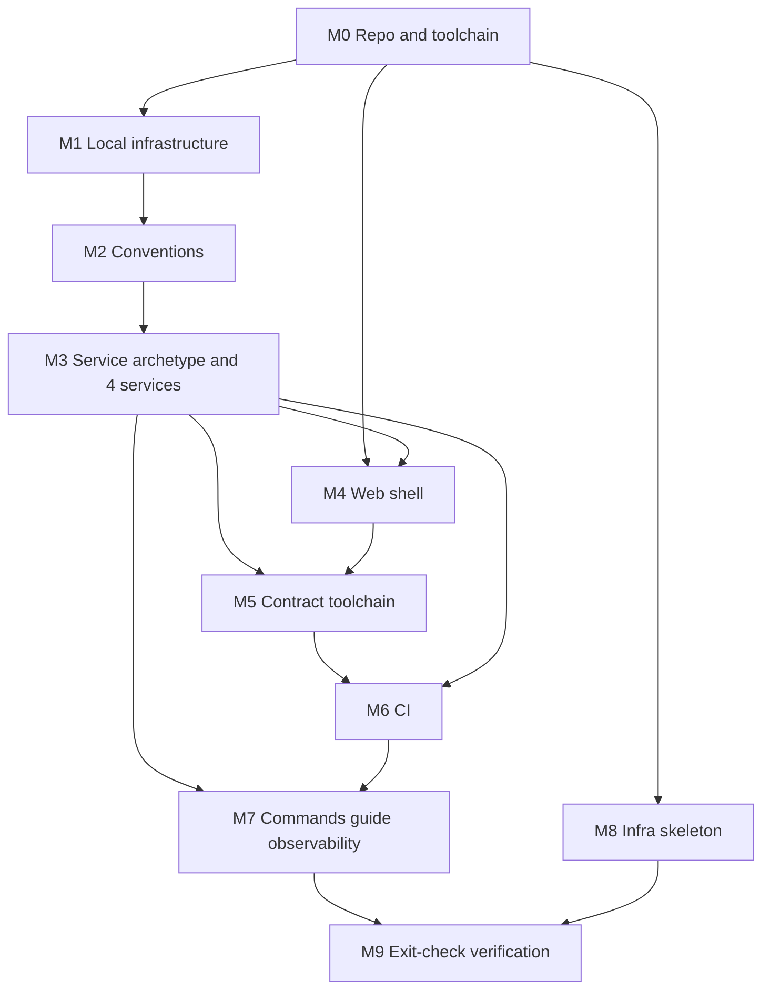

# Stage 1 — Build a reproducible project foundation (detailed plan)

**Status:** Ready for implementation
**Source:** [`ROADMAP.md`](../ROADMAP.md) §6 (Stage 1) and [`TECHNICAL_DESIGN.md`](../TECHNICAL_DESIGN.md)
**Product concept:** [`IDEA.md`](../IDEA.md)
**Scope note:** This plan intentionally does not predict dates. Work advances when each task's acceptance check passes.

---

## 1. Purpose

Turn Stage 1 of the roadmap into an executable, ordered set of tasks. The outcome of Stage 1 is a clean checkout that can be built and run locally in a predictable way, with reviewable change flow — not a working product. Features start in Stage 3.

This plan is written for a single developer (or a coding agent) to execute task by task, top to bottom, verifying acceptance before moving on.

---

## 2. Decisions locked

| Topic | Decision | Rationale |
| --- | --- | --- |
| Service scope | Walking skeleton: all four Spring services (account, atlas, media, social) plus the web shell, each runnable with its own database identity, role, and Flyway baseline. | Satisfies the exit check that each service owns its database and migration history, and de-risks the deployment model early. |
| Version control / CI | GitHub repository with GitHub Actions. | Free, ARM64 `buildx` support, OIDC available for later OCI auth. |
| Local tooling | Makefile targets, Mailpit mail catcher, Testcontainers + PostGIS for integration tests, npm workspaces, versions pinned via `.tool-versions` and `.nvmrc`. | Matches design §16.1 (Makefile targets) and keeps the toolchain reproducible. |
| API contract | Code-first with `springdoc-openapi`; the generated OpenAPI 3.1 document is committed per service; TypeScript types are generated for the web with `openapi-typescript`. | One source of truth (Java code); no hand-maintained duplicate request types in TypeScript (design §9.1). |
| Database schema | Minimal per-service baseline migration proving the mechanism; business tables from design §8 land in Stage 3. | Avoids premature schema and rework. |
| CI / infra reach | Full design coverage: format, lint, tests, contract validation, dependency scan, ARM64 image builds; plus a Terraform skeleton that validates but provisions nothing. | Proves the deployment artifact shape before Stage 2. |

---

## 3. Sequencing approach

**Chosen: layered foundation (Approach A).**

Build in horizontal layers — repo/toolchain, local infrastructure, conventions, one service archetype applied to all four services, contracts, CI, docs/observability, infra skeleton, then verification. This maps one-to-one to the Stage 1 exit checks and, by applying a single archetype to all four services, prevents per-service drift.

Rejected alternatives:

- **Vertical spine first** (one service through every layer, then replicate ×3): fastest first proof, but the replicated services tend to drift from the reference.
- **Scaffolder first** (build a template/generator, then instantiate): over-engineered for four fixed services.

### Dependency graph



---

## 4. Milestones and tasks

Each task lists a **Deliverable** and an **Acceptance** check. Do not mark a task done until its acceptance check passes and is demonstrated (command output, CI run, or captured evidence).

### M0 — Repository and toolchain bootstrap

- **M0.1 — Initialize version control.**
  - Deliverable: `git init` with branch `main`; initial commit containing the current documents; `.gitignore` covering Java (`target/`), Node (`node_modules/`, `.next/`), env files (`*.env`, `.env`), IDE files, OS files.
  - Decision: `IDEA.md`, `ROADMAP.md`, and `TECHNICAL_DESIGN.md` live under `docs/` (as `docs/IDEA.md`, `docs/ROADMAP.md`, `docs/TECHNICAL_DESIGN.md`). Their cross-links stay valid because the three documents are co-located. `docs/` also holds ADRs, engineering notes, and this planning directory. The repository root keeps only tooling and the entry `README`.
  - Acceptance: `git log` shows the initial commit; `git status` clean.
- **M0.2 — Create the monorepo skeleton.**
  - Deliverable: directory layout from design §16:
    ```text
    apps/web/
    services/account/
    services/atlas/
    services/media/
    services/social/
    contracts/openapi/
    data/natural-earth/
    data/place-import/
    infra/compose/
    infra/terraform/
    docs/adr/
    docs/engineering/
    docs/planning/
    docker-compose.yml
    ```
    Add `.gitkeep` files so empty directories are tracked. Service directories are named without a `-service` suffix (`account`, `atlas`, `media`, `social`) by owner choice, deviating from design §16's `*-service/` spelling; API route prefixes remain `identity/atlas/media/social` (design §9.1).
  - Acceptance: tree matches the layout; committed.
- **M0.3 — Pin the toolchain.**
  - Deliverable: `.tool-versions` (Java 25 Temurin, Node 24 LTS), `.nvmrc` (`24`), root `package.json` declaring npm workspaces (`apps/*`) and `engines`, `.editorconfig`.
  - Acceptance: a fresh checkout resolves the pinned versions with the documented manager (mise/asdf for Java); `npm` is the standard package manager.
- **M0.4 — Root command surface.**
  - Deliverable: root `Makefile` with targets `dev-infra`, `dev-infra-down`, `dev`, `format`, `lint`, `test`, `build`, `contracts`, `infra-validate`, and `help`. Targets may be stubs until their milestone wires them.
  - Acceptance: `make help` lists every target; `make` with no target prints help.

### M1 — Local infrastructure (Compose)

- **M1.1 — Compose stack.**
  - Deliverable: `docker-compose.yml` (or `infra/compose/docker-compose.yml` referenced from root) with:
    - PostgreSQL 18 with PostGIS, one logical database and one least-privilege role per service (`account`, `atlas`, `media`, `social`), created by an init SQL script. No shared tables; no superuser used by applications.
    - Mailpit (SMTP + web UI) for local mail capture.
    - Named volumes for Postgres data; healthchecks on both services.
  - Acceptance: `make dev-infra` brings both services to a healthy state; each service database is reachable by its own role only; `psql` confirms the four databases exist.
- **M1.2 — Local configuration template.**
  - Deliverable: `.env.example` with placeholders for database URLs/credentials, mail host/port, and app base URL. Document that production secrets are never stored here.
  - Acceptance: `.env.example` contains no real secrets; `.env` is git-ignored.

### M2 — Cross-cutting conventions

- **M2.1 — Engineering conventions.**
  - Deliverable: `docs/engineering/` covering, at minimum:
    - Database migrations: Flyway naming (`V<n>__<description>.sql`), one schema per service, `ddl-auto=validate`, never auto-create production schemas.
    - API error format: RFC 9457 `application/problem+json` with `type`, `title`, `status`, `detail`, `instance`, and a stable `code` extension; standard status mapping (design §9.6).
    - Request validation: length/format/enum rules enforced server-side and mirrored in the web client.
    - Structured logging: JSON logs with request/correlation IDs; never log passwords, tokens, full verification/reset URLs, or object keys.
    - Health checks: `/actuator/health/liveness` and `/actuator/health/readiness`, internal only.
    - Configuration naming: environment-variable names and profile conventions (`local`, `prod`); provide `.env.example`.
  - Acceptance: each rule is specific enough for a coding agent to follow without guessing; each is exercised by at least one service in M3.
- **M2.2 — Architecture Decision Records.**
  - Deliverable: `docs/adr/` with ADR-0001 (monorepo layout), ADR-0002 (stack and version pins), ADR-0003 (code-first OpenAPI with generated TS types), ADR-0004 (minimal per-service schema baseline).
  - Acceptance: each ADR states context, decision, consequences, and status.

### M3 — Service archetype and four walking-skeleton services

- **M3.1 — Define the service archetype.**
  - Deliverable: a written archetype in `docs/engineering/` describing the package-by-feature layout, the standard dependency set, configuration files, health/logging setup, Flyway baseline convention, OpenAPI export, and Dockerfile pattern. This is the single reference the four services copy.
  - Acceptance: archetype documented and self-consistent.
- **M3.2 — Scaffold each service.**
  - Deliverable (per service: `account`, `atlas`, `media`, `social`):
    - Maven project with Maven Wrapper; Java 25; Spring Boot 4.1.x (refresh to latest patch at execution).
    - Dependencies: web, security, data-jpa, validation, actuator, Flyway, PostgreSQL driver, `springdoc-openapi`.
    - Test dependencies: JUnit 5 and Testcontainers with a PostGIS image.
    - `application.yml` (env-driven) with `local` and `prod` profiles; `ddl-auto=validate`.
    - `V1__baseline.sql` in `src/main/resources/db/migration` creating a service-owned marker table (Atlas also enables the PostGIS extension). Business tables are deferred to Stage 3.
    - Request-ID filter (correlation ID into MDC), JSON logging config, health endpoints, and one versioned info/ping endpoint under `/api/v1/<service>/…`.
    - springdoc configuration and an export step that writes the OpenAPI document to `contracts/openapi/<service>.yaml`.
    - ARM64 layered `Dockerfile` and `.dockerignore`.
  - Acceptance: for each service, `./mvnw spring-boot:run` boots against Compose infra, the Flyway baseline applies to its own database, health endpoints are green, an integration test runs under Testcontainers, and the image builds.

### M4 — Web application shell

- **M4.1 — Next.js shell.**
  - Deliverable: Next.js 16 App Router project in `apps/web` using TypeScript and Tailwind, registered as an npm workspace; env-driven configuration; a minimal application shell.
  - Acceptance: `npm install && npm run build` succeeds in a fresh checkout.
- **M4.2 — Public handle route.**
  - Deliverable: page at `/profile/[handle]` and an explicit rewrite from `/@:handle` to it (design §15.2, note the App Router `@` parallel-route caveat). A placeholder renders a handle.
  - Acceptance: requesting `/@somehandle` renders the profile route; no route folder named `@...` exists.
- **M4.3 — Consume generated types.**
  - Deliverable: web imports generated TypeScript types from `contracts/openapi` (wired fully in M5); until then, a documented placeholder.
  - Acceptance: type generation command produces a file the web can import.

### M5 — Contract toolchain

- **M5.1 — Export and generate.**
  - Deliverable: scripts (invoked by `make contracts`) that (a) export each service's OpenAPI document and (b) generate TypeScript types with `openapi-typescript` into the web app.
  - Acceptance: running the command in a clean checkout regenerates identical committed output.
- **M5.2 — Contract validation.**
  - Deliverable: Redocly/Spectral configuration and a validation step; a drift check that fails if committed specs differ from freshly generated ones.
  - Acceptance: an intentionally invalid contract fails validation; a drifted committed spec is detected.

### M6 — Continuous integration (GitHub Actions)

- **M6.1 — Backend workflow.**
  - Deliverable: workflow running, per service (matrix), format check → static analysis → tests with Testcontainers (PostGIS) → OpenAPI validation → dependency/security scan, on pull requests.
  - Acceptance: a deliberately broken build fails the workflow.
- **M6.2 — Web workflow.**
  - Deliverable: workflow running lint, typecheck, and build for `apps/web`.
  - Acceptance: a type error fails the workflow.
- **M6.3 — Container image builds.**
  - Deliverable: ARM64 multi-platform `buildx` builds for the four services and the web app, with pinned base image tags (no `latest` in deployment definitions).
  - Acceptance: images build for `linux/arm64` in CI.
- **M6.4 — Dependency updates.**
  - Deliverable: Dependabot (or Renovate) configuration for Maven, npm, GitHub Actions, and Docker.
  - Acceptance: the bot opens a test update PR.

### M7 — Root commands, contributor/agent guide, observability baseline

- **M7.1 — Finalize root commands.**
  - Deliverable: `make dev-infra`, `dev-infra-down`, `dev`, `format`, `lint`, `test`, `build`, `contracts`, `infra-validate`, `help`, all wired.
  - Acceptance: each target runs successfully from a clean checkout.
- **M7.2 — Contributor and coding-agent guide.**
  - Deliverable: `CONTRIBUTING.md` and a repository-local `AGENTS.md` describing: how to run the project, where each service owns data, how to update OpenAPI, and how to verify a change.
  - Acceptance: a coding helper can locate the relevant service, its contract, and its domain rules without guessing.
- **M7.3 — Observability baseline.**
  - Deliverable: documented request/correlation IDs, useful structured logs, health status, and a written way to inspect storage/quota counters (placeholder for the Media request ledger introduced in Stage 5).
  - Acceptance: logs include a correlation ID end to end; health status is documented; the counter-inspection procedure is written.

### M8 — Infrastructure skeleton

- **M8.1 — Compose production template.**
  - Deliverable: `infra/compose/` production deployment template (services, health, restart policies) that is not deployed in Stage 1.
  - Acceptance: template is present and documented as Stage 2 input.
- **M8.2 — Terraform skeleton.**
  - Deliverable: `infra/terraform/` with provider configuration and an empty resource structure; `make infra-validate` runs `terraform fmt -check` and `terraform validate`.
  - Acceptance: `make infra-validate` passes; no resources are provisioned.

### M9 — Exit-check verification

- **M9.1 — Fresh-checkout verification script.**
  - Deliverable: a script that clones the repository into a temporary directory, runs `make dev-infra`, `make build`, and `make test`, starts the services, and curls each health endpoint; captures output as evidence under `docs/`.
  - Acceptance: the script completes with all services healthy on a clean checkout.
- **M9.2 — Exit-check confirmation.**
  - Deliverable: a short verification note mapping each Stage 1 exit check to evidence.
  - Acceptance: all four exit checks below are demonstrated.

---

## 5. Exit-check mapping

| Stage 1 exit check (ROADMAP §6) | Satisfied by |
| --- | --- |
| A fresh local checkout can start and stop with documented commands. | M0.4, M1.1, M7.1, M9.1 |
| Each service has its own database identity and migration history; services do not share database tables or persistence entities. | M1.1, M3.2, M9.2 |
| CI can catch a broken build or invalid API contract before deployment. | M5.2, M6.1, M6.2, M9.2 |
| A coding helper can locate the relevant service, API contract, and domain rules without guessing. | M2, M5, M7.2 |

---

## 6. Definition of done (Stage 1)

- All tasks M0–M9 pass their acceptance checks.
- All four exit checks are demonstrated with captured evidence.
- A brand-new clone, following only `README.md`/`CONTRIBUTING.md`, reaches running services and green health checks.
- CI is green on the default branch and fails on a deliberately broken build and an invalid contract.
- No production secrets are present in the repository; `.env.example` holds placeholders only.

---

## 7. Risks and open items

- **Version pins are provisional.** Spring Boot 4.1.x, Java 25, Next.js 16, PostgreSQL 18, and PostGIS must be re-verified for the latest supported patch/minor at execution time (design §3). Re-check before committing M0.3/M3.2.
- **Spring Boot 4.1.x / Java 25 toolchain maturity.** If a dependency lacks a compatible release, prefer the newest supported combination rather than pinning an unverifiable version; record the change in ADR-0002.
- **Doc location.** The three product/design documents live under `docs/` (see M0.1). Keep future documentation in `docs/` and the repository root free of prose documents.
- **CI cost/time.** ARM64 image builds and Testcontainers make CI heavier; keep the backend matrix and image builds as separate jobs so failures are attributable.

### Carried from Stage 0 (not blocking Stage 1)

- Actual OCI quotas (compute, Object Storage requests, email), the public hostname, and the email delivery provider remain Stage 0 decisions. Stage 1 needs only the local Mailpit catcher, so it can proceed regardless.
- These items block Stage 2 (deployment), not Stage 1 (local foundation).

---

## 8. Out of scope for Stage 1

- Business tables and features (Stage 3).
- Real provisioning, HTTPS, hostname routing, secrets management, and backups (Stage 2).
- Media upload/processing pipeline (Stage 5).
- Cross-service business integration beyond a health/info contract (Stage 3 onward).
- Any customer-facing functionality.
