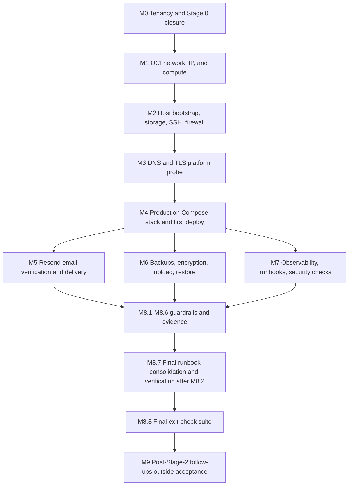

# Stage 2 — Prove a safe zero-cost deployment (detailed plan)

**Status:** Ready for human-guided execution  
**Updated:** 2026-05-19 (two-instance E2.1.Micro split; A1 unavailable)  
**Source:** [`ROADMAP.md`](../ROADMAP.md) §7 (Stage 2), §15–16; [`TECHNICAL_DESIGN.md`](../TECHNICAL_DESIGN.md) §§2–3, 9.1, 12, 15–17; [`stage-1-foundation-plan.md`](stage-1-foundation-plan.md)  
**Product concept:** [`IDEA.md`](../IDEA.md)  
**Scope note:** This plan intentionally does not predict dates. Work advances when each task's acceptance check passes. The human owner runs the commands; an agent guides, reviews evidence, and records results.

---

## 1. Purpose and outcome

Turn Stage 2 of the roadmap into an ordered, executable deployment plan. The outcome is a real deployment of the existing walking-skeleton stack to OCI Always Free at `https://myatlas.services`, with private service networking, HTTPS, encrypted backups, cost guardrails, and runbooks. This is an infrastructure/deployment plan, not a feature-code plan; Stage 3 features are not implemented here.

The plan is written for the human owner to execute task by task, top to bottom, with agent guidance. Each task states a deliverable and an acceptance check. Do not mark a task done until its acceptance check passes and is demonstrated with command output, a console observation, or a captured evidence note.

### Inputs used

- [`ROADMAP.md`](../ROADMAP.md) §7 (Stage 2), §15–16.
- [`TECHNICAL_DESIGN.md`](../TECHNICAL_DESIGN.md) §§2–3, 9.1, 12, 15–17.
- [`conventions.md`](../engineering/conventions.md), [`service-archetype.md`](../engineering/service-archetype.md).
- [`observability.md`](../operations/observability.md).
- [`infra/compose/production.yml`](../../infra/compose/production.yml) (pre-split template; M4.1 creates `production-instance1.yml` and `production-instance2.yml`), [`docker-compose.yml`](../../docker-compose.yml), [`infra/terraform/`](../../infra/terraform/).
- [`Makefile`](../../Makefile), [`CONTRIBUTING.md`](../../CONTRIBUTING.md), [`AGENTS.md`](../../AGENTS.md), [`.gitignore`](../../.gitignore), [`scripts/`](../../scripts/).
- Existing service baselines: `V1__baseline.sql` in each service, `infra/compose/postgres-init/001-create-databases-and-roles.sh`.

### Assumptions

- The tenancy is OCI Always Free, home region UK South (London), with three availability domains.
- The domain `myatlas.services` is owned at GoDaddy and GoDaddy DNS remains authoritative.
- The owner has an OCI account, SSH key pair, and access to the OCI Console and OCI Cloud Shell or a local OCI CLI.
- The owner can receive email at `<OWNER_EMAIL>` for Resend testing and operational notices.
- The Stage 1 stack still builds and the four services expose `/api/v1/<service>/ping` and internal Actuator health endpoints.
- Docker images for the four services, web, Caddy, and PostGIS are built for `linux/amd64` on the owner workstation (or CI later) and transferred to hosts; do **not** build JVM images on the 1 GB instances.
- No paid OCI resource is provisioned at any point. If a resource cannot be confirmed as Always Free, stop and resolve it before proceeding.

### Requirements

- Deploy only within OCI Always Free allocations in the home region; never upgrade to a paid shape or managed service.
- Expose only Caddy on instance 1 (TCP 80/443). PostgreSQL and the four Spring services are never publicly exposed; cross-host access is limited by security rules to required private paths.
- Serve the apex `myatlas.services` as canonical; redirect `www.myatlas.services` to the apex with HTTP `301`.
- Prove HTTPS, routing, health, request IDs, backups, restore, reboot recovery, and cost/capacity guardrails.
- Keep secrets out of Git and out of logs; use parameterized placeholders in committed files.
- Record the media deferral explicitly: uploads, processing, and the request-budget ledger are Stage 5 work.

---

## 2. Decisions locked

| Topic | Locked decision | Consequence for this plan |
| --- | --- | --- |
| Stage 2 outcome | Real deployment of the existing walking-skeleton stack to OCI Always Free at `https://myatlas.services`. | The plan ends at a live, verified deployment, not at a feature-complete product. |
| Execution model | Human owner runs the steps with agent guidance. Approach A: guided manual deployment first; Terraform codification is a follow-up and **not** part of Stage 2 execution. | Milestones use console/CLI instructions and acceptance evidence. M9 is outside Stage 2 acceptance. |
| Domain and DNS | `myatlas.services` bought at GoDaddy. Keep GoDaddy DNS. No Cloudflare proxy. | All DNS changes happen in GoDaddy; Caddy terminates TLS directly. |
| Hostname | Apex `myatlas.services` is canonical. `www.myatlas.services` redirects to the apex with HTTP `301`. | Caddy serves both names and returns `301` for `www`; canonical links use the apex. |
| Tenancy | OCI Always Free-only, home region UK South (London), three availability domains. No paid upgrade. | Provision only after verifying limits; retry across ADs on capacity failure where applicable. |
| Compute | **Two** `VM.Standard.E2.1.Micro` (AMD, 1 OCPU / 1 GB RAM each), Ubuntu 24.04. **Instance 1 (`myatlas-prod-01`)**: public entrypoint, reserved public IP `myatlas-public-ip` (`<RESERVED_PUBLIC_IP>`), attaches the single **50 GB** block volume `myatlas-data-01` mounted at `/srv/myatlas` (Postgres data + backup staging). **Instance 2 (`myatlas-prod-02`)**: backend/data workers host in the same public subnet with an ephemeral public IP for outbound access, uses boot volume only (47 GB). | Two hosts, split stack, no HA. Tight memory on both; 2 GB swap is a safety net, not extra capacity. Do not keep a stopped E2.Micro as a “spare” (wastes boot-volume quota). |
| Network | One VCN, one public subnet (`10.0.0.0/24`), one internet gateway, one route table, one security list. Both hosts are in the public subnet; instance 1 has the reserved IP, instance 2 has an ephemeral IP used only for outbound access and maintenance. NAT gateways are unavailable in this tenancy (limit 0). Inbound TCP 22 from owner IP and from instance 1 to instance 2; TCP 80/443 to instance 1 only; Postgres 5432 only from instance 2's private IP; backend ports 8082–8084 only from instance 1's private IP. No public access to 3000, 5432, 8081–8084. | Only Caddy on instance 1 serves public traffic; instance 2's public IP is locked down by the security list and UFW; cross-host rules are explicit and minimal. |
| Stack (split) | Docker Engine + Compose on both VMs. **Instance 1:** Caddy, web, account, PostGIS. **Instance 2:** atlas, media, social. Caddy on instance 1 reverse-proxies `/api/v1/atlas/*` → `http://<INSTANCE2_PRIVATE_IP>:8082`, `/api/v1/media/*` → `8083`, `/api/v1/social/*` → `8084`; `/api/v1/identity/*` → `account:8081` on the same host; `/` → `web:3000`. | Two Compose projects (or one repo deployed twice with different service subsets) must stay consistent. Internal service URLs in env use private IPs for cross-host calls. |
| Images | Build **amd64** images on the owner workstation (or CI later), transfer with `docker save` / `scp` / `docker load` to the host(s) that need them. Do not build JVM images on 1 GB hosts. | Avoid OOM and slow builds on Micro instances. |
| Caddy routing | Same logical routes as before, with atlas/media/social upstreams pointing to instance 2 private IPs. Unknown `/api/v1/*` → JSON 404; `/actuator/*` blocked publicly. | Document upstream IPs in runbook and in Compose/Caddy env/config. |
| Email | Resend Free (3,000/month, 100/day), GoDaddy DNS, sender `no-reply@myatlas.services`. OCI Email Delivery excluded (Always Free 0/day). | Stage 2 verifies Resend delivery from instance 1 (or a host that can reach internet); app adapter integration is Stage 3 work documented now. |
| Media | Deferred to Stage 5. Stage 2 does not implement uploads/processing/ledger/guard. **Decision:** run the `media` container on instance 2 for parity and health verification only, with no public upload flow. The private Object Storage bucket is for backups on instance 1 only. Full media features are Stage 5. | Media remains skeleton-level in Stage 2 except being deployed and healthy as part of the split. |
| Backups | Nightly `pg_dump` per DB from instance 1, encrypted with `age` (public key on instance 1, private key offline), uploaded to private `myatlas-backups` in `uk-london-1`. Prefer instance principal on instance 1; fallback is a dedicated least-privilege user key stored only on instance 1. Retention 7 daily + up to 4 weekly (28 days). Monthly restore rehearsal into a clean local Postgres/PostGIS container. | Backup scripts run on instance 1 only. |
| Resource ceilings (guidance) | Per host 1 GB RAM: strict `mem_limit` per container, small JVM `-Xmx` (112–176 MB) with a 96 MB metaspace cap, Postgres tuned down on instance 1 (`shared_buffers=96MB`, `max_connections=40`), and the 2 GB swap used only as a safety net. Exact values are recorded in Compose and the runbook. | Expect tight headroom; monitor with `docker stats`. |
| Observability | JSON logs to stdout, Docker `json-file` rotation, Caddy access logs, request IDs, internal-only health endpoints, documented commands. Optional free external uptime monitor pointing at `https://myatlas.services/`. | Same as before, applied per host. |
| Validation/acceptance | Same functional checks as before, executed against the public URL (instance 1) with instance 2 reachable privately. | Evidence recorded in `docs/operations/stage-2-verification.md`. |
| Runbooks | Extend runbook for two hosts: which host runs what, SSH to each, deploy/update per host, cross-host networking checks, backup only on instance 1. | `docs/operations/runbook.md` updated. |
| Secrets | No secrets in Git. Per-host env files under deployed Compose dirs, mode `600`. | Examples committed; real env files ignored. |
| Terraform | Not part of Stage 2 execution. | M9 follow-up. |

## 3. Sequencing approach (updated)

Same Approach A (manual first), but milestones now include **two hosts** and a **split Compose deployment**. M5/M6/M7 can partially overlap after the base stack is up on both hosts (M6 backups remain on instance 1).

---

### Why manual first

**Chosen: Approach A — guided manual deployment first, then codify.**

The owner first proves the topology by hand in the OCI Console/CLI and on both hosts. This produces working evidence, a precise resource inventory, and the exact commands that Terraform must subsequently reproduce. Codifying into Terraform before the manual deployment is proven would encode guesses about UK South capacity, image architecture, DNS/TLS behavior, and Always Free quotas.

Rejected alternatives:

- **Terraform-first:** faster repeatability in theory, but it hides quota/capacity failures behind a plan/apply cycle and makes the first deployment harder to debug for an owner learning OCI.
- **CI-first image registry:** useful afterwards, but it adds registry credentials and a build pipeline before the runtime topology is proven. The first deploy builds `linux/amd64` images on the owner workstation and transfers them with `docker save`/`scp`/`docker load`.

### Dependency graph



M5, M6, and M7 may run in parallel after M4 because they touch different resources. M8 requires M5–M7 evidence. M7.7 only verifies the runbook sections owned through M7; M8.7 performs the final consolidation and whole-runbook verification only after M8.2 has added the capacity and idle-reclamation sections. M8.8 runs the final exit-check suite last. M9 is deliberately last and does not gate Stage 2.

---

## 4. Artifacts and files map

| Path | Action | Responsibility |
| --- | --- | --- |
| `docs/planning/stage-2-deployment-plan.md` | Create (this file) | The executable Stage 2 plan. |
| `docs/operations/stage-2-verification.md` | Create | Evidence note: tenancy/quota baseline, commands run, outputs, exit-check mapping, media deferral. |
| `docs/adr/ADR-0005-stage-2-deployment-topology.md` | Create | Records the two-host split, Compose, Caddy, networking, image-build topology, pinned Caddy tag and image digests, and the `docker`-group root-equivalence consequence. |
| `docs/adr/ADR-0006-transactional-email-resend.md` | Create | Records Resend Free, GoDaddy DNS verification, SPF/DKIM/DMARC, and why OCI Email Delivery is excluded. |
| `docs/adr/ADR-0007-backup-encryption-and-retention.md` | Create | Records `age` encryption, offline private key, instance-principal preference, Identity Domains dynamic-group risk, fallback API key/config ownership, and retention. |
| `infra/compose/production-instance1.yml`, `infra/compose/production-instance2.yml` | Create | Split from `production.yml`: instance 1 adds `caddy`, resource limits, logging rotation, volumes, JVM/Hikari/Postgres settings, and removes the public web port; instance 2 runs `atlas`, `media`, `social` and points `POSTGRES_HOST` at instance 1. |
| `infra/compose/Caddyfile` | Create | Caddy site blocks, TLS, routing, redirects, JSON 404, Actuator block, security headers, access logs. |
| `scripts/deploy/bootstrap-host.sh` | Create | Idempotent Ubuntu 24.04 amd64 host bootstrap: packages, Docker, OCI CLI, `age`, directories. Host-aware: instance 1 requires the `/srv/myatlas` mount; instance 2 does not. |
| `scripts/backup/backup-databases.sh` | Create | Dumps each database, encrypts with `age`, uploads to `myatlas-backups`, prunes local staging. |
| `scripts/backup/restore-database.sh` | Create | Restores an encrypted dump into a clean local Postgres/PostGIS container. |
| `scripts/backup/verify-backup.sh` | Create | Verifies the latest object exists, is non-empty, and has an `age` header. |
| `scripts/ops/smoke-test.sh` | Create | Checks HTTPS, HTTP→HTTPS 308, `www`→apex 301, pings, request IDs, unknown API 404, Actuator block, web root. |
| `scripts/ops/check-public-ports.sh` | Create | Checks public exposure of 22, 80, 443, 3000, 5432, 8080, and 8081–8084 from outside the hosts. |
| `scripts/ops/check-limits.sh` | Create | Inventories compute, block volumes, boot volumes, public IPs, and bucket usage against Always Free caps. |
| `scripts/ops/send-test-email.sh` | Create | Sends one Resend test email through the HTTPS API and checks the response. |
| `infra/systemd/myatlas-backup.service` | Create | Oneshot systemd unit that runs the backup script as `deploy`. |
| `infra/systemd/myatlas-backup.timer` | Create | Daily 02:30 UTC timer with persistence and a randomized delay. |
| `docs/operations/runbook.md` | Create | First deploy, update deploy, restart, rollback, restore, disk/quota pressure, email outage, TLS failure, capacity failure, idle reclamation. |
| `docs/ROADMAP.md` | Modify | Records that the Stage 2 media storage/request-budget exit check is deferred to Stage 5. |
| `docs/operations/observability.md` | Modify | Adds production log/health/inventory commands and confirms Actuator is internal-only. |
| `CONTRIBUTING.md` | Modify only if absent | Add a one-line pointer to `docs/operations/runbook.md` in the verification section. No other changes. |
| `AGENTS.md` | Modify only if absent | Add a one-line note that production deployment is human-guided via the runbook. No other changes. |
| `infra/terraform/` | Follow-up (M9) | Codifies the proven topology after Stage 2; not part of Stage 2 acceptance. |
| `.github/workflows/` | Follow-up (M9) | Publishes amd64 images to GHCR/OCIR after Stage 2; not part of Stage 2 acceptance. |

---

## 5. Milestones and tasks

Each task lists a **Deliverable** and an **Acceptance** check. Where useful, it lists exact commands and the expected result. Do not mark a task done until the acceptance check passes and the evidence is recorded.

### M0 — Stage 0 closure and tenancy verification gate

- **M0.1 — Verify tenancy type, home region, and availability domains.**
  - **Deliverable:** A "Tenancy baseline" section in `docs/operations/stage-2-verification.md` recording tenancy OCID, tenancy type (Always Free; `oci iam tenancy get` does not expose a free-tier flag, so the M0.2 Limits/Usage baseline confirms it), home region, and the three availability-domain names.
  - **Commands:**
    ```sh
    oci iam tenancy get --tenancy-id <TENANCY_OCID>
    oci iam region-subscription list --tenancy-id <TENANCY_OCID>
    oci iam availability-domain list --compartment-id <TENANCY_OCID>
    ```
  - **Expected:** Tenancy output shows the tenancy OCID, name, and home-region key `LHR`; the CLI does not expose an Always Free flag, so M0.2 confirms the tenancy type. Region subscription shows home region `uk-london-1` (UK South) with `is-home-region: true`; availability-domain output lists three ADs.
  - **Acceptance:** The verification note contains the tenancy OCID, tenancy type, home region, and exact AD names used in subsequent milestones. No resource is created in M0.
- **M0.2 — Capture the Always Free quota baseline.**
  - **Deliverable:** A "Quota baseline" table in the verification note with the values observed in OCI Console → Governance & Administration → Tenancy Management → Limits, Quotas and Usage.
  - **Expected values:** Two `VM.Standard.E2.1.Micro` instances (1 OCPU / 1 GB each) fit the AMD E2 Always Free allowance; record the exact tenancy values on the Limits page. Block storage 200 GB cap (expected about 144 GB: two ~47 GB boot volumes + one 50 GB block volume); Object Storage 20 GB combined and 50,000 requests/month; outbound 10 TB/month; email 0/day for OCI Email Delivery under Always Free.
  - **Acceptance:** The table records each value. The note says to use OCI Billing & Cost Management and the Limits/Usage page as the authoritative checks; Cost Analysis availability may vary by tenancy.
- **M0.3 — Confirm GoDaddy DNS control.**
  - **Deliverable:** A "DNS baseline" section recording the current apex A, `www` A/CNAME, NS, MX, and TXT records, plus the default TTL.
  - **Commands:**
    ```sh
    dig +short NS myatlas.services
    dig +short A myatlas.services @1.1.1.1
    dig +short A www.myatlas.services @1.1.1.1
    dig +short MX myatlas.services @1.1.1.1
    dig +short TXT myatlas.services @1.1.1.1
    ```
  - **Acceptance:** The owner can create A, TXT, MX, and CNAME records in GoDaddy; the current values and TTL are recorded so they can be restored if needed.
- **M0.4 — Re-check the Stage 1 gate.**
  - **Deliverable:** A "Stage 1 gate" entry in the verification note with the result of the local build and test commands.
  - **Commands:**
    ```sh
    make test
    make build
    docker buildx ls
    ```
  - **Expected:** `make test` and `make build` pass; `docker buildx ls` shows a builder. The `linux/amd64` images are built on the owner workstation and transferred to the hosts in M4.4.
  - **Acceptance:** The note records pass/fail and any environment limitation (for example, Docker unavailable). If a check fails, fix it before M1; do not deploy a broken stack.
- **M0.5 — Record the deployment topology ADR.**
  - **Deliverable:** `docs/adr/ADR-0005-stage-2-deployment-topology.md` with context, decision, consequences, and status `Accepted`.
  - **Content:** Two Always Free E2.1.Micro hosts (public entrypoint and private backend), one VCN with one public subnet and an internet gateway, a reserved public IP on instance 1 and an ephemeral public IP on instance 2, split Docker Compose projects, Caddy as the only public listener, private cross-host service network, workstation-built `linux/amd64` images transferred with `docker save`/`scp`/`docker load`, the media deferral, the pinned Caddy `caddy:2.10.2-alpine` tag, and the fact that `deploy` in the `docker` group is root-equivalent and that the `deploy` SSH key is therefore highly privileged. The `linux/amd64` Caddy and PostGIS image digests are added in M4.1 when captured, using the exact `docker buildx imagetools inspect` commands as the recording step.
  - **Acceptance:** The ADR matches the decisions table, states both hosts' failure modes explicitly, records the Caddy tag, and documents the Docker-group root-equivalence and highly privileged SSH key consequences. The digest entries are present and complete after M4.1.
- **M0.6 — Discover the owner workstation IP before provisioning.**
  - **Deliverable:** The owner workstation's public IPv4 address recorded in the verification note as `<OWNER_IP>`.
  - **Command (on the owner workstation, not on a host and not in OCI Cloud Shell, which report their own egress IPs):**
    ```sh
    curl -4 ifconfig.me
    ```
  - **Acceptance:** The output is recorded as `<OWNER_IP>`, it is the address the owner uses for SSH, and M1.1 uses it in the TCP 22 ingress rule. `<OWNER_IP>` is not first discovered in M2.3, M7.7, or any later task; M2.3 only re-confirms it before enabling UFW.

### M1 — OCI network, reserved IP, and compute provisioning

- **M1.1 — Create the compartment, VCN, public subnet, internet gateway, route table, and security list.**
  - **Deliverable:** A dedicated compartment `myatlas-prod`, VCN `myatlas-vcn` (`10.0.0.0/16`), public subnet `myatlas-public-subnet` (`10.0.0.0/24`), internet gateway `myatlas-igw`, public route table `myatlas-public-rt`, and security list `myatlas-public-sl`. NAT gateways are unavailable in this tenancy (Always Free limit 0), so both hosts use the public subnet. Instance 2 keeps an ephemeral public IP for outbound access; inbound access is restricted by the security list and the host firewall.
  - **Commands (run in OCI Cloud Shell or with a configured OCI CLI):**
    ```sh
    oci iam compartment create \
      --compartment-id <TENANCY_OCID> \
      --name myatlas-prod \
      --description "My Atlas production"

    oci network vcn create \
      --compartment-id <COMPARTMENT_OCID> \
      --cidr-block 10.0.0.0/16 \
      --display-name myatlas-vcn \
      --dns-label myatlas

    oci network internet-gateway create \
      --compartment-id <COMPARTMENT_OCID> \
      --vcn-id <VCN_OCID> \
      --is-enabled true \
      --display-name myatlas-igw

    oci network route-table create \
      --compartment-id <COMPARTMENT_OCID> \
      --vcn-id <VCN_OCID> \
      --display-name myatlas-public-rt \
      --route-rules '[{"destination":"0.0.0.0/0","destinationType":"CIDR_BLOCK","networkEntityId":"<IGW_OCID>"}]'

    oci network security-list create \
      --compartment-id <COMPARTMENT_OCID> \
      --vcn-id <VCN_OCID> \
      --display-name myatlas-public-sl \
      --egress-security-rules '[{"destination":"0.0.0.0/0","protocol":"all"}]' \
      --ingress-security-rules '[
        {"source":"<OWNER_IP>/32","protocol":"6","tcpOptions":{"destinationPortRange":{"min":22,"max":22}}},
        {"source":"0.0.0.0/0","protocol":"6","tcpOptions":{"destinationPortRange":{"min":80,"max":80}}},
        {"source":"0.0.0.0/0","protocol":"6","tcpOptions":{"destinationPortRange":{"min":443,"max":443}}},
        {"source":"<INST2_PRIVATE_IP>/32","protocol":"6","tcpOptions":{"destinationPortRange":{"min":5432,"max":5432}}},
        {"source":"<INST1_PRIVATE_IP>/32","protocol":"6","tcpOptions":{"destinationPortRange":{"min":22,"max":22}}},
        {"source":"<INST1_PRIVATE_IP>/32","protocol":"6","tcpOptions":{"destinationPortRange":{"min":8082,"max":8084}}}
      ]'

    oci network subnet create \
      --compartment-id <COMPARTMENT_OCID> \
      --vcn-id <VCN_OCID> \
      --cidr-block 10.0.0.0/24 \
      --display-name myatlas-public-subnet \
      --dns-label public \
      --route-table-id <ROUTE_TABLE_OCID> \
      --security-list-ids '["<SECURITY_LIST_OCID>"]'
    ```
  - **Expected:** `myatlas-public-sl` has six ingress rules: TCP 22 from `<OWNER_IP>/32`, TCP 80 and 443 from `0.0.0.0/0`, TCP 5432 from `<INST2_PRIVATE_IP>/32`, and TCP 22 and 8082–8084 from `<INST1_PRIVATE_IP>/32`. The internal rules let instance 2 reach Postgres and let Caddy on instance 1 reach the backend, without exposing those ports to the internet. No public rule for 3000, 8080, or 8081. UDP 443 is intentionally not opened because Stage 2 does not use HTTP/3. `<OWNER_IP>` is the owner workstation's `curl -4 ifconfig.me` result, not a host or OCI Cloud Shell egress IP (discovered before M1.1 and re-confirmed in M2.3).
  - **Acceptance:** The subnet is public, the route table sends `0.0.0.0/0` to the internet gateway, and the security list exposes only 22/80/443 publicly; 5432 and 8082–8084 are restricted to the two host private IPs.
- **M1.2 — Reserve the public IP.**
  - **Deliverable:** A reserved public IP named `myatlas-public-ip` in `myatlas-prod`.
  - **Command:**
    ```sh
    oci network public-ip create \
      --compartment-id <COMPARTMENT_OCID> \
      --display-name myatlas-public-ip \
      --lifetime RESERVED
    ```
  - **Expected:** The response contains `"lifetime": "RESERVED"`, `"lifecycle-state": "AVAILABLE"`, and an `ip-address`.
  - **Acceptance:** The reserved IP address is recorded in the verification note as `<RESERVED_PUBLIC_IP>` (a public value, not a secret).
- **M1.3 — Provision both E2.1.Micro instances.**
  - **Deliverable:** Two `VM.Standard.E2.1.Micro` instances (AMD64/x86_64, 1 OCPU / 1 GB each, Ubuntu 24.04): `myatlas-prod-01` (public entrypoint) and `myatlas-prod-02` (backend, ephemeral public IP for outbound access), both in `myatlas-public-subnet`, with image-default boot volumes (about 47 GB each).
  - **Preflight — find the Ubuntu 24.04 AMD64 image:**
    ```sh
    oci compute image list \
      --compartment-id <TENANCY_OCID> \
      --operating-system "Canonical Ubuntu" \
      --operating-system-version "24.04" \
      --shape VM.Standard.E2.1.Micro \
      --query 'data[0].id' \
      --output table
    ```
    If the CLI filter returns no rows or an unsupported-argument error, copy the image OCID from the OCI Console: Compute → Images → Canonical Ubuntu 24.04, AMD64.
  - **Launch (try each AD until each instance succeeds; record the AD used for each):**
    ```sh
    oci compute instance launch \
      --compartment-id <COMPARTMENT_OCID> \
      --availability-domain <AD_NAME> \
      --shape VM.Standard.E2.1.Micro \
      --image-id <UBUNTU_24_04_AMD64_IMAGE_OCID> \
      --display-name myatlas-prod-01 \
      --subnet-id <PUBLIC_SUBNET_OCID> \
      --assign-public-ip true \
      --ssh-authorized-keys-file <SSH_PUBLIC_KEY_PATH>

    oci compute instance launch \
      --compartment-id <COMPARTMENT_OCID> \
      --availability-domain <AD_NAME_2> \
      --shape VM.Standard.E2.1.Micro \
      --image-id <UBUNTU_24_04_AMD64_IMAGE_OCID> \
      --display-name myatlas-prod-02 \
      --subnet-id <SUBNET_OCID> \
      --assign-public-ip true \
      --ssh-authorized-keys-file <SSH_PUBLIC_KEY_PATH>
    ```
    Omit `--boot-volume-size-in-gbs` to use the image-default boot volume (about 47 GB). Instance 2 gets an ephemeral (non-reserved) public IP, which may change on reboot; administer it via that IP or via ProxyJump through instance 1, with inbound traffic restricted by the security list and UFW.
  - **Expected:** Both instances reach `RUNNING`; `ssh -i <SSH_PRIVATE_KEY_PATH> ubuntu@<EPHEMERAL_PUBLIC_IP>` works for instance 1; `uname -m` returns `x86_64`; `nproc` returns `1`; `free -m` shows about 1 GB; `lsblk` shows a boot disk of about 47 GB. Instance 2 has a private IP plus an ephemeral public IP, and `curl -fsS https://download.docker.com/linux/ubuntu/gpg -o /dev/null` succeeds from both hosts.
  - **Capacity note:** The A1 shape was unavailable in this tenancy; do not retry a single A1 host unless this plan is explicitly superseded by a new ADR/plan update. If an E2.1.Micro launch fails in one AD, try the other two ADs and record the failures. Never upgrade to a paid shape.
  - **Acceptance:** Both instances are running on AMD64 (`x86_64`) with 1 OCPU / 1 GB each; the AD used by each instance is recorded; instance 2 has an ephemeral public IP for outbound access and no reserved IP.
- **M1.4 — Move the reserved public IP onto instance 1.**
  - **Deliverable:** The reserved public IP is attached to instance 1's primary VNIC; its temporary ephemeral public IP is released. Instance 2 keeps its own ephemeral public IP for outbound access.
  - **Commands:**
    ```sh
    oci compute instance list-vnics --instance-id <INSTANCE1_OCID>
    oci network private-ip list --vnic-id <VNIC_OCID> --subnet-id <PUBLIC_SUBNET_OCID>
    oci network public-ip update \
      --public-ip-id <RESERVED_PUBLIC_IP_OCID> \
      --private-ip-id <PRIVATE_IP_OCID>
    ```
  - **Release the ephemeral IP** after confirming the reserved IP works:
    ```sh
    oci network public-ip list \
      --compartment-id <COMPARTMENT_OCID> \
      --scope REGION \
      --query 'data[?lifetime==`EPHEMERAL`].{id:id,ip:"ip-address"}'
    oci network public-ip delete --public-ip-id <EPHEMERAL_PUBLIC_IP_OCID>
    ```
  - **If OCI rejects the reserved-IP update because the private IP already has an ephemeral public IP:** delete the ephemeral public IP first from OCI Cloud Shell, then rerun the reserved-IP update. Keep a Cloud Shell session open so SSH access is not lost during the swap.
  - **Expected:** `ssh -i <SSH_PRIVATE_KEY_PATH> ubuntu@<RESERVED_PUBLIC_IP>` works against instance 1; instance 1 has only the reserved IP. Instance 2 keeps its ephemeral IP.
  - **Acceptance:** The reserved IP is attached to instance 1 and its own ephemeral IP is gone; instance 2 retains its ephemeral IP for outbound access.
- **M1.5 — Attach, format, and mount the 50 GB block volume (instance 1 only).**
  - **Deliverable:** A 50 GB block volume `myatlas-data-01` in the same AD as instance 1, attached to `myatlas-prod-01`, formatted `ext4`, mounted at `/srv/myatlas`, and persisted in `/etc/fstab` with an idempotent append. Instance 2 has no extra block volume and uses its boot volume only. The `nofail` option is paired with the Docker systemd drop-in added in M2.4 so Docker cannot start without the mount on instance 1.
  - **Commands:**
    ```sh
    oci bv volume create \
      --compartment-id <COMPARTMENT_OCID> \
      --availability-domain <AD_NAME_INST1> \
      --display-name myatlas-data-01 \
      --size-in-gbs 50

    oci compute volume-attachment attach \
      --instance-id <INSTANCE1_OCID> \
      --volume-id <VOLUME_OCID> \
      --type paravirtualized \
      --device /dev/oracleoci/oraclevdb
    ```
  - **On instance 1:**
    ```sh
    lsblk -o NAME,SIZE,TYPE,MOUNTPOINT
    # Confirm /dev/oracleoci/oraclevdb (or the attached device) is the 50 GB volume, not the boot disk.
    sudo mkfs.ext4 /dev/oracleoci/oraclevdb
    sudo mkdir -p /srv/myatlas
    sudo blkid -s UUID -o value /dev/oracleoci/oraclevdb
    grep -q ' /srv/myatlas ' /etc/fstab || echo 'UUID=<VOLUME_UUID> /srv/myatlas ext4 defaults,nofail 0 2' | sudo tee -a /etc/fstab
    sudo mount -a
    df -h /srv/myatlas
    findmnt /srv/myatlas
    ```
  - **Expected:** `df -h /srv/myatlas` shows about 47–49 GB available; `findmnt /srv/myatlas` shows the ext4 mount; a reboot keeps the mount. The `grep -q` guard makes the fstab append idempotent.
  - **Acceptance:** The block volume survives a reboot and is mounted at `/srv/myatlas` on instance 1; `findmnt /srv/myatlas` is run again after boot in M8.6. Instance 2 is documented as boot-volume-only. `nofail` is retained only because M2.4 adds a systemd dependency on the mount; otherwise remove `nofail` after verification.
- **M1.6 — Establish the resource inventory and cleanup discipline.**
  - **Deliverable:** An "OCI inventory" section in the verification note with commands to list instances, boot volumes, block volumes, and public IPs, plus the cleanup rule.
  - **Commands:**
    ```sh
    oci compute instance list --compartment-id <COMPARTMENT_OCID>
    oci bv boot-volume list --compartment-id <COMPARTMENT_OCID> --availability-domain <AD_NAME>
    oci bv volume list --compartment-id <COMPARTMENT_OCID>
    oci network public-ip list --compartment-id <COMPARTMENT_OCID> --scope REGION
    ```
  - **Acceptance:** The note states that terminating an instance preserves its boot volume by default, and that preserved boot volumes and unattached reserved public IPs still count against Always Free quotas. After M1 the inventory shows exactly two running E2.1.Micro instances, two boot volumes, one attached 50 GB block volume, and one attached reserved public IP; no orphaned boot volume or unattached reserved IP remains.

### M2 — Host bootstrap, storage, and SSH/firewall hardening (both hosts unless noted)

Apply M2.1–M2.5 on **instance 1 (`myatlas-prod-01`)** and **instance 2 (`myatlas-prod-02`)**. Instance 1 is the public edge and owns the 50 GB block volume; instance 2 is the backend with an ephemeral public IP and uses its boot volume only.

- **M2.1 — Run the host bootstrap script.**
  - **Deliverable:** `scripts/deploy/bootstrap-host.sh` is idempotent and installs `ca-certificates`, `curl`, `gnupg`, `git`, `jq`, `age`, `ufw`, `shellcheck`, `python3-pip`, `pipx`, Docker Engine, the Compose plugin, the buildx plugin from Docker's Ubuntu **amd64** repository, and the OCI CLI. It creates `/srv/myatlas/{app,docker,backups}` but does not `chown` to `deploy` (that user is created in M2.2).
  - **Host difference:** `--require-mount` makes the script refuse to run unless `/srv/myatlas` is a mount point. Use it on instance 1. On instance 2, omit the flag: there is no block volume, so the tree is created on the boot volume. Record the deviation in the verification note.
  - **Commands (instance 1 then instance 2):**
    ```sh
    chmod +x scripts/deploy/bootstrap-host.sh
    sudo ./scripts/deploy/bootstrap-host.sh --require-mount   # instance 1
    sudo ./scripts/deploy/bootstrap-host.sh                  # instance 2
    sudo ./scripts/deploy/bootstrap-host.sh --require-mount   # rerun: idempotency proof
    ```
  - **Expected:** The second run completes without error. `docker --version`, `docker compose version`, `age --version`, `oci --version`, `jq --version`, and `shellcheck --version` all succeed. `uname -m` is `x86_64` on both hosts.
  - **Acceptance:** The script runs twice cleanly on instance 1 and once on instance 2; all six tools report versions on each host; the mount guard is enforced on instance 1 and documented as skipped on instance 2.
- **M2.2 — Create the deploy user and harden SSH without losing the current session.**
  - **Deliverable:** A non-root `deploy` user in the `sudo` and `docker` groups with passwordless sudo via `/etc/sudoers.d/99-myatlas-deploy`, the owner's public key in `~deploy/.ssh/authorized_keys`, and `/etc/ssh/sshd_config.d/99-myatlas.conf` with `PasswordAuthentication no`, `KbdInteractiveAuthentication no`, `PermitRootLogin no`, `PubkeyAuthentication yes`, and `AllowUsers deploy ubuntu`. Replace `AllowUsers deploy ubuntu` with `AllowUsers deploy` only after a second-terminal login works.
  - **Commands:** Copy the public key to the host (`scp` from the workstation, or use `/home/ubuntu/.ssh/authorized_keys`), then on each host:
    ```sh
    id deploy >/dev/null 2>&1 || sudo useradd --create-home --shell /bin/bash --groups sudo deploy
    sudo usermod -aG sudo deploy
    sudo usermod -aG docker deploy
    printf '%s\n' 'deploy ALL=(ALL) NOPASSWD:ALL' | sudo tee /etc/sudoers.d/99-myatlas-deploy >/dev/null
    sudo chmod 0440 /etc/sudoers.d/99-myatlas-deploy
    sudo visudo -cf /etc/sudoers.d/99-myatlas-deploy
    sudo chown -R deploy:deploy /srv/myatlas
    sudo install -d -m 700 -o deploy -g deploy /home/deploy/.ssh
    sudo install -m 600 -o deploy -g deploy /tmp/<key>.pub /home/deploy/.ssh/authorized_keys
    sudo tee /etc/ssh/sshd_config.d/99-myatlas.conf >/dev/null <<'EOF'
    PasswordAuthentication no
    KbdInteractiveAuthentication no
    PermitRootLogin no
    PubkeyAuthentication yes
    AllowUsers deploy ubuntu
    EOF
    sudo sshd -t && sudo systemctl restart ssh
    ```
  - **Lockout safety:** Keep the original `ubuntu` session open. Prove `ssh -i <SSH_PRIVATE_KEY_PATH> deploy@<RESERVED_PUBLIC_IP>` from a second terminal, then remove `ubuntu` from `AllowUsers` and restart SSH again. On instance 2, connect via its ephemeral public IP from the owner IP or via ProxyJump through instance 1; the security list and UFW block all other inbound traffic.
  - **Expected:** `sudo -l -U deploy` shows passwordless sudo access; `id -nG deploy` includes `sudo` and `docker`; root/password login is refused; `sudo -iu deploy docker ps` works.
  - **Acceptance:** Key-only `deploy` login works from a second terminal on both hosts; the admin path for instance 2 is documented; the docker-group root-equivalence and highly privileged key are recorded in ADR-0005 and the runbook.
- **M2.3 — Enable the host firewall and Docker port guard without locking yourself out.**
  - **Deliverable:** UFW default deny incoming on both hosts with a host-specific allow list, plus an idempotent systemd oneshot that persists `DOCKER-USER` rules after Docker starts. Do **not** install `netfilter-persistent`: it conflicts with UFW on Ubuntu 24.04, and apt removes UFW when installing it. Docker publishes ports through `DOCKER-USER`, so UFW alone is not enough.
  - **Instance 1 allow list:** TCP 22 from `<OWNER_IP>`; TCP 80/443 from anywhere; TCP 5432 from `<INST2_PRIVATE_IP>` only.
  - **Commands (instance 1):**
    ```sh
    sudo ufw default deny incoming
    sudo ufw default allow outgoing
    sudo ufw allow from <OWNER_IP> to any port 22 proto tcp
    sudo ufw allow 80/tcp
    sudo ufw allow 443/tcp
    sudo ufw allow from <INST2_PRIVATE_IP> to any port 5432 proto tcp
    sudo ufw --force enable
    sudo tee /usr/local/sbin/myatlas-docker-firewall.sh >/dev/null <<'EOF'
    #!/usr/bin/env bash
    set -Eeuo pipefail
    iptables -n -L DOCKER-USER >/dev/null 2>&1 || exit 0
    iptables -F DOCKER-USER
    iptables -A DOCKER-USER -p tcp -s <INST2_PRIVATE_IP> --dport 5432 -j ACCEPT
    iptables -A DOCKER-USER -p tcp --dport 5432 -j DROP
    iptables -A DOCKER-USER -p tcp --dport 3000 -j DROP
    iptables -A DOCKER-USER -p tcp --dport 8080 -j DROP
    iptables -A DOCKER-USER -p tcp -d <INST2_PRIVATE_IP> --dport 8082:8084 -j ACCEPT
    iptables -A DOCKER-USER -p tcp --dport 8081:8084 -j DROP
    iptables -A DOCKER-USER -j RETURN
    EOF
    sudo chmod 0755 /usr/local/sbin/myatlas-docker-firewall.sh
    sudo tee /etc/systemd/system/myatlas-docker-firewall.service >/dev/null <<'EOF'
    [Unit]
    Description=MyAtlas Docker port guard
    After=docker.service ufw.service
    Requires=docker.service

    [Service]
    Type=oneshot
    RemainAfterExit=yes
    ExecStart=/usr/local/sbin/myatlas-docker-firewall.sh

    [Install]
    WantedBy=multi-user.target
    EOF
    sudo systemctl daemon-reload
    sudo systemctl enable --now myatlas-docker-firewall
    sudo ufw status verbose
    sudo iptables -S DOCKER-USER
    ```
  - **Instance 2 allow list:** TCP 22 from `<OWNER_IP>` and `<INST1_PRIVATE_IP>`; TCP 8082–8084 from `<INST1_PRIVATE_IP>` only; no 80/443.
  - **Commands (instance 2):**
    ```sh
    sudo ufw default deny incoming
    sudo ufw default allow outgoing
    sudo ufw allow from <OWNER_IP> to any port 22 proto tcp
    sudo ufw allow from <INST1_PRIVATE_IP> to any port 22 proto tcp
    sudo ufw allow from <INST1_PRIVATE_IP> to any port 8082:8084 proto tcp
    sudo ufw --force enable
    sudo tee /usr/local/sbin/myatlas-docker-firewall.sh >/dev/null <<'EOF'
    #!/usr/bin/env bash
    set -Eeuo pipefail
    iptables -n -L DOCKER-USER >/dev/null 2>&1 || exit 0
    iptables -F DOCKER-USER
    iptables -A DOCKER-USER -p tcp -s <INST1_PRIVATE_IP> --dport 8082:8084 -j ACCEPT
    iptables -A DOCKER-USER -p tcp -d <INST1_PRIVATE_IP> --dport 5432 -j ACCEPT
    iptables -A DOCKER-USER -p tcp --dport 5432 -j DROP
    iptables -A DOCKER-USER -p tcp --dport 3000 -j DROP
    iptables -A DOCKER-USER -p tcp --dport 8080 -j DROP
    iptables -A DOCKER-USER -p tcp --dport 8081:8084 -j DROP
    iptables -A DOCKER-USER -j RETURN
    EOF
    sudo chmod 0755 /usr/local/sbin/myatlas-docker-firewall.sh
    sudo tee /etc/systemd/system/myatlas-docker-firewall.service >/dev/null <<'EOF'
    [Unit]
    Description=MyAtlas Docker port guard
    After=docker.service ufw.service
    Requires=docker.service

    [Service]
    Type=oneshot
    RemainAfterExit=yes
    ExecStart=/usr/local/sbin/myatlas-docker-firewall.sh

    [Install]
    WantedBy=multi-user.target
    EOF
    sudo systemctl daemon-reload
    sudo systemctl enable --now myatlas-docker-firewall
    sudo ufw status verbose
    sudo iptables -S DOCKER-USER
    ```
  - **Ordering note:** The script flushes `DOCKER-USER` and appends rules in order, so both the source-scoped inbound `ACCEPT` and the destination-scoped outbound `ACCEPT` sit above the port-range `DROP` lines. The outbound rules matter because `DOCKER-USER` also sees container traffic leaving the host: instance 1 needs to reach `<INST2_PRIVATE_IP>:8082-8084`, and instance 2 needs to reach `<INST1_PRIVATE_IP>:5432`. Without them, Caddy returns `502` and Flyway logs `Connect timed out`. The script is idempotent and reruns after Docker starts at boot. Replace `<INST1_PRIVATE_IP>`/`<INST2_PRIVATE_IP>` with the actual private IPs before running.
  - **Lockout safety:** Keep the OCI Cloud Shell and original SSH session open; verify from a second terminal before closing. If SSH is blocked, restore TCP 22 for the workstation-discovered owner IP using the runbook recovery path.
  - **Acceptance:** `ufw status verbose` shows default deny incoming and the host-specific allow list; `myatlas-docker-firewall.service` is active; `iptables -S DOCKER-USER` shows both cross-host `ACCEPT` rules above the drops, and 3000/8080/8081–8084 are dropped from other sources on both hosts; second-terminal SSH works before the original session closes.
- **M2.4 — Move Docker data and logs to the intended location.**
  - **Deliverable (instance 1):** `/etc/docker/daemon.json` with `"data-root": "/srv/myatlas/docker"`, `"log-driver": "json-file"`, and 10m/3 rotation, plus `/etc/systemd/system/docker.service.d/10-myatlas-mount.conf` with `RequiresMountsFor=/srv/myatlas` and `After=srv-myatlas.mount`.
  - **Commands (instance 1):**
    ```sh
    sudo tee /etc/docker/daemon.json >/dev/null <<'EOF'
    {
      "data-root": "/srv/myatlas/docker",
      "log-driver": "json-file",
      "log-opts": { "max-size": "10m", "max-file": "3" }
    }
    EOF
    sudo install -d /etc/systemd/system/docker.service.d
    sudo tee /etc/systemd/system/docker.service.d/10-myatlas-mount.conf >/dev/null <<'EOF'
    [Unit]
    RequiresMountsFor=/srv/myatlas
    After=srv-myatlas.mount
    EOF
    sudo systemctl daemon-reload
    sudo systemctl restart docker
    docker info --format '{{.DockerRootDir}}'
    ```
  - **Instance 2:** set `data-root` to `/srv/myatlas/docker` on the boot volume **or** leave Docker's default `/var/lib/docker`. Record the choice in the runbook; do not add the mount drop-in there.
  - **Acceptance:** Instance 1's Docker root is `/srv/myatlas/docker`, logging is `json-file` with 10m/3, and `systemctl show docker --property=RequiresMountsFor` shows `/srv/myatlas`. Instance 2's layout is recorded.
- **M2.5 — Set UTC time sync and a bounded swap file on both hosts.**
  - **Deliverable:** UTC timezone, `systemd-timesyncd` enabled, and a 2 GB `/swapfile` persisted in `/etc/fstab` with a `grep -q` guard.
  - **Commands:**
    ```sh
    sudo timedatectl set-timezone UTC
    sudo systemctl enable --now systemd-timesyncd
    sudo fallocate -l 2G /swapfile
    sudo chmod 600 /swapfile
    sudo mkswap /swapfile
    sudo swapon /swapfile
    grep -q '^/swapfile ' /etc/fstab || echo '/swapfile none swap sw 0 0' | sudo tee -a /etc/fstab
    timedatectl
    swapon --show
    ```
  - **Expected:** `timedatectl` shows `Time zone: UTC` and `System clock synchronized: yes`; `swapon --show` lists `/swapfile` at 2G.
  - **Acceptance:** UTC, time sync, and 2 GB swap are active and persistent on both hosts.

Acceptance (M2 overall): both hosts have Docker/Compose/age/jq/oci-cli/shellcheck, a hardened `deploy` user, host firewalls matching the M1.6 matrix, the chosen Docker data layout, and UTC + 2 GB swap.

### M3 — DNS and TLS platform probe (instance 1)

- **M3.1 — Create the GoDaddy DNS records.**
  - **Deliverable:** Apex `A` `@` → `<RESERVED_PUBLIC_IP>` (points to **instance 1**), `www` `A` → same IP, TTL 600. Remove conflicting parked records for `@` and `www`.
  - **Acceptance:**
    ```sh
    dig +short A myatlas.services @1.1.1.1
    dig +short A www.myatlas.services @1.1.1.1
    ```
    Both return `<RESERVED_PUBLIC_IP>`.
- **M3.2 — Probe TLS with a temporary Caddy container on instance 1 (staging only).**
  - **Pinned image:** `caddy:2.10.2-alpine` (same as M4). Record in ADR-0005.
  - **Deliverable:** `/srv/myatlas/probe` on **instance 1** with staging `Caddyfile`. Do not issue production certs from repeated probes.
  - **Probe `Caddyfile` (example):**
    ```caddyfile
    {
      email {$ACME_EMAIL}
      acme_ca https://acme-staging-v02.api.letsencrypt.org/directory
    }
    myatlas.services { respond "myatlas stage 2 tls probe" 200 }
    www.myatlas.services { redir https://myatlas.services{uri} 301 }
    ```
  - **Run on instance 1:**
    ```sh
    sudo mkdir -p /srv/myatlas/probe
    # write Caddyfile, then:
    sudo docker run -d --name caddy-probe -p 80:80 -p 443:443 -e ACME_EMAIL=<OWNER_EMAIL> -v /srv/myatlas/probe/Caddyfile:/etc/caddy/Caddyfile:ro -v caddy-probe-data:/data caddy:2.10.2-alpine
    ```
  - **Expected:** `curl -kI https://myatlas.services` returns 200 (staging); `curl -I http://myatlas.services` returns 308 to HTTPS; `www` returns 301 to apex; `openssl s_client ...` shows a Let's Encrypt staging issuer. HTTP 308 vs 301 in probes is acceptable if behavior is documented; final production Caddyfile should use explicit redirects as specified in M4.2.
  - **After probe:** stop/remove probe container; keep `caddy-probe-data` until M4 healthy, then remove. No production cert issuance from probes.
  - **Acceptance:** DNS and 80/443 reach instance 1; staging cert observed with `-k`; evidence recorded.
- **M3.3 — Document DNS/TLS rollback and rate-limit handling.** Same as before, in runbook under “TLS probe and rollback”.

### M4 — Production Compose stack and first full deploy

- **M4.1 — Create the split production Compose files.**
  - **Deliverable:** Two committed Compose files: `infra/compose/production-instance1.yml` (services `caddy`, `web`, `account`, `postgres`) and `infra/compose/production-instance2.yml` (services `atlas`, `media`, `social`). Only Caddy publishes ports to the internet; Postgres and the backend publish only on their host's private IP. Each host runs its own Compose project (`name: myatlas-instance1` and `name: myatlas-instance2`); Docker networks do not span hosts, so cross-host traffic uses the published private-IP ports. `production.yml` may remain as the pre-split template but is not the operational file.
  - **Required changes (apply the shared settings to both files):**
    - Add top-level anchors:
      ```yaml
      x-logging: &default-logging
        driver: json-file
        options:
          max-size: "10m"
          max-file: "3"
      ```
    - Add the `caddy` service:
      ```yaml
      caddy:
        image: caddy:2.10.2-alpine@sha256:<CADDY_DIGEST>
        environment:
          APP_DOMAIN: ${APP_DOMAIN:?Set APP_DOMAIN}
          WWW_DOMAIN: ${WWW_DOMAIN:?Set WWW_DOMAIN}
          ACME_EMAIL: ${ACME_EMAIL:?Set ACME_EMAIL}
          INSTANCE2_PRIVATE_IP: ${INSTANCE2_PRIVATE_IP:?Set INSTANCE2_PRIVATE_IP}
        ports:
          - "80:80"
          - "443:443"
        volumes:
          - ./Caddyfile:/etc/caddy/Caddyfile:ro
          - caddy-data:/data
          - caddy-config:/config
        depends_on:
          web:
            condition: service_healthy
          account:
            condition: service_healthy
        networks:
          - application
        mem_limit: 128m
        logging: *default-logging
        healthcheck:
          test: ["CMD", "caddy", "version"]
          interval: 30s
          timeout: 5s
          retries: 3
        restart: unless-stopped
      ```
    - **Split placement:** Put `caddy`, `web`, `account`, and `postgres` in `production-instance1.yml`; put `atlas`, `media`, and `social` in `production-instance2.yml`. Do not list `atlas`, `media`, or `social` in Caddy's `depends_on`: they run on instance 2 and are reached through private-IP upstreams in the Caddyfile (M4.2).
    - **Cross-host database:** Replace the hardcoded `postgres:5432` in each service's DB URL with `${POSTGRES_HOST:-postgres}:5432`. On instance 1 keep the default (or set `POSTGRES_HOST=postgres`); on instance 2 set `POSTGRES_HOST=<INSTANCE1_PRIVATE_IP>`. Remove `depends_on: postgres` from `atlas`, `media`, and `social` in `production-instance2.yml`; `account` on instance 1 keeps its local `depends_on: postgres`.
    - **Cross-host port publishing:** `expose` is container-network only, so it is not enough when Caddy and the backend are on different hosts. On instance 1, publish Postgres on the private interface only: `ports: ["${INSTANCE1_PRIVATE_IP:?Set INSTANCE1_PRIVATE_IP}:5432:5432"]`. On instance 2, publish the backend on the private interface only: `"${INSTANCE2_PRIVATE_IP:?Set INSTANCE2_PRIVATE_IP}:8082:8082"` for atlas, `:8083:8083` for media, and `:8084:8084` for social. Never publish 8081 or bind these ports to `0.0.0.0`.
    - Set the `postgres` service image to `postgis/postgis:18-3.6@sha256:<POSTGIS_DIGEST>` in `production-instance1.yml`.
    - Add `logging: *default-logging` and a 1 GB-host memory budget to every service: caddy `64m`, web `224m`, account `352m`, postgres `352m` on instance 1; atlas `352m`, media `288m`, social `224m` on instance 2. Each host's limits total under 1 GB; the 2 GB swap is a safety net, not headroom to spend.
    - Add `JAVA_TOOL_OPTIONS` to the four Spring services: `-Xmx176m -XX:MaxMetaspaceSize=96m` for account/atlas, `-Xmx144m -XX:MaxMetaspaceSize=96m` for media, and `-Xmx112m -XX:MaxMetaspaceSize=96m` for social.
    - Add `SPRING_DATASOURCE_HIKARI_MAXIMUM_POOL_SIZE: "5"` to the four Spring services.
    - Add `command: ["postgres", "-c", "max_connections=40", "-c", "shared_buffers=96MB"]` and `shm_size: 96mb` to postgres.
    - Remove the `web` service's published port. Web is reachable only as `web:3000` on the `application` network.
    - Add `caddy-data` and `caddy-config` to the `volumes` section.
  - **Image pin:** Use the same exact tag chosen at the start of M3.2, `caddy:2.10.2-alpine`, consistently in M3.2, `production-instance1.yml`, and the M4.2 validation; record the tag in ADR-0005. Do not use `latest` or a floating `2.10-alpine` tag.
  - **Digest pin:** Capture the `linux/amd64` manifest digests with the exact recording step below and pin them in the split files:
    ```sh
    docker buildx imagetools inspect caddy:2.10.2-alpine
    docker buildx imagetools inspect postgis/postgis:18-3.6
    ```
    Set `production-instance1.yml` to `caddy:2.10.2-alpine@sha256:<CADDY_DIGEST>` and `postgis/postgis:18-3.6@sha256:<POSTGIS_DIGEST>`. Copy the digest from the `linux/amd64` platform entry and record both digests plus the exact `docker buildx imagetools inspect` commands and output in ADR-0005.
  - **Port note:** Do not publish `443:443/udp`. Stage 2 does not use HTTP/3, so the OCI security list and UFW intentionally allow only TCP 80/443. The observed ACME challenge was `tls-alpn-01`, which needs TCP 443; TCP 80 remains necessary for the HTTP→HTTPS redirect.
  - **Network note:** Do not set the `application` network to `internal: true`. Services need outbound HTTPS for Resend, OCI Object Storage, and Caddy's ACME challenge. Isolation comes from publishing no ports except Caddy's 80/443.
  - **Database-init note:** `infra/compose/postgres-init/001-create-databases-and-roles.sh` runs only when the `postgres-data` volume is empty. If the volume already exists, inspect it before recreating it; do not delete a volume that may contain data.
  - **Acceptance:** Replace `<CADDY_DIGEST>` and `<POSTGIS_DIGEST>` with the captured values before validating; no angle-bracket placeholder may remain in either split file. Validate both Compose files with a temporary non-secret env file (the real `.env.production` is created in M4.5):
    ```sh
    cat > /tmp/myatlas-compose.env <<'EOF'
    APP_DOMAIN=myatlas.services
    WWW_DOMAIN=www.myatlas.services
    ACME_EMAIL=owner@example.com
    INSTANCE1_PRIVATE_IP=10.0.0.10
    INSTANCE2_PRIVATE_IP=10.0.0.11
    POSTGRES_HOST=postgres
    IMAGE_REGISTRY=myatlas
    IMAGE_TAG=test
    POSTGRES_ADMIN_USER=postgres
    POSTGRES_ADMIN_PASSWORD=test
    ACCOUNT_DB_PASSWORD=test
    ATLAS_DB_PASSWORD=test
    MEDIA_DB_PASSWORD=test
    SOCIAL_DB_PASSWORD=test
    EOF
    for f in production-instance1.yml production-instance2.yml; do
      docker compose -f "infra/compose/${f}" --env-file /tmp/myatlas-compose.env config --format json \
        | jq -r --arg f "$f" '
            .services | to_entries[] | .key as $s
            | (.value.ports // [])[]
            | "\($f) \($s) \(.host_ip // "0.0.0.0"):\(.published)->\(.target)/\(.protocol)"'
    done
    docker compose -f infra/compose/production-instance1.yml --env-file /tmp/myatlas-compose.env config --format json \
      | jq -r '.services.caddy.ports[] | "\(.published)/\(.protocol)"'
    ```
    Both `config` runs render without error. The port listing must show only Caddy on `0.0.0.0:80/443`; Postgres bound to `10.0.0.10:5432`; and atlas/media/social bound to `10.0.0.11:8082/8083/8084`. The Caddy query prints `80/tcp` and `443/tcp`, with no `443/udp` and no `8081`.
- **M4.2 — Create `infra/compose/Caddyfile`.**
  - **Deliverable:** The Caddyfile below, with the exact routing decisions, validated with the pinned `caddy:2.10.2-alpine` tag chosen in M3.2.
  - **Content:**
    ```caddyfile
    {
      admin off
      email {$ACME_EMAIL}
    }

    {$WWW_DOMAIN} {
      redir https://{$APP_DOMAIN}{uri} 301
    }

    {$APP_DOMAIN} {
      encode gzip

      header {
        X-Content-Type-Options "nosniff"
        Referrer-Policy "strict-origin-when-cross-origin"
      }

      request_body {
        max_size 10MB
      }

      handle /api/v1/identity/* {
        reverse_proxy account:8081
      }

      handle /api/v1/atlas/* {
        reverse_proxy {$INSTANCE2_PRIVATE_IP:?Set INSTANCE2_PRIVATE_IP}:8082
      }

      handle /api/v1/media/* {
        reverse_proxy {$INSTANCE2_PRIVATE_IP:?Set INSTANCE2_PRIVATE_IP}:8083
      }

      handle /api/v1/social/* {
        reverse_proxy {$INSTANCE2_PRIVATE_IP:?Set INSTANCE2_PRIVATE_IP}:8084
      }

      handle /api/v1* {
        header Content-Type application/problem+json
        respond `{"type":"about:blank","title":"Not Found","status":404,"detail":"No API route matches this path.","instance":"{http.request.uri}","code":"NOT_FOUND"}` 404
      }

      handle /actuator* {
        respond 404
      }

      handle {
        reverse_proxy web:3000
      }

      log {
        output stdout
        format json
      }
    }
    ```
  - **Expected behavior:** `/` reaches web; each API prefix reaches its service; unknown `/api/v1/*` returns JSON 404; `/actuator/*` returns 404; `www` redirects to the apex with a `301` because the Caddyfile uses an explicit `301`; Caddy obtains and renews certificates automatically via ACME (`tls-alpn-01` observed in this deployment, with HTTP-01 as fallback).
  - **Content-Type note:** The `header Content-Type application/problem+json` directive sets the unknown-API response type explicitly. Verify with `curl -i` that the response contains `Content-Type: application/problem+json`; if Caddy appends or overrides it, use `header +Content-Type` or set the header inside the `respond` handler.
  - **Body-limit note:** The 10 MB `request_body` limit covers the Stage 2 JSON APIs. Stage 5 media uploads will need a larger or streaming limit and are explicitly out of scope here.
  - **Cross-host note:** `account` and `web` run on instance 1 and are reached by service name. `atlas`, `media`, and `social` run on instance 2 and are reached by `INSTANCE2_PRIVATE_IP`; set it in instance 1's `.env.production` and pass it to the `caddy` container. Caddy cannot health-gate on remote service names.
  - **Acceptance:** Validate the Caddyfile independently of the not-yet-running stack:
    ```sh
    docker run --rm \
      -e APP_DOMAIN=myatlas.services \
      -e WWW_DOMAIN=www.myatlas.services \
      -e ACME_EMAIL=owner@example.com \
      -e INSTANCE2_PRIVATE_IP=10.0.0.5 \
      -v "$PWD/infra/compose/Caddyfile:/etc/caddy/Caddyfile:ro" \
      caddy:2.10.2-alpine caddy validate --config /etc/caddy/Caddyfile --adapter caddyfile
    ```
    The command prints `Valid configuration`.
- **M4.3 — Define the production environment contract.**
  - **Deliverable:** No `infra/compose/.env.production.example` is committed. The real `.env.production` is created directly on each host in M4.5 from the ownership table below, mode `600`, owned by `deploy`, and ignored by git. Operators must fill every Compose variable from this section; no real value belongs in the repository.
  - **Env-file ownership:**
    | File | Variables owned | Notes |
    | --- | --- | --- |
    | `infra/compose/.env.production` | `APP_DOMAIN`, `WWW_DOMAIN`, `ACME_EMAIL`, `INSTANCE1_PRIVATE_IP`, `INSTANCE2_PRIVATE_IP`, `POSTGRES_HOST`, `IMAGE_REGISTRY`, `IMAGE_TAG`, `POSTGRES_ADMIN_USER`, `POSTGRES_ADMIN_PASSWORD`, `ACCOUNT_DB_PASSWORD`, `ATLAS_DB_PASSWORD`, `MEDIA_DB_PASSWORD`, `SOCIAL_DB_PASSWORD` | Consumed by Compose. The same `IMAGE_REGISTRY`/`IMAGE_TAG`/DB passwords are used on both hosts. Instance 1 needs `INSTANCE1_PRIVATE_IP` (Postgres bind) and `INSTANCE2_PRIVATE_IP` (Caddy upstreams); instance 2 needs `INSTANCE2_PRIVATE_IP` (backend bind) and `POSTGRES_HOST=<INSTANCE1_PRIVATE_IP>`. Mode 600, owned by `deploy`, never committed. |
    | `infra/compose/.env.production` | `APP_BASE_URL`, `APP_PUBLIC_BASE_URL`, `MAIL_PROVIDER`, `MAIL_FROM`, `RESEND_API_KEY` | Reserved for Stage 3 application configuration where Compose does not pass them. Stage 2 M5.3 reads only `RESEND_API_KEY` directly from this file for the test script. |
    | `/etc/myatlas/backup.env` | `AGE_PUBLIC_KEY`, `BACKUP_BUCKET=myatlas-backups`, `OCI_CLI_AUTH` (`instance_principal`, or `api_key` in the fallback), `OCI_CLI_REGION=uk-london-1`, `OCI_CLI_NAMESPACE=<OBJECT_STORAGE_NAMESPACE>`, and `OCI_CLI_CONFIG_FILE` when the fallback API key is used | Consumed only by the systemd backup service. Mode 600. |
    | `/etc/myatlas/oci/config` | OCI CLI profile for fallback API-key auth, including `region` and `namespace` when they are stored here instead of `backup.env` | Created only when instance principal is unavailable. Owns the API-key credentials; `OCI_CLI_CONFIG_FILE` in `backup.env` points to it. `deploy:deploy` mode 600 or `root:deploy` mode 640. |
  - **Ownership rule:** Each variable has exactly one owning file. Compose reads only `infra/compose/.env.production`; systemd reads only `/etc/myatlas/backup.env`; the OCI CLI reads `/etc/myatlas/oci/config` only when the fallback API key is used. Do not duplicate secrets across files.
  - **Acceptance:** `git check-ignore -v infra/compose/.env.production` reports the `.env.*` rule; no env template or real env value is tracked in git.
- **M4.4 — Build the amd64 images on the owner workstation and transfer them to the hosts.**
  - **Deliverable:** A clean clone at `/srv/myatlas/app` on each host; images tagged `myatlas/<service>:<IMAGE_TAG>` for `account`, `atlas`, `media`, `social`, and `web`, built for `linux/amd64` on the workstation; the pinned Caddy/PostGIS images pulled on instance 1.
  - **Build (owner workstation):**
    ```sh
    git clone <REPOSITORY_URL> ~/myatlas-build
    cd ~/myatlas-build
    export IMAGE_TAG="$(git rev-parse --short HEAD)"
    docker buildx build --platform linux/amd64 --load -t "myatlas/account:${IMAGE_TAG}" services/account
    docker buildx build --platform linux/amd64 --load -t "myatlas/atlas:${IMAGE_TAG}" services/atlas
    docker buildx build --platform linux/amd64 --load -t "myatlas/media:${IMAGE_TAG}" services/media
    docker buildx build --platform linux/amd64 --load -t "myatlas/social:${IMAGE_TAG}" services/social
    docker buildx build --platform linux/amd64 --load -f apps/web/Dockerfile -t "myatlas/web:${IMAGE_TAG}" .
    docker buildx imagetools inspect caddy:2.10.2-alpine | grep linux/amd64
    docker buildx imagetools inspect postgis/postgis:18-3.6 | grep linux/amd64
    docker save \
      "myatlas/account:${IMAGE_TAG}" "myatlas/atlas:${IMAGE_TAG}" \
      "myatlas/media:${IMAGE_TAG}" "myatlas/social:${IMAGE_TAG}" \
      "myatlas/web:${IMAGE_TAG}" | gzip > "myatlas-${IMAGE_TAG}.tar.gz"
    ```
  - **Transfer to instance 1, then backend images to instance 2:**
    ```sh
    scp -i <SSH_PRIVATE_KEY_PATH> "myatlas-${IMAGE_TAG}.tar.gz" deploy@<RESERVED_PUBLIC_IP>:/srv/myatlas/app/
    ssh -i <SSH_PRIVATE_KEY_PATH> deploy@<RESERVED_PUBLIC_IP> \
      "gunzip -c /srv/myatlas/app/myatlas-${IMAGE_TAG}.tar.gz | docker load"
    # On instance 1, save only the backend images and copy them over the private network:
    docker save "myatlas/atlas:${IMAGE_TAG}" "myatlas/media:${IMAGE_TAG}" "myatlas/social:${IMAGE_TAG}" \
      | gzip > /srv/myatlas/app/myatlas-backend-${IMAGE_TAG}.tar.gz
    scp -i ~/.ssh/<key> /srv/myatlas/app/myatlas-backend-${IMAGE_TAG}.tar.gz deploy@<INST2_PRIV>:/srv/myatlas/app/
    ssh -i ~/.ssh/<key> deploy@<INST2_PRIV> "gunzip -c /srv/myatlas/app/myatlas-backend-${IMAGE_TAG}.tar.gz | docker load"
    # Pull the pinned images on instance 1:
    docker pull caddy:2.10.2-alpine
    docker pull postgis/postgis:18-3.6
    ```
  - **Expected:** Each build completes on the workstation; `docker image inspect myatlas/account:${IMAGE_TAG} --format '{{.Architecture}}'` returns `amd64`; the Caddy and PostGIS inspect outputs show `linux/amd64` manifests and their digests; `docker load` reports the expected tags on each host.
  - **Acceptance:** The five service images are present on the hosts that need them (`account`, `web` on instance 1; `atlas`, `media`, `social` on instance 2) and are `amd64`; Caddy and PostGIS are pulled on instance 1; their `linux/amd64` digests are recorded in ADR-0005 and pinned in `production-instance1.yml`. No JVM image is built on a 1 GB host.
- **M4.5 — Create the production environment files and first split deploy.**
  - **Deliverable:** `/srv/myatlas/app/infra/compose/.env.production` on both hosts, populated from the M4.3 ownership contract, owned by `deploy`, mode 600; the split stacks running. Start Postgres before instance 2, because the backend services use instance 1's Postgres.
  - **Commands (instance 1, database first):**
    ```sh
    cd /srv/myatlas/app
    umask 077
    touch infra/compose/.env.production
    # Populate .env.production from the M4.3 ownership contract: set IMAGE_TAG, POSTGRES_HOST=postgres, INSTANCE2_PRIVATE_IP, and all credentials.
    docker compose -f infra/compose/production-instance1.yml --env-file infra/compose/.env.production up -d --wait postgres
    docker compose -f infra/compose/production-instance1.yml --env-file infra/compose/.env.production up -d --wait account
    docker compose -f infra/compose/production-instance1.yml --env-file infra/compose/.env.production up -d --wait web
    ```
  - **Commands (instance 2, after Postgres is healthy):**
    ```sh
    cd /srv/myatlas/app
    umask 077
    touch infra/compose/.env.production
    # Populate .env.production from the M4.3 ownership contract: set IMAGE_TAG, POSTGRES_HOST=<INSTANCE1_PRIVATE_IP>, and the DB passwords.
    docker compose -f infra/compose/production-instance2.yml --env-file infra/compose/.env.production up -d --wait
    ```
  - **Commands (instance 1, edge last):**
    ```sh
    docker compose -f infra/compose/production-instance1.yml --env-file infra/compose/.env.production up -d --wait caddy
    docker compose -f infra/compose/production-instance1.yml --env-file infra/compose/.env.production ps
    ```
  - **Expected:** `compose ps` on instance 1 shows `caddy`, `web`, `account`, and `postgres` healthy (Caddy may be `running`, whose healthcheck is process-level); instance 2 shows `atlas`, `media`, and `social` healthy. Flyway applies `V1__baseline.sql` in each database; the backend services reach Postgres over the private network.
  - **Acceptance:** All services are healthy on their host; the web root and all four ping endpoints work through Caddy; each service database has its marker table and a successful Flyway history row; no service on instance 2 exposes a public port.
- **M4.6 — Verify the first deploy end to end.**
  - **Deliverable:** Verification notes recorded (no new docs file required unless requested).
  - **Commands (from workstation or instance 1):**
    ```sh
    curl -fsS -o /dev/null -w '%{http_code}\n' https://myatlas.services/
    curl -sS -o /dev/null -w '%{http_code}\n' http://myatlas.services/
    curl -sS -o /dev/null -w '%{http_code} %{redirect_url}\n' https://www.myatlas.services/
    curl -i https://myatlas.services/api/v1/identity/ping
    curl -i https://myatlas.services/api/v1/atlas/ping
    curl -i https://myatlas.services/api/v1/media/ping
    curl -i https://myatlas.services/api/v1/social/ping
    curl -i https://myatlas.services/api/v1/unknown
    curl -i https://myatlas.services/actuator/health
    ```
  - On **instance 1** (Postgres host):
    ```sh
    docker compose -f infra/compose/production-instance1.yml --env-file .env.production exec -T postgres psql -U postgres -d account_db -c "select installed_rank,version,description,success from flyway_schema_history;"
    ```
    Repeat for `atlas_db`, `media_db`, `social_db`.
  - **Expected:** Web `200`, HTTP→HTTPS redirect `308`, `www` `301` to apex, each ping `200` with `X-Request-ID`, unknown API `404` JSON `NOT_FOUND`, Actuator `404`, Flyway success rows present.
  - **Acceptance:** Results recorded; if ACME pending, wait and retry (no repeated prod issuance spam).
- **M4.7 — Verify resource limits (per host).**
  - **Deliverable:** Notes showing limits and heap/connection checks.
  - **Instance 1:** `docker stats --no-stream`, `free -h`, check `JAVA_TOOL_OPTIONS`/MaxHeap for `account`, `web` container memory, Postgres `max_connections` (should be 40), Hikari pool 5.
  - **Instance 2:** `docker stats --no-stream`, `free -h`, check `JAVA_TOOL_OPTIONS`/MaxHeap for `atlas`,`media`,`social`.
  - **Acceptance:** Limits match decisions (caddy 64m, web 224m, account 352m, postgres 352m on instance 1; atlas 352m, media 288m, social 224m on instance 2). Host memory headroom noted; 2 GB swap present on both.
- **M4.8 — Protect env files on both hosts.**
  - **Deliverable:** `.env.production` ignored by git, mode 600, owned by `deploy`, not committed. Repeat checks on each host path.
  - **Acceptance:** No secrets tracked.
- **M4.9 — Runbook updates.**
  - **Deliverable:** `docs/operations/runbook.md` covers split deploy: commands for instance 1 and instance 2 compose files, image transfer flow (amd64 save/load), rollback by `IMAGE_TAG`, restart per service, and Postgres cross-host firewall notes.

### M5 — Resend email verification and test delivery

- **M5.1 — Verify the domain in Resend and add DNS records.**
  - **Deliverable:** Resend domain `myatlas.services` verified; GoDaddy DNS contains the exact SPF, DKIM, and DMARC records Resend displays; sender is `no-reply@myatlas.services`.
  - **Steps:** Add the domain in Resend, copy the displayed records into GoDaddy (A/TXT/CNAME/MX as shown), wait for verification, then add a DMARC TXT record at `_dmarc` with at least `v=DMARC1; p=none; rua=mailto:<OWNER_EMAIL>`.
  - **Expected checks:**
    ```sh
    dig +short TXT myatlas.services @1.1.1.1
    dig +short TXT _dmarc.myatlas.services @1.1.1.1
    dig +short TXT <RESEND_DKIM_HOST> @1.1.1.1
    dig +short CNAME <RESEND_DKIM_HOST> @1.1.1.1
    dig +short MX myatlas.services @1.1.1.1
    ```
  - **Acceptance:** The Resend dashboard shows the domain verified; the SPF, DKIM, and DMARC values match the Resend dashboard; the sender address is recorded.
- **M5.2 — Record the email ADR.**
  - **Deliverable:** `docs/adr/ADR-0006-transactional-email-resend.md` with context, decision, consequences, and status `Accepted`.
  - **Content:** Resend Free (3,000/month, 100/day), GoDaddy DNS verification, SPF/DKIM/DMARC, sender `no-reply@myatlas.services`, and the reason OCI Email Delivery is excluded (Always Free-only shows 0/day).
  - **Acceptance:** The ADR matches the decisions table and states that the application email adapter is a Stage 3 dependency.
- **M5.3 — Send a test email from instance 1.**
  - **Deliverable:** `scripts/ops/send-test-email.sh` reads `RESEND_API_KEY` from the process environment, sends one email through `https://api.resend.com/emails` (port 443), and fails on a non-2xx response. It never echoes the key, never enables `set -x`, and passes the Authorization header to `curl` via stdin (for example `curl --config -`) so the key does not appear in `ps`, shell traces, or logs. The script must not source `.env.production` (no `source`, `.`, or `set -a`); the caller extracts only the `RESEND_API_KEY` line.
  - **Command:**
    ```sh
    cd /srv/myatlas/app
    export RESEND_API_KEY="$(sed -n 's/^RESEND_API_KEY=//p' infra/compose/.env.production)"
    ./scripts/ops/send-test-email.sh <OWNER_EMAIL>
    unset RESEND_API_KEY
    ```
  - **Expected:** Resend returns HTTP `200` with a message `id`; the email arrives at `<OWNER_EMAIL>` with sender `no-reply@myatlas.services`. The script does not print the API key, and the key does not appear in `ps`, shell traces, or logs.
  - **Acceptance:** The test email is delivered; the verification note records the Resend response ID and the delivery observation. OCI outbound TCP 25 is not used. Only `RESEND_API_KEY` is read from `.env.production`; the file is not sourced wholesale.
- **M5.4 — Document the email outage runbook and app integration contract.**
  - **Deliverable:** An "Email outage" section in `docs/operations/runbook.md` and an "Email configuration contract" note in `docs/operations/stage-2-verification.md`.
  - **Content:** Check Resend status, verify DNS records, check the API key, rotate the key if compromised, inspect application logs for safe error codes, and communicate degraded verification. Record the environment names the Stage 3 adapter will use (`MAIL_PROVIDER`, `MAIL_FROM`, `RESEND_API_KEY`).
  - **Acceptance:** The runbook lists symptoms, checks, commands, and escalation; no secret is logged.

### M6 — Backups, encryption, upload, and restore rehearsal

- **M6.1 — Create the private backup bucket and IAM access.**
  - **Deliverable:** A private Object Storage bucket `myatlas-backups` in `myatlas-prod`; a dynamic group `myatlas-instance` matching **instance 1** (`myatlas-prod-01`) because backups run there; a scoped policy allowing that dynamic group to manage objects only in `myatlas-backups`; a lifecycle policy for 7-day daily and up-to-4-copy 28-day weekly retention.
  - **Commands:**
    ```sh
    oci os bucket create \
      --compartment-id <COMPARTMENT_OCID> \
      --name myatlas-backups \
      --public-access-type NoPublicAccess

    oci iam dynamic-group create \
      --compartment-id <TENANCY_OCID> \
      --name myatlas-instance \
      --description "My Atlas backup host (instance 1)" \
      --matching-rule "instance.id = '<INSTANCE1_OCID>'"

    cat > policy.json <<'EOF'
    [
      "Allow dynamic-group myatlas-instance to read buckets in compartment myatlas-prod",
      "Allow dynamic-group myatlas-instance to manage objects in compartment myatlas-prod where target.bucket.name = 'myatlas-backups'"
    ]
    EOF

    oci iam policy create \
      --compartment-id <TENANCY_OCID> \
      --name myatlas-backup-policy \
      --description "Backup bucket access for instance 1" \
      --statements file://policy.json
    ```
  - **Policy compartment scoping note:** Policy statements are relative to the policy's attachment compartment. Attach `myatlas-backup-policy` to the tenancy root (`<TENANCY_OCID>`) and keep `in compartment myatlas-prod`, so the statement resolves to the existing `myatlas-prod` compartment. Alternatively, attach the policy anywhere and use the absolute form `in compartment id <COMPARTMENT_OCID>`. Do **not** attach the policy to `myatlas-prod` while also using `in compartment myatlas-prod`: that resolves to a child compartment named `myatlas-prod` that does not exist.
  - **Namespace note:** If the OCI CLI profile does not infer the Object Storage namespace, add `--namespace <OBJECT_STORAGE_NAMESPACE>` to the `oci os` commands. Record the namespace in the verification note (it is a public value).
  - **Identity Domains note:** New tenancies that use Identity Domains may require the domain-qualified form `dynamic-group <DOMAIN_NAME>/myatlas-instance` instead of `dynamic-group myatlas-instance` in policy statements. Record the dynamic-group OCID from the create response as `<DYNAMIC_GROUP_OCID>`. Verify the created group and matching rule:
    ```sh
    oci iam dynamic-group list --compartment-id <TENANCY_OCID>
    oci iam dynamic-group get --dynamic-group-id <DYNAMIC_GROUP_OCID>
    ```
    If the policy is rejected or instance-principal access fails, update the policy statements to the domain-qualified principal, re-test, and record the form used and the residual risk in ADR-0007 notes; the open question is also tracked in section 11.
  - **Lifecycle policy file `lifecycle.json`** (the OCI CLI `--items` value is a JSON array of rules):
    ```json
    [
      {
        "name": "delete-daily-after-7-days",
        "action": "DELETE",
        "isEnabled": true,
        "objectNameFilter": { "inclusionPrefixes": ["daily/"] },
        "timeAmount": 7,
        "timeUnit": "DAYS"
      },
      {
        "name": "delete-weekly-after-28-days",
        "action": "DELETE",
        "isEnabled": true,
        "objectNameFilter": { "inclusionPrefixes": ["weekly/"] },
        "timeAmount": 28,
        "timeUnit": "DAYS"
      }
    ]
    ```
    ```sh
    oci os object-lifecycle-policy put \
      --bucket-name myatlas-backups \
      --items file://lifecycle.json
    ```
  - **Fallback:** If instance principal is unavailable, create a dedicated user `myatlas-backup`, an API key, and a group policy scoped to the same bucket.
    - Create the group and service user (attach these to the tenancy root):
      ```sh
      oci iam group create \
        --compartment-id <TENANCY_OCID> \
        --name myatlas-backup \
        --description "My Atlas backup uploaders"

      oci iam user create \
        --compartment-id <TENANCY_OCID> \
        --name myatlas-backup \
        --description "My Atlas backup uploader service account"
      ```
      Record the returned group and user OCIDs as `<BACKUP_GROUP_OCID>` and `<BACKUP_USER_OCID>`.
    - Create a scoped group policy using the corrected compartment scoping (attached to `<TENANCY_OCID>`, with `in compartment myatlas-prod`; or use the absolute form `in compartment id <COMPARTMENT_OCID>`):
      ```sh
      cat > backup-user-policy.json <<'EOF'
      [
        "Allow group myatlas-backup to read buckets in compartment myatlas-prod",
        "Allow group myatlas-backup to manage objects in compartment myatlas-prod where target.bucket.name = 'myatlas-backups'"
      ]
      EOF

      oci iam policy create \
        --compartment-id <TENANCY_OCID> \
        --name myatlas-backup-user-policy \
        --description "Backup bucket access for the fallback API key" \
        --statements file://backup-user-policy.json
      ```
      Do not attach this policy to `myatlas-prod` while also using `in compartment myatlas-prod`; that resolves to a non-existent child compartment.
    - Create and upload an API key for the service user. Generate the key pair on the workstation and keep the private key out of Git and off any shared medium:
      ```sh
      openssl genrsa -out myatlas-backup.key 2048
      chmod 600 myatlas-backup.key
      openssl rsa -pubout -in myatlas-backup.key -out myatlas-backup.pub
      oci iam user api-key upload \
        --user-id <BACKUP_USER_OCID> \
        --key-file myatlas-backup.pub
      ```
      Record the returned key `fingerprint` as `<API_KEY_FINGERPRINT>`.
    - Store the OCI CLI config at `/etc/myatlas/oci/config` so `deploy` can read it, including the matching private key at `/etc/myatlas/oci/myatlas-backup.key`; set `OCI_CLI_AUTH=api_key` and `OCI_CLI_CONFIG_FILE=/etc/myatlas/oci/config` in `/etc/myatlas/backup.env`; and verify the file modes and that `deploy` can use it. `<OCI_CONFIG_SOURCE>` is the config file containing `user`, `fingerprint`, `tenancy`, `region`, and `key_file` values:
      ```sh
      # Preferred: deploy-owned config and key.
      sudo install -d -m 700 -o deploy -g deploy /etc/myatlas/oci
      sudo install -m 600 -o deploy -g deploy <OCI_CONFIG_SOURCE> /etc/myatlas/oci/config
      sudo install -m 600 -o deploy -g deploy myatlas-backup.key /etc/myatlas/oci/myatlas-backup.key
      stat -c '%a %U:%G' /etc/myatlas/oci/config /etc/myatlas/oci/myatlas-backup.key
      sudo -u deploy test -r /etc/myatlas/oci/config
      sudo -u deploy oci os ns get --config-file /etc/myatlas/oci/config
      ```
      The config's `key_file` must point to `/etc/myatlas/oci/myatlas-backup.key`. If the config must be root-owned, use `root:deploy` mode 640 for both files, keep the same `OCI_CLI_CONFIG_FILE` value, and confirm `deploy` can still read them:
      ```sh
      sudo install -d -m 750 -o root -g deploy /etc/myatlas/oci
      sudo install -m 640 -o root -g deploy <OCI_CONFIG_SOURCE> /etc/myatlas/oci/config
      sudo install -m 640 -o root -g deploy myatlas-backup.key /etc/myatlas/oci/myatlas-backup.key
      stat -c '%a %U:%G' /etc/myatlas/oci/config /etc/myatlas/oci/myatlas-backup.key
      sudo -u deploy test -r /etc/myatlas/oci/config
      sudo -u deploy oci os ns get --config-file /etc/myatlas/oci/config
      ```
      When using this fallback, set `OCI_CLI_AUTH=api_key` and uncomment or add the `OCI_CLI_CONFIG_FILE` line in `/etc/myatlas/backup.env`, then confirm both without printing secrets:
      ```sh
      sudo grep -q '^OCI_CLI_AUTH=api_key$' /etc/myatlas/backup.env
      sudo grep -q '^OCI_CLI_CONFIG_FILE=/etc/myatlas/oci/config$' /etc/myatlas/backup.env
      ```
  - **Region and namespace:** `OCI_CLI_REGION=uk-london-1` and `OCI_CLI_NAMESPACE=<OBJECT_STORAGE_NAMESPACE>` belong in `/etc/myatlas/backup.env`; if the fallback OCI config stores them instead, record that ownership in the verification note and do not duplicate them in both files.
  - **Policy test (instance principal):** From instance 1, run `oci os object put --auth "${OCI_CLI_AUTH:-instance_principal}" --bucket-name myatlas-backups --name iam-test.txt --file /etc/hostname`, then `oci os object list --auth "${OCI_CLI_AUTH:-instance_principal}" --bucket-name myatlas-backups`, then `oci os object delete --auth "${OCI_CLI_AUTH:-instance_principal}" --bucket-name myatlas-backups --name iam-test.txt --force`. The same commands against any other bucket must fail; do not broaden the instance-principal policy to make them pass.
  - **Policy test (fallback API key):** When the fallback path is used, export the API-key environment in the current shell before rerunning the put/list/delete sequence as `deploy`: `export OCI_CLI_AUTH=api_key OCI_CLI_CONFIG_FILE=/etc/myatlas/oci/config` (or prefix each `oci` command with `env OCI_CLI_AUTH=api_key OCI_CLI_CONFIG_FILE=/etc/myatlas/oci/config`). Setting these values only in `/etc/myatlas/backup.env` is not enough because that file is read by the systemd service, not by the interactive shell. Then run the same put/list/delete sequence with `--auth "${OCI_CLI_AUTH:-instance_principal}"`; the explicitly exported `OCI_CLI_AUTH=api_key` makes the test use API-key auth instead of instance principal. All three operations must succeed for `myatlas-backups` and fail for any other bucket; do not broaden either policy to make them pass. Record both test outcomes in the verification note.
  - **Acceptance:** `oci os bucket get --bucket-name myatlas-backups` shows `NoPublicAccess`; `oci iam dynamic-group get --dynamic-group-id <DYNAMIC_GROUP_OCID>` shows the expected matching rule; the instance-principal put/list/delete policy test succeeds only for `myatlas-backups`; when the fallback API key is used, the API-key put/list/delete policy test also succeeds only for `myatlas-backups`; an anonymous `curl` to an object URL returns `403` or `404`; the lifecycle policy lists both rules; if the fallback API key is used, `sudo -u deploy oci os ns get --config-file /etc/myatlas/oci/config` succeeds.
- **M6.2 — Record the backup ADR.**
  - **Deliverable:** `docs/adr/ADR-0007-backup-encryption-and-retention.md` with context, decision, consequences, a Notes subsection for the Identity Domains dynamic-group form and policy-test outcome, and status `Accepted`.
  - **Content:** `pg_dump` per database, `age` encryption with the public key on instance 1 and the private key offline, instance-principal preference including the Identity Domains domain-qualified dynamic-group risk that new tenancies may require, the policy test result and whether the qualified `dynamic-group <DOMAIN_NAME>/myatlas-instance` form was required, fallback API key with `/etc/myatlas/oci/config` ownership, `OCI_CLI_CONFIG_FILE`, and `OCI_CLI_AUTH=api_key` when the fallback is active, 7 daily + up to 4 weekly retention, 28-day window, and monthly restore rehearsal.
  - **Acceptance:** The ADR matches the decisions table, states the RPO target of 24 hours and RTO target of 1 day, and its Notes subsection records the dynamic-group domain-qualification risk, the form used, the policy-test outcome, the residual risk, and fallback config ownership.
- **M6.3 — Write the backup, restore, and verification scripts.**
  - **Deliverable:** `scripts/backup/backup-databases.sh`, `scripts/backup/restore-database.sh`, and `scripts/backup/verify-backup.sh`, all executable, with `set -Eeuo pipefail` and shellcheck-clean syntax.
  - **Backup behavior:**
    - Dump each of `account_db`, `atlas_db`, `media_db`, and `social_db` with `pg_dump -Fc --no-owner --no-privileges` inside the postgres container. This is the chosen ownership approach: the dump contains no `OWNER TO` or grant statements, so it restores into a clean PostGIS container that does not have the `account`, `atlas`, `media`, or `social` roles.
    - Encrypt each dump with `age -r "$AGE_PUBLIC_KEY"` before it leaves instance 1.
    - Name objects `<database>-<UTC timestamp>.dump.age` under `daily/`; on Sundays also upload under `weekly/`.
    - Upload with `oci os object put --auth "${OCI_CLI_AUTH:-instance_principal}" --bucket-name myatlas-backups`, so the fallback API-key path is selected when `OCI_CLI_AUTH=api_key` is set. When `OCI_CLI_CONFIG_FILE` is set, the same parameterized form resolves to config-file auth; never hardcode `--auth instance_principal` in the scripts.
    - Delete local staging files older than 2 days after successful upload.
  - **Restore behavior:** Run on the owner workstation. Decrypt with the offline private key, start a clean `postgis/postgis:18-3.6` container, create the target database, and `pg_restore --no-owner --no-privileges` the dump. The dump already strips ownership; the restore flags are a defensive guard. Creating the service roles first is the alternative, but this plan chooses the ownerless dump approach.
  - **Restore verification:** After `pg_restore`, run inside the clean container:
    ```sh
    psql -U postgres -d account_db -c 'select count(*) from account_service_marker;'
    psql -U postgres -d account_db -c 'select installed_rank, version, description, success from flyway_schema_history;'
    ```
    Expect the marker count to be `1` and at least one Flyway row with `success = t`.
  - **Verification behavior:** List and get the latest object using `--auth "${OCI_CLI_AUTH:-instance_principal}"` (or no `--auth` when `OCI_CLI_CONFIG_FILE` is set), check it is non-empty, and check the first bytes contain `age-encryption.org/v1`.
  - **Acceptance:** `bash -n` passes for all three scripts; `shellcheck` reports no errors (run it on instance 1 where M2.1 installs it, or on the workstation if the host copy is unavailable); a `--dry-run` mode lists the four databases and output object names without writing.
- **M6.4 — Generate the age key pair and place only the public key on instance 1.**
  - **Deliverable:** An offline private key stored in the owner's password manager or encrypted removable media; the public key at `/etc/myatlas/age.pub` mode 644; `/etc/myatlas/backup.env` mode 600 containing `AGE_PUBLIC_KEY`, `BACKUP_BUCKET=myatlas-backups`, `OCI_CLI_AUTH=instance_principal`, `OCI_CLI_REGION=uk-london-1`, and `OCI_CLI_NAMESPACE=<OBJECT_STORAGE_NAMESPACE>`. When the API-key fallback is used, set `OCI_CLI_AUTH=api_key` and include `OCI_CLI_CONFIG_FILE=/etc/myatlas/oci/config`.
  - **Commands (offline):**
    ```sh
    age-keygen -o age.key
    age-keygen -y age.key > age.pub
    ```
  - **On instance 1:**
    ```sh
    sudo install -d -m 755 /etc/myatlas
    sudo install -m 644 age.pub /etc/myatlas/age.pub
    sudo install -m 600 /dev/null /etc/myatlas/backup.env
    sudo tee /etc/myatlas/backup.env >/dev/null <<'EOF'
    AGE_PUBLIC_KEY=<AGE_PUBLIC_KEY>
    BACKUP_BUCKET=myatlas-backups
    OCI_CLI_AUTH=instance_principal
    OCI_CLI_REGION=uk-london-1
    OCI_CLI_NAMESPACE=<OBJECT_STORAGE_NAMESPACE>
    # Fallback API-key auth: set OCI_CLI_AUTH=api_key and uncomment the config path.
    # OCI_CLI_AUTH=api_key
    # OCI_CLI_CONFIG_FILE=/etc/myatlas/oci/config
    EOF
    sudo chmod 600 /etc/myatlas/backup.env
    ```
  - **Acceptance:** `age-keygen -y <AGE_PRIVATE_KEY_PATH>` matches `/etc/myatlas/age.pub`; the private key is not present on instance 1; the backup env file is mode 600 and contains the region and namespace variables (and, when the fallback is active, `OCI_CLI_AUTH=api_key` plus the fallback config path).
- **M6.5 — Install the systemd service and timer.**
  - **Deliverable:** `infra/systemd/myatlas-backup.service` and `infra/systemd/myatlas-backup.timer`, installed under `/etc/systemd/system/`.
  - **Service content:**
    ```ini
    [Unit]
    Description=My Atlas encrypted database backup
    After=docker.service
    Requires=docker.service

    [Service]
    Type=oneshot
    User=deploy
    Group=deploy
    WorkingDirectory=/srv/myatlas/app
    EnvironmentFile=/etc/myatlas/backup.env
    ExecStart=/srv/myatlas/app/scripts/backup/backup-databases.sh
    Nice=10
    IOSchedulingClass=best-effort
    IOSchedulingPriority=7
    ```
  - **Timer content:**
    ```ini
    [Unit]
    Description=Run the My Atlas database backup daily

    [Timer]
    OnCalendar=*-*-* 02:30:00 UTC
    Persistent=true
    RandomizedDelaySec=15m
    Unit=myatlas-backup.service

    [Install]
    WantedBy=timers.target
    ```
  - **Commands:**
    ```sh
    chmod +x scripts/backup/backup-databases.sh scripts/backup/restore-database.sh scripts/backup/verify-backup.sh
    sudo cp infra/systemd/myatlas-backup.service /etc/systemd/system/
    sudo cp infra/systemd/myatlas-backup.timer /etc/systemd/system/
    sudo systemctl daemon-reload
    sudo systemctl enable --now myatlas-backup.timer
    systemctl list-timers myatlas-backup.timer
    sudo systemctl start myatlas-backup.service
    sudo journalctl -u myatlas-backup.service -n 50 --no-pager
    ```
  - **Expected:** The timer lists a next run; the manual start succeeds; the journal shows four dumps, four uploads, and no secret values.
  - **Acceptance:** The timer is enabled and the first backup run completes successfully.
- **M6.6 — Prove backup upload and restore into a clean local database.**
  - **Deliverable:** A "Backup and restore evidence" section in the verification note with the object names, sizes, instance 1 download path, workstation restore output, and the execution context of every command.
  - **Step 1 — On instance 1, as `deploy`:** List the objects, then download the chosen encrypted dump into the instance 1 staging directory. The manual run supplies the non-secret values explicitly because `/etc/myatlas/backup.env` is mode 600 and root-owned and is read only by the systemd service:
    ```sh
    cd /srv/myatlas/app
    env \
      BACKUP_BUCKET=myatlas-backups \
      OCI_CLI_AUTH="${OCI_CLI_AUTH:-instance_principal}" \
      OCI_CLI_REGION=uk-london-1 \
      OCI_CLI_NAMESPACE=<OBJECT_STORAGE_NAMESPACE> \
      ./scripts/backup/verify-backup.sh
    oci os object list --auth "${OCI_CLI_AUTH:-instance_principal}" --bucket-name myatlas-backups
    oci os object get \
      --auth "${OCI_CLI_AUTH:-instance_principal}" \
      --bucket-name myatlas-backups \
      --name daily/<object> \
      --file /srv/myatlas/backups/<file>
    ```
    The `env` list above applies only to `verify-backup.sh`; the separate `oci` commands read the shell environment, so their `--auth` value still falls back to `instance_principal`. When using the fallback API key, set the environment for the whole fallback sequence before running the commands, for example `export OCI_CLI_AUTH=api_key OCI_CLI_CONFIG_FILE=/etc/myatlas/oci/config` (or prefix each `oci` command with `env OCI_CLI_AUTH=api_key OCI_CLI_CONFIG_FILE=/etc/myatlas/oci/config`), and keep passing the same values to `verify-backup.sh` through its `env` list. These values are non-secret; the manual run prints no secrets.
  - **Step 2 — On the owner workstation:** Copy the encrypted dump from instance 1, confirm Docker, the pinned PostGIS image, and `age` are available locally, then restore into a clean local container:
    ```sh
    scp -i <SSH_PRIVATE_KEY_PATH> deploy@myatlas.services:/srv/myatlas/backups/<file> .
    docker version
    docker info
    age --version
    docker run --rm postgis/postgis:18-3.6 postgres --version
    ./scripts/backup/restore-database.sh \
      --dump "./<file>" \
      --database account_db \
      --private-key <AGE_PRIVATE_KEY_PATH>
    ```
    The restore script starts its own clean `postgis/postgis:18-3.6` container on the workstation; do not point it at the production database. If `age --version` fails, install `age` or run the decryption in a container that provides `age`; do not skip the check. If `docker version`, `docker info`, or the PostGIS image check fails, install or start Docker, or pull the pinned PostGIS image, before running the restore.
  - **Expected:** The instance 1 download writes `/srv/myatlas/backups/<file>`; the bucket contains `daily/account-*.dump.age`, `daily/atlas-*.dump.age`, `daily/media-*.dump.age`, and `daily/social-*.dump.age`; `scp -i <SSH_PRIVATE_KEY_PATH>` copies the chosen file to the workstation; `docker version`, `docker info`, `age --version` (or the container fallback), and the PostGIS image check succeed on the workstation; the restore container starts; the ownerless dump restores without `role ... does not exist` errors; `select count(*) from account_service_marker;` returns `1`; `flyway_schema_history` shows `success = t`.
  - **Acceptance:** At least one database is restored into a clean local Postgres/PostGIS container and the marker table and Flyway history are present. The restore uses the ownerless dump (`pg_dump -Fc --no-owner --no-privileges`) and, after restore, records the `account_service_marker` count and the `flyway_schema_history` rows. The verification note records which commands ran on instance 1 (download to `/srv/myatlas/backups/<file>`), which ran on the workstation (`scp -i <SSH_PRIVATE_KEY_PATH>`, Docker/PostGIS/`age` checks, and `restore-database.sh` with `--dump`, `--database`, and `--private-key`), the restore date, and the RPO/RTO assumptions.
- **M6.7 — Document backup and restore runbook sections.**
  - **Deliverable:** `docs/operations/runbook.md` sections "Restore DB", "Backup failure", "Encryption key loss", and "Object Storage/quota pressure".
  - **Content:** Exact restore commands, how to inspect `journalctl -u myatlas-backup.service`, how to verify the age public key, what to do if the private key is lost (backups are unrecoverable; rotate the key pair and take a fresh backup), and how to check bucket usage and lifecycle.
  - **Acceptance:** Each section has symptoms, checks, commands, expected output, and escalation. The key-loss section states clearly that losing the offline private key makes existing backups unrecoverable.

### M7 — Observability, operational runbooks, and security checks

- **M7.1 — Verify Docker log rotation and Caddy access logs.**
  - **Deliverable:** All containers use `json-file` with `max-size: 10m` and `max-file: 3`; Caddy writes JSON access logs to stdout.
  - **Commands:**
    ```sh
    docker inspect --format '{{json .HostConfig.LogConfig}}' "$(docker compose -f infra/compose/production-instance1.yml --env-file infra/compose/.env.production ps -q caddy)"
    docker compose -f infra/compose/production-instance1.yml --env-file infra/compose/.env.production logs --tail=5 caddy
    ```
  - **Expected:** `LogConfig` shows `json-file` with the 10m/3 options; Caddy logs are JSON and include request fields.
  - **Acceptance:** Log rotation is configured for every service on both hosts; Caddy access logs are visible.
- **M7.2 — Update `docs/operations/observability.md` with production commands.**
  - **Deliverable:** A "Production inspection" section with exact commands for `docker compose ps`, `docker compose logs`, `df -h`, `docker stats`, `docker system df`, `curl -i` for request IDs, and internal health checks.
  - **Content:** State that Actuator is internal-only and blocked by Caddy; show the `X-Request-ID` check; show how to read Caddy JSON access logs; show how to inspect backup timer logs.
  - **Acceptance:** The document contains the commands and expected output, and no secret values.
- **M7.3 — Write and run `scripts/ops/smoke-test.sh`.**
  - **Deliverable:** A script that checks HTTPS, the HTTP-to-HTTPS `308` redirect, the `www`-to-apex `301` redirect, all four ping endpoints with `X-Request-ID`, unknown API JSON 404 with `Content-Type: application/problem+json`, Actuator 404, and web root 200. It exits non-zero on any failure.
  - **Command:**
    ```sh
    ./scripts/ops/smoke-test.sh https://myatlas.services
    ```
  - **Expected:** Every check prints `PASS`; exit code `0`. An intentionally wrong base URL or path fails with a non-zero exit code. The `www` check expects `301`, matching the explicit `301` in both Caddyfiles.
  - **Acceptance:** The smoke test passes against production and fails when a check is deliberately broken.
- **M7.4 — Write and run `scripts/ops/check-public-ports.sh`.**
  - **Deliverable:** A script run from outside the hosts that checks 22, 80, 443, 3000, 5432, 8080, and 8081–8084. It accepts whether SSH is expected open from the current network.
  - **Command:**
    ```sh
    ./scripts/ops/check-public-ports.sh myatlas.services --ssh-expected open
    ```
  - **Expected:** 80 and 443 open; 22 open from the owner IP; 3000, 5432, 8080, and 8081–8084 closed or filtered. The script exits non-zero if a forbidden port is open.
  - **Acceptance:** The output proves that only 22 (owner-only), 80, and 443 are reachable.
- **M7.5 — Run the security checklist and enable HSTS after a defined stable period.**
  - **Deliverable:** A "Security checks" section in the verification note covering SSH, firewall, database exposure, Actuator, secrets, TLS, and HSTS, with the HSTS stable-period start and end times recorded.
  - **Checks:**
    ```sh
    sudo sshd -T | grep -E 'passwordauthentication|permitrootlogin'
    sudo ufw status verbose
    sudo iptables -S DOCKER-USER
    curl -i https://myatlas.services/actuator/health
    curl -i https://myatlas.services/api/v1/unknown
    openssl s_client -connect myatlas.services:443 -servername myatlas.services </dev/null 2>/dev/null | openssl x509 -noout -issuer -dates
    curl -sI https://myatlas.services | grep -i strict-transport-security
    ```
  - **Pre-HSTS header check:** Before HSTS is added, `curl -sI https://myatlas.services | grep -i strict-transport-security` prints nothing and exits non-zero (no `Strict-Transport-Security` header). After HSTS is added, the same command prints the header.
  - **HSTS:** Use a concrete 24-hour stable period. Record the UTC start time when the M7.3 smoke test first passes. Confirm valid HTTPS continuously for 24 hours using a defined cadence: use the optional M7.6 uptime monitor if configured, or run `./scripts/ops/smoke-test.sh https://myatlas.services` at a documented interval (for example hourly) and record each result; if neither is feasible, record why in the verification note. At the end of that period, run the M7.3 smoke test again as the final stable-period smoke test. Record the UTC end time only if that final smoke test passes; if it fails, do not add HSTS, fix the failure, and restart the 24-hour window with a new start time. Only after the final smoke test passes, add to the apex Caddy site block:
    ```caddyfile
    header Strict-Transport-Security "max-age=31536000; includeSubDomains"
    ```
    Apply the change with `docker compose ... restart caddy` (the Caddy admin endpoint is disabled, so use a restart rather than `caddy reload`), then re-run the M7.3 smoke test. M8.8 repeats the smoke test with HSTS present.
  - **Acceptance:** Every check has the expected result; the pre-HSTS header grep produced no output; the verification note records the 24-hour check cadence, the HSTS stable-period start and end timestamps, and the continuous-check results; HSTS is added only after the final stable-period smoke test passes at the end of that period; no secret is printed.
- **M7.6 — Configure the optional free uptime monitor.**
  - **Deliverable:** If the owner chooses, a free external monitor checks `https://myatlas.services/` and `https://myatlas.services/api/v1/identity/ping` every 5 minutes and sends alerts to `<OWNER_EMAIL>`.
  - **Acceptance:** If configured, the monitor shows both checks up and a test alert is received. If not configured, the verification note says "not configured" and records the manual smoke-test cadence instead.
- **M7.7 — Verify the runbook sections owned through M7; final consolidation happens in M8.7 after M8.2.**
  - **Deliverable:** Verify (do not re-own) that `docs/operations/runbook.md` contains the sections owned by M3.3, M4.9, M5.4, M6.7, M7.2, and M7.7. M8.2 owns the capacity and idle-reclamation sections; M8.7 performs the final consolidation and whole-runbook verification only after M8.2 completes.
  - **Sections in scope now:** TLS probe and rollback (M3.3); First deploy, Update deploy, Restart, Rollback image tag (M4.9); Email outage (M5.4); Restore DB, Backup failure, Encryption key loss, Object Storage/quota pressure (M6.7); Production inspection (M7.2); TLS renewal failure, Disk pressure/Docker cleanup, SSH/UFW lockout recovery (M7.7). UK South capacity failure and Idle-instance reclamation recovery are owned by M8.2, are not edited here, and are consolidated in M8.7 after M8.2.
  - **Content requirements:** Each section has symptoms, checks, exact commands, expected output, and escalation. Disk pressure includes `df -h`, `docker system df`, `docker system prune` guidance, log rotation verification, and the boot-time `findmnt /srv/myatlas` check. Object Storage pressure includes bucket size, lifecycle, and stopping non-essential uploads. TLS renewal failure includes Caddy logs, DNS/port checks, staging retry, and rate-limit caution. SSH/UFW lockout recovery names the OCI Console path (Compute → Instances → `myatlas-prod-01` → Console connection → Create local connection) and separates the two execution contexts:
    1. **Discover the owner IP on the owner workstation** (not on the hosts and not in OCI Cloud Shell, which return their own egress IPs). Record the output as `<OWNER_IP>`:
       ```sh
       curl -4 ifconfig.me
       ```
    2. **Run the OCI CLI update in OCI Cloud Shell**, using the workstation result as `<OWNER_IP>/32` and preserving the existing 80/443 and VCN-internal 5432 rules; dropping the 5432 rule breaks instance 2. Never use the Cloud Shell egress IP for the SSH rule:
       ```sh
        cat > /tmp/myatlas-ingress.json <<'EOF'
        [
          {"source":"<OWNER_IP>/32","protocol":"6","tcpOptions":{"destinationPortRange":{"min":22,"max":22}}},
          {"source":"0.0.0.0/0","protocol":"6","tcpOptions":{"destinationPortRange":{"min":80,"max":80}}},
          {"source":"0.0.0.0/0","protocol":"6","tcpOptions":{"destinationPortRange":{"min":443,"max":443}}},
          {"source":"<INST2_PRIVATE_IP>/32","protocol":"6","tcpOptions":{"destinationPortRange":{"min":5432,"max":5432}}}
        ]
        EOF
        oci network security-list update \
          --security-list-id <PUBLIC_SECURITY_LIST_OCID> \
          --ingress-security-rules file:///tmp/myatlas-ingress.json
       ```
    The runbook then re-tests SSH from a second terminal with `ssh -i <SSH_PRIVATE_KEY_PATH> deploy@<RESERVED_PUBLIC_IP>` before any other change, and records that this second-terminal login succeeds after the rule change.
  - **Acceptance:** Every section owned through M7 is present and actionable, and the owning task is identified for each. The SSH/UFW lockout section separates workstation IP discovery from the Cloud Shell OCI CLI update, never uses the Cloud Shell egress IP for the SSH rule, and records a successful second-terminal login after the rule change. The capacity and idle-reclamation sections are explicitly marked as pending M8.2 and are not duplicated here. Final consolidation and whole-runbook verification happen only in M8.7, after M8.2. A reader can follow each section without guessing.

### M8 — Cost/capacity guardrails and Stage 2 exit-check verification

- **M8.1 — Write and run `scripts/ops/check-limits.sh`.**
  - **Execution context:** Run from OCI Cloud Shell or a workstation with an OCI CLI profile that can read tenancy/compartment resources, not from instance 1's narrowly scoped instance principal. Do not add `--auth instance_principal` to this script, and do not broaden the instance-principal policy just to make it run on a host.
  - **Deliverable:** A script that inventories instances, boot volumes, block volumes, reserved public IPs, and the backup bucket, and compares them with the Always Free caps. It accepts compartment and availability domain as arguments or environment variables:
    ```sh
    ./scripts/ops/check-limits.sh \
      --compartment-id <COMPARTMENT_OCID> \
      --availability-domain <AD_NAME>
    ```
    The script also supports `COMPARTMENT_OCID=<COMPARTMENT_OCID> AD_NAME=<AD_NAME> ./scripts/ops/check-limits.sh`.
  - **Commands inside the script (using the supplied values):**
    ```sh
    oci compute instance list --compartment-id "$COMPARTMENT_OCID"
    oci bv boot-volume list --compartment-id "$COMPARTMENT_OCID" --availability-domain "$AD_NAME"
    oci bv volume list --compartment-id "$COMPARTMENT_OCID"
    oci network public-ip list --compartment-id "$COMPARTMENT_OCID" --scope REGION
    oci os bucket get --bucket-name myatlas-backups --fields approximateSize,approximateCount
    oci os bucket get --bucket-name myatlas-backups --fields approximateSize,approximateCount \
      | jq -r '.data."approximate-size"'
    ```
  - **Bucket usage evidence note:** Without `--fields`, `oci os bucket get` returns a null approximate size. Parse `.data."approximate-size"` (bytes; and optionally `.data."approximate-count"`) and record the exact command and output in the verification note. The 20 GiB cap is enforced in bytes, so compare the parsed value against `20 * 1024^3` (21,474,836,480 bytes), not against raw `20`.
  - **Expected:** Two `VM.Standard.E2.1.Micro` instances at 1 OCPU / 1 GB each; two boot volumes plus one 50 GB block volume at or below 200 GB (expected about 144 GB); no orphaned boot volume; one reserved public IP attached to instance 1 and one ephemeral public IP on instance 2; bucket usage below 20 GiB, evidenced by the parsed `approximate-size` in bytes satisfying `< 20 * 1024^3` (and, if converted for display, `< 20` GiB). The script exits non-zero if a cap is exceeded or an orphan is detected.
  - **Acceptance:** The script passes from OCI Cloud Shell or the workstation OCI CLI profile, and the verification note records the exact `oci os bucket get --fields approximateSize,approximateCount` command and its parsed `.data."approximate-size"` output, linked to the Limits page baseline from M0.2.
- **M8.2 — Document capacity and idle-reclamation monitoring.**
  - **Deliverable:** "UK South capacity failure" and "Idle-instance reclamation recovery" sections in the runbook, plus a monitoring entry in the verification note.
  - **Content:** Record that the A1 shape was unavailable and the plan deliberately uses two `VM.Standard.E2.1.Micro` hosts; if an E2.1.Micro launch fails in one AD, retry the remaining ADs. Never upgrade to a paid shape. Monitor Compute → Instances → Metrics for CPU/network/memory; note OCI may reclaim idle Always Free instances based on 7-day low activity. Recovery: recreate the affected instance (instance 1 from the preserved boot volume, reattach `myatlas-data-01`, reassociate the reserved IP, update GoDaddy DNS if the IP changed; instance 2 from its preserved boot volume), then rerun the smoke test.
  - **Acceptance:** Both sections exist with exact commands and expected output.
- **M8.3 — Verify reserved public IP billing after the first day.**
  - **Deliverable:** A "Reserved IP billing" entry in the verification note recorded at least 24 hours after provisioning.
  - **Checks:** Inspect OCI Billing & Cost Management → Invoices and the Limits/Usage page. Use Billing & Cost Management and the Limits/Usage page as the authoritative checks; Cost Analysis availability may vary by tenancy.
  - **Fallback:** If a public IP charge appears, delete the reserved IP, create an ephemeral public IP for the same private IP, update the GoDaddy A records to the new address, and record the change. Commands:
    ```sh
    oci network public-ip delete --public-ip-id <RESERVED_PUBLIC_IP_OCID>
    oci network public-ip create \
      --compartment-id <COMPARTMENT_OCID> \
      --lifetime EPHEMERAL \
      --private-ip-id <PRIVATE_IP_OCID>
    ```
  - **Acceptance:** The note records either "no charge observed" or the fallback was executed and DNS was updated. The decision is traceable.
- **M8.4 — Write the Stage 2 verification note.**
  - **Deliverable:** `docs/operations/stage-2-verification.md` containing: tenancy/quota baseline, DNS baseline, OCI inventory, first-deploy evidence, runtime limits, email delivery evidence, backup/restore evidence, security checks, cost/capacity checks, and the exit-check mapping.
  - **Media deferral:** State explicitly that the Stage 2 exit check about storage/request-budget exhaustion is deferred to Stage 5, and that Stage 2 verifies private Object Storage and no public bucket access instead.
  - **Acceptance:** Every exit check in section 6 maps to a task and an evidence entry. No claim is made that a command ran unless its output is captured. The note is updated after M8.8 with the final exit-check suite output.
- **M8.5 — Update the roadmap and cross-references.**
  - **Deliverable:** `docs/ROADMAP.md` §7 records the media exit-check deferral to Stage 5. `docs/operations/observability.md` contains the production commands. `CONTRIBUTING.md` and `AGENTS.md` contain a one-line pointer to `docs/operations/runbook.md` if absent.
  - **Acceptance:** The roadmap, observability page, and contributor/agent guides are consistent with the deployed topology. No Stage 3 feature is added.
- **M8.6 — Prove reboot recovery.**
  - **Deliverable:** A "Reboot recovery" entry in the verification note.
  - **Commands (repeat for instance 1, then instance 2):**
    ```sh
    ssh deploy@<HOST>
    sudo reboot
    # Wait for SSH to return, then:
    ssh deploy@<HOST>
    findmnt /srv/myatlas   # instance 1 only
    docker compose -f infra/compose/production-instance1.yml --env-file infra/compose/.env.production ps   # instance 1
    docker compose -f infra/compose/production-instance2.yml --env-file infra/compose/.env.production ps   # instance 2
    ./scripts/ops/smoke-test.sh https://myatlas.services
    ```
  - **Expected:** On instance 1 the block volume is mounted at `/srv/myatlas`; Docker starts on boot on both hosts; Compose services restart via `restart: unless-stopped`; Caddy reuses its persisted certificate; the smoke test passes within 5 minutes without manual intervention.
  - **Acceptance:** `findmnt /srv/myatlas` shows the ext4 mount after boot, the stack recovers after a reboot, and the smoke test passes.
- **M8.7 — Consolidate and verify the complete operational runbook.**
  - **Deliverable:** After M8.2, the final `docs/operations/runbook.md` contains every required section, with a section-ownership table and no duplicated or contradictory ownership.
  - **Section ownership:**
    | Runbook section | Owning task |
    | --- | --- |
    | TLS probe and rollback | M3.3 |
    | First deploy; Update deploy; Restart; Rollback image tag | M4.9 |
    | Email outage | M5.4 |
    | Restore DB; Backup failure; Encryption key loss; Object Storage/quota pressure | M6.7 |
    | Production inspection | M7.2 |
    | TLS renewal failure; Disk pressure/Docker cleanup; SSH/UFW lockout recovery | M7.7 |
    | UK South capacity failure; Idle-instance reclamation recovery | M8.2 |
  - **Content requirements:** Every section has symptoms, checks, exact commands, expected output, and escalation. The SSH/UFW lockout recovery section includes OCI Console console-connection steps and OCI Cloud Shell commands to restore TCP 22 for the workstation-discovered owner IP. The disk-pressure section includes the boot-time `findmnt /srv/myatlas` check. The security-model entry states that `deploy` in the `docker` group is root-equivalent and the SSH key is highly privileged.
  - **Acceptance:** Every required section is present exactly once, has symptoms/checks/commands/expected output/escalation, and no section is claimed by two tasks. A reader can follow it without guessing.
- **M8.8 — Run the final Stage 2 exit-check suite.**
  - **Deliverable:** A final run of `smoke-test.sh` (with HSTS present), `check-public-ports.sh`, `check-limits.sh`, `verify-backup.sh`, and the restore rehearsal, with output captured in the verification note. This is the authoritative final output; the M8.4 note is updated with it after the run.
  - **Acceptance:** All checks pass and the runbook from M8.7 is present. The verification note contains the captured M8.8 output, and the M8.4 note is updated after the run. The only deferred exit check is the media storage/request-budget exhaustion check, explicitly assigned to Stage 5.

### M9 — Post-Stage-2 follow-ups (outside Stage 2 acceptance)

- **M9.1 — Codify the proven topology in Terraform.**
  - **Deliverable:** `infra/terraform/` resources for the compartment, VCN, public subnet, internet gateway, route table, security list, reserved and ephemeral public IPs, two E2.1.Micro instances, the 50 GB block volume, backup bucket, dynamic group, and policies. Use `terraform import` for existing resources; `terraform plan` must show no unexpected changes before any apply.
  - **Acceptance:** `make infra-validate` passes; `terraform plan` matches the manual inventory. This task is **not** required for Stage 2 acceptance.
- **M9.2 — Publish amd64 images from CI.**
  - **Deliverable:** A GitHub Actions workflow builds and pushes `account`, `atlas`, `media`, `social`, and `web` images to GHCR or OCIR for `linux/amd64`; the hosts pull tagged images instead of loading workstation builds.
  - **Acceptance:** A tagged workflow run publishes images; both hosts pull the published tag instead of loading a workstation build. This task is **not** required for Stage 2 acceptance.
- **M9.3 — Evaluate OCI Vault for production secrets.**
  - **Deliverable:** A decision note comparing the current mode-600 `.env.production` with OCI Vault or instance-principal secret retrieval.
  - **Acceptance:** The note records the chosen direction and any migration tasks. This task is **not** required for Stage 2 acceptance.
- **M9.4 — Hand off the media deferral to Stage 5.**
  - **Deliverable:** A short handoff note listing the Stage 5 work: upload reservation, streaming upload, processing, private media bucket, request-budget ledger, and storage/request exhaustion behavior.
  - **Acceptance:** The note references the Stage 2 verification entry that records the deferral. This task is **not** required for Stage 2 acceptance.

---

## 6. Exit-check mapping

| Stage 2 exit check (ROADMAP §7) | Satisfied by | Evidence |
| --- | --- | --- |
| The deployment fits the tenancy's confirmed free allocations and does not depend on paid managed services. | M0.2, M1.3, M1.5, M8.1, M8.3 | Limits baseline; instance/volume inventory; `check-limits.sh`; reserved-IP billing check. |
| A database backup can be restored into a clean local environment. | M6.1–M6.7 | Bucket listing; `verify-backup.sh`; restore output with marker table and Flyway history. |
| Public traffic cannot reach service ports or PostgreSQL directly. | M1.1, M2.3, M4.1, M4.2, M7.4 | Security list (no 3000/5432/8080/8081–8084); UFW/`DOCKER-USER`; Compose port map; `check-public-ports.sh`. |
| Storage and request-budget exhaustion produce a controlled application response and do not silently create a paid resource. | **Deferred to Stage 5** for media uploads, processing, and the request-budget ledger. Stage 2 verifies the private Object Storage baseline. | M6.1 (private `myatlas-backups`, no public access), M8.4 (deferral recorded), M9.4 (Stage 5 handoff). |

### Approved acceptance items mapped to tasks

| Acceptance item | Tasks |
| --- | --- |
| Valid HTTPS | M3.2 (staging with `curl -k`), M4.2, M4.6, M7.5 |
| HTTP and `www` redirects (HTTP→HTTPS 308; www→apex 301) | M3.2, M4.2, M4.6, M7.3 |
| All four ping endpoints 200 with `X-Request-ID` | M4.6, M7.3 |
| Unknown API 404 (JSON, `application/problem+json`) | M4.2, M4.6, M7.3 |
| Actuator blocked externally | M4.2, M4.6, M7.3 |
| Ports 3000, 5432, 8080, and 8081–8084 closed externally | M1.1, M2.3, M7.4 |
| Compose all healthy | M4.1, M4.5, M8.6 |
| Flyway applied | M4.5, M4.6 |
| Reboot recovery and boot-time block-volume mount | M8.6 |
| Resend test email delivered | M5.1–M5.3 |
| Backup/restore proven | M6.3–M6.6 |
| Limits page within caps | M0.2, M8.1 |
| Capacity/idle runbooks written | M8.2, M8.7 |
| All required runbook sections present exactly once | M7.7 (verify sections through M7), M8.2 (add capacity/idle sections), M8.7 (final consolidation after M8.2) |

---

## 7. Definition of done (Stage 2)

- All tasks M0–M8 pass their acceptance checks. M9 is a follow-up and does not gate Stage 2.
- `https://myatlas.services` serves the web app with a valid certificate; HTTP returns `308` to HTTPS and `www` returns `301` to the apex.
- All four ping endpoints return `200` with `X-Request-ID`; unknown API paths return JSON 404 with `application/problem+json`; Actuator is not publicly reachable.
- `check-public-ports.sh` shows only 22 (owner-only), 80, and 443 reachable; ports 3000, 5432, 8080, and 8081–8084 are closed externally.
- `docker compose ps` shows all services healthy; Flyway has applied each service baseline; runtime limits and effective JVM `MaxHeapSize` match the decisions table.
- The Caddy and PostGIS images are digest-pinned in `production-instance1.yml`, and the tag and digests are recorded in ADR-0005.
- The 50 GB block volume is mounted at `/srv/myatlas` at boot on instance 1; Docker's data root on instance 1 remains on that volume, and instance 2's chosen data layout is documented.
- A Resend test email is delivered from instance 1 without using outbound TCP 25; the API key is not sourced with the whole env file and does not appear in `ps`, traces, or logs.
- A nightly encrypted backup is uploaded to the private `myatlas-backups` bucket, and at least one database has been restored into a clean local Postgres/PostGIS container.
- A reboot recovers the stack without manual intervention and the smoke test passes.
- `check-limits.sh` and the Limits page show the deployment within Always Free caps; no paid resource is present.
- `docs/operations/runbook.md` contains every required runbook section exactly once, with ownership recorded, including capacity failure, idle-instance reclamation recovery, SSH/UFW lockout recovery, and the docker-group root-equivalence warning. M7.7 verifies the sections owned through M7; M8.7 consolidates and verifies the complete runbook after M8.2 adds the capacity and idle-reclamation sections; M8.8 runs the final suite only after M8.7.
- `docs/operations/stage-2-verification.md` maps every exit check to evidence, records the HSTS stable-period start and end, and records the media deferral to Stage 5.
- No production secret is tracked in Git; `.env.production` is mode 600 and ignored; logs do not contain passwords, tokens, or API keys.

---

## 8. Risks and open items

| Risk or open item | Impact | Mitigation / resolution point |
| --- | --- | --- |
| UK South E2.1.Micro capacity is contended (A1 already unavailable). | Provisioning may fail in one or more ADs. | Retry the other two ADs; never upgrade to paid. Record failures and do not revert to a single A1 host. |
| OCI may reclaim idle Always Free instances based on 7-day low CPU/network/memory. | The deployment can disappear without an explicit deletion. | Monitor Compute metrics; keep the optional uptime monitor; document recovery from the preserved boot volume in M8.2. |
| Reserved public IP billing is ambiguous. | A small unexpected charge may appear. | Verify after 24 hours (M8.3); fall back to an ephemeral IP and update GoDaddy DNS if charged. |
| Terminating an instance preserves the boot volume by default. | Orphaned boot volumes and unattached reserved IPs count against quotas. | Inventory and cleanup discipline in M1.6 and M8.1. |
| Instance 2 relies on an ephemeral public IP for outbound access. | The IP can change on reboot or release, and the host is internet-routable. | Keep inbound restricted to owner SSH and instance 1 service ports in the security list and UFW; record the current IP after any reboot; NAT gateways are unavailable in this tenancy. |
| OCI blocks outbound TCP 25. | SMTP on port 25 will not work. | Use Resend's HTTPS API (port 443) or SMTP 587; Stage 2 uses the HTTPS API. |
| Caddy ACME validation (`tls-alpn-01` observed) needs public DNS and reachable TCP 443; TCP 80 is still needed for the HTTP→HTTPS redirect. | Certificate issuance fails if DNS or ports are wrong. | M3.1 and M3.2 verify DNS and ports; use Let's Encrypt staging for repeated probes to avoid rate limits. |
| GoDaddy DNS propagation and default records. | The apex may serve a parked page or stale records. | Record the baseline in M0.3; lower TTL to 600; remove conflicting default records; verify with two public resolvers. |
| PostGIS image may lack an amd64 manifest for the pinned tag. | The database container will not run on instance 1. | Preflight `docker buildx imagetools inspect` in M4.4; if absent, select a verified amd64 PostGIS 18/3.6 image and record it in ADR-0005. |
| Each host is a single point of failure for its slice. | Instance 1 failure takes down the edge, web, account, and Postgres; instance 2 failure takes down atlas/media/social. | Document both failure modes in ADR-0005; rely on backups and the recovery runbook; do not claim high availability. |
| Secrets on disk in `.env.production`. | A host compromise exposes database and email credentials. | Mode 600, `deploy` ownership, no Git tracking, no logging; rotate on suspicion; evaluate OCI Vault in M9.3. |
| The untracked, ignored `.env.development` contains local-only credentials. | Reusing those values in production would weaken security. | Never copy local credentials into production; generate new random values; rotate any value that may have been reused outside local development. |
| Memory pressure from JVMs plus Postgres on 1 GB hosts. | OOM kills or slow responses. | Enforce `mem_limit` and `-Xmx`; Hikari 5; Postgres 40 connections; monitor `docker stats`; 2 GB swap as a safety net. Split the stack across the two hosts as decided. |
| Docker image builds on a host consume CPU/RAM. | Builds may OOM the 1 GB hosts. | Build `linux/amd64` images on the owner workstation and transfer them with `docker save`/`scp`/`docker load`; never build JVM images on the hosts. |
| Object Storage request quota is shared. | Backups and future media calls can consume the 50,000/month allowance. | Stage 2 only writes backups; monitor bucket usage; Stage 5 adds the request ledger. |
| Let's Encrypt rate limits. | Repeated failed issuance can block certificates for a week. | Use staging for probes; issue production certificates once DNS and ports are proven. |
| Resend free-tier limits (100/day, 3,000/month). | Verification email bursts may be throttled. | Stage 2 sends only a test; Stage 3 must rate-limit and handle provider errors. |
| OCI CLI instance-principal setup is wrong. | Backups cannot upload. | M6.1 verifies dynamic group and policy; fallback dedicated API key documented in ADR-0007. |
| Identity Domains may require a domain-qualified dynamic-group principal. | The backup policy may not match and instance-principal uploads fail. | M6.1 verifies `oci iam dynamic-group get` and runs a policy test; use `dynamic-group <DOMAIN_NAME>/myatlas-instance` if required; record the form in ADR-0007. |
| `deploy` is in the `docker` group, which is root-equivalent. | Compromise of a `deploy` SSH key is equivalent to root on that host. | Protect both keys, keep password auth disabled, document the consequence in ADR-0005 and the runbook, and keep the private keys offline when not in use. |
| SSH or UFW changes can lock the owner out. | The owner loses remote access during hardening. | Keep the original session and OCI Cloud Shell open; verify from a second terminal; confirm `<OWNER_IP>` before enabling UFW; use the Console/Cloud Shell recovery runbook. |
| The block volume may not mount at boot while `/etc/fstab` uses `nofail`. | Docker could write data or logs to the boot volume. | M2.4 adds `RequiresMountsFor=/srv/myatlas`; M8.6 verifies `findmnt /srv/myatlas` after boot; remove `nofail` after verification if preferred. |
| Caddy or PostGIS tags can move or lose their amd64 manifest. | An unexpected image change can break the deployment. | Pin `caddy:2.10.2-alpine` and `postgis/postgis:18-3.6` digests in `production-instance1.yml`; record `docker buildx imagetools inspect` output in ADR-0005. |
| The 10 MB request-body limit is too small for Stage 5 media uploads. | Media uploads will fail when Stage 5 begins. | Stage 2 keeps the limit for JSON APIs; Stage 5 must raise or stream uploads as part of the media milestone. |
| Owner-provided values are missing. | Commands cannot run. | Use the placeholders in this plan; fill them in M0/M1 before provisioning. Do not commit them. |
| The owner's public IP changes. | The security list and UFW rules block SSH. | Update the OCI security list and UFW from OCI Cloud Shell or the Console; document the recovery in the runbook. |

---

## 9. Out of scope for Stage 2

- Stage 3 product features: registration, handles, email verification flows, place search, visits, map coloring, public profiles, and memories.
- Stage 5 media work: uploads, processing, variants, media bucket, request-budget ledger, storage/request exhaustion behavior, and the Stage 2 media exit-check item.
- Terraform apply or codification as a Stage 2 deliverable (M9 follow-up only).
- CI image publishing to GHCR/OCIR as a Stage 2 deliverable (M9 follow-up only).
- Kubernetes, service mesh, Kafka/RabbitMQ, managed databases, load balancers, WAF, or any paid managed service.
- Multi-host high availability, autoscaling, or disaster recovery across regions.
- Cloudflare proxy or a second DNS provider.
- OCI Email Delivery.
- A full Prometheus/Grafana/Loki observability stack; only JSON logs, Docker metrics, Caddy logs, and an optional free uptime monitor.
- Secret-manager migration; OCI Vault is evaluated only in M9.3.
- Application feature code changes beyond configuration needed to run the existing skeleton in production.

---

## 10. Guided execution notes for the human owner

These notes are for someone who knows the repository but is learning OCI. They are short on purpose; the tasks above are authoritative.

### What to observe in the OCI Console

| Area | Where to look | What "good" looks like |
| --- | --- | --- |
| Tenancy and quotas | Governance & Administration → Tenancy Management → Limits, Quotas and Usage | Two E2.1.Micro instances (1 OCPU / 1 GB each) in use; block storage 200 GB cap (expected about 144 GB used); Object Storage 20 GB and 50,000 requests/month; outbound 10 TB/month. Use Billing & Cost Management and Limits/Usage as the authoritative checks; Cost Analysis availability may vary. |
| Compute | Compute → Instances → `myatlas-prod-01`, `myatlas-prod-02` | Both `RUNNING`; shape `VM.Standard.E2.1.Micro`; 1 OCPU / 1 GB; boot volume about 47 GB each; instance 1 has the block volume attached. |
| Block volume | Storage → Block Volumes → `myatlas-data-01` | 50 GB; attached to `myatlas-prod-01`; same AD as the instance. Instance 2 has no block volume. |
| Networking | Networking → Virtual Cloud Networks → `myatlas-vcn` | Public subnet; route `0.0.0.0/0` to `myatlas-igw`; security list has only 22 (owner IP), 80, 443. |
| Reserved IP | Networking → Reserved Public IPs | `myatlas-public-ip` is `AVAILABLE` and attached to the instance's private IP. |
| Object Storage | Storage → Buckets → `myatlas-backups` | Visibility is private; lifecycle rules show 7-day daily and 28-day weekly (up to 4 weekly copies); backup objects appear under `daily/` and `weekly/`. |
| IAM | Identity & Security → Domains → Dynamic Groups; Policies | `myatlas-instance` matches instance 1's OCID; the policy is scoped to `myatlas-backups` and uses the domain-qualified principal if the tenancy requires it. |
| Metrics | Compute → Instances → `myatlas-prod-01`, `myatlas-prod-02` → Metrics | CPU, network, and memory show normal activity; no long idle period that could trigger reclamation. |
| Billing | Billing & Cost Management → Invoices; Limits/Usage | No unexpected charge; reserved IP billing checked after 24 hours. |

### What to observe on the hosts

| Check | Command | What "good" looks like |
| --- | --- | --- |
| Host architecture | `uname -m` | `x86_64`. |
| Disk | `df -h / /srv/myatlas`, `findmnt /srv/myatlas` | Instance 1: `/srv/myatlas` shows ~47–49 GB, stays below ~70% used, and remains mounted after reboot. Instance 2: boot volume has room. |
| Memory | `free -h`, `docker stats --no-stream` | Containers stay under their `mem_limit`; host has headroom. |
| Containers | `docker compose -f infra/compose/production-instance1.yml ... ps` on instance 1; `...-instance2.yml ... ps` on instance 2 | The services assigned to each host are healthy. |
| Logs | `docker compose ... logs --tail=50 <service>` | JSON logs with request IDs; no secrets. |
| Firewall | `sudo ufw status verbose`, `sudo iptables -S DOCKER-USER` | Instance 1: 22/80/443 public plus 5432 from instance 2 only; instance 2: 22 from the owner and 8082–8084 from instance 1 only; no public 3000/5432/8080/8081–8084. |
| Images | `docker buildx imagetools inspect caddy:2.10.2-alpine`, `docker buildx imagetools inspect postgis/postgis:18-3.6` | The pinned tags and digests match `production-instance1.yml` and ADR-0005. |
| Backups | `systemctl list-timers myatlas-backup.timer`, `journalctl -u myatlas-backup.service -n 50` | Timer has a next run; the last run uploaded four encrypted dumps. |
| TLS | `curl -I https://myatlas.services`, `openssl s_client ...` | `200`; certificate issuer is Let's Encrypt; dates are current. |

### How to think about the first deployment

1. **Prove the account before the app.** M0 verifies the tenancy, quotas, and DNS. If any value is not Always Free, stop before provisioning.
2. **Prove the network before the host.** M1 creates the VCN, security list, reserved IP, and instance. The security list is the outer boundary; the host firewall is the inner boundary.
3. **Prove the host before the stack.** M2 hardens SSH, enables the firewall, moves Docker to the block volume, and sets time/swap.
4. **Prove DNS and TLS before Compose.** M3 answers the question "can this domain get a certificate?" without involving the application.
5. **Prove the stack before email and backups.** M4 gets all services healthy through Caddy. M5 and M6 then add email and data protection.
6. **Prove recovery before calling it done.** M8 reboots the host, reruns the smoke test, checks limits, and records evidence. A deployment that cannot recover is not finished.

### When something fails

- **Capacity failure:** try the next AD; record the failure; wait and retry. Do not upgrade.
- **TLS failure:** check DNS with `dig`, check ports 80/443, read Caddy logs, and retry with Let's Encrypt staging before requesting another production certificate.
- **Compose unhealthy:** inspect `docker compose ps`, then the failing service's logs; check the database health and Flyway output.
- **SSH or UFW lockout:** keep the OCI Cloud Shell open; use the OCI Console instance console connection or Cloud Shell to restore TCP 22 for the current owner IP; re-test from a second terminal before changing anything else.
- **Backup failure:** inspect `journalctl -u myatlas-backup.service`; verify the age public key, the instance-principal policy, and the bucket name; rerun the service manually.
- **Unexpected cost or quota:** stop and inspect the Limits page and inventory before creating or deleting anything. Never create a paid resource to work around a free-tier limit.

---

## 11. Task Contract

- **objective:** Produce an executable Stage 2 deployment plan that a human owner can follow to deploy the existing walking-skeleton stack to OCI Always Free at `https://myatlas.services`, with HTTPS, private service networking, encrypted backups, cost guardrails, and runbooks.
- **success_criteria:** The plan file exists at `docs/planning/stage-2-deployment-plan.md`; it reflects every approved decision; it contains M0–M9 with deliverables and acceptance checks; it maps every Stage 2 exit check, including the media deferral; it contains exact file paths and commands where useful; it contains no secrets and no unresolved decision placeholders. Runtime values use explicit `<...>` placeholders that the execution tasks resolve.
- **non_goals:** Implementing Stage 3 features; implementing Stage 5 media uploads/processing/ledger; executing Terraform or CI registry publishing in Stage 2; provisioning any paid OCI resource; changing application code beyond deployment configuration.
- **assumptions:** The tenancy is Always Free in UK South with three ADs; GoDaddy remains the DNS provider; the owner can run OCI CLI/Cloud Shell commands; the Stage 1 stack builds and exposes the documented ping/health endpoints; `linux/amd64` images are built on the owner workstation and transferred to the two E2.1.Micro hosts.
- **open_questions:** None blocking. Execution-time unknowns: reserved public IP billing (verified in M8.3 with an ephemeral-IP fallback); the exact Resend DKIM/SPF record names and values (taken from the Resend dashboard in M5.1); the Ubuntu 24.04 amd64 image OCID and the ADs that accept the two E2.1.Micro launches (M1.3); the exact Caddy/PostGIS `linux/amd64` digests (M4.1, recorded in ADR-0005); and whether the tenancy requires the Identity Domains domain-qualified `dynamic-group <DOMAIN_NAME>/myatlas-instance` principal (M6.1, recorded in ADR-0007).
- **accepted_tradeoffs:** Each host is a single point of failure for its slice; there is no high availability. Two 1 OCPU / 1 GB hosts leave tight memory headroom; instance 2 uses an ephemeral public IP because NAT gateways are unavailable in this tenancy. Images are built on the workstation and transferred instead of using a registry. Secrets live in a mode-600 file on the hosts rather than OCI Vault. `deploy` in the `docker` group is root-equivalent, so the SSH keys are highly privileged. Media is deferred to Stage 5, so one Stage 2 exit check is explicitly deferred.
- **validation:** M8.8 runs `smoke-test.sh`, `check-public-ports.sh`, `check-limits.sh`, `verify-backup.sh`, and the restore rehearsal after M8.7 confirms the runbook, and records the output in `docs/operations/stage-2-verification.md`; the M8.4 note is updated with the M8.8 results after that run.
- **ask_abort_triggers:** Stop and ask before creating a resource that is not confirmed Always Free; before upgrading a shape or service; before exposing a port other than 22/80/443; before committing a secret; before deleting a boot volume, block volume, bucket, or reserved IP that may contain data or be in use; before changing DNS in a way that could break the apex; and if a command's output contradicts the quota baseline.

---

## 12. Markers

- `implementation_decisions_count`: 19 locked decisions in section 2, plus the concrete implementation choices recorded in section 11.
- `testing_decisions_count`: 14 exit/acceptance checks mapped in section 6, plus the M8.8 final suite.
- `slices_defined`: 10 milestones (M0–M9) and 59 atomic tasks.
